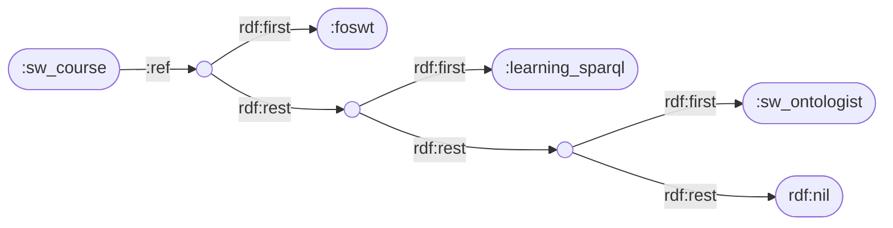
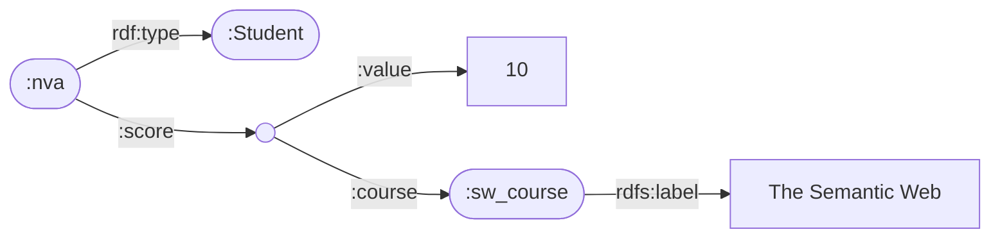
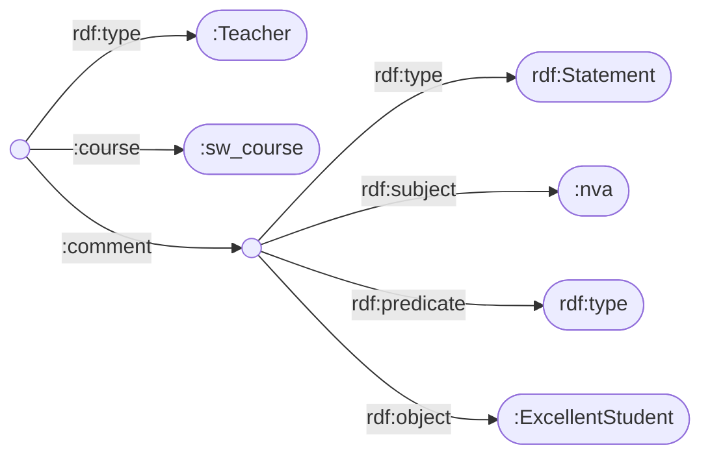
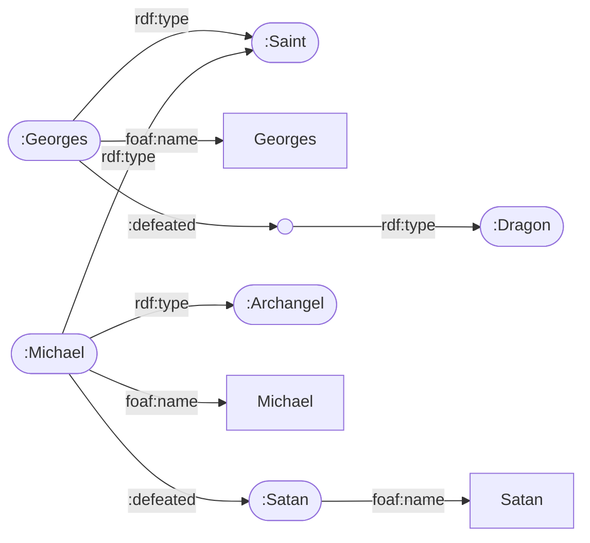

# 0 · CÁCH DÙNG SỔ TAY NÀY

**Đọc đề → tìm dạng → lật đúng trang → làm theo các bước → so với bài mẫu → dò checklist.**

1. Đọc câu hỏi, khoanh **từ khoá** (bảng dưới) → biết câu đó là dạng nào (D1…D12) và nằm ở **trang nào**.
2. Lật tới trang đó (mã dạng in to ở **mép ngoài phía trên** mỗi trang: trang lẻ bên phải, trang chẵn bên trái). Mỗi dạng có đúng 4 phần:
   - **A. Các bước**: làm và **viết lên giấy** theo đúng thứ tự này.
   - **B. Bảng tra**: câu tiếng Việt → cú pháp cần viết.
   - **C. Bài mẫu**: một bài giải **đầy đủ**, trình bày y như nên viết trên giấy thi. Thay dữ liệu của đề mới vào là xong.
   - **D. Kiểm trước khi nộp**: dò từng ô ☐, mỗi ô là một lỗi hay bị trừ điểm.
3. Xong câu nào, đánh dấu câu đó ở bảng dưới, rồi sang câu tiếp.

| Đề có câu / từ khoá… | Dạng | Tr. |
|---|---|---|
| "Tạo RDF / Turtle **và vẽ đồ thị**" cho một đoạn văn; "liệt kê các bộ-3" | **D1** Câu văn → Turtle + đồ thị | tr.@D1 |
| "Biểu diễn **đồ thị sau** bằng Turtle", "vẽ đồ thị cho Turtle", N-Triples, RDF/XML | **D2** Chuyển đổi cú pháp | tr.@D2 |
| "Dùng **RDFS** biểu diễn: lớp, lớp con, domain, range" | **D3** Schema RDFS | tr.@D3 |
| "Viết các bộ-3 **suy ra được**", "đúng / sai / không xác định" (RDFS) | **D4** Suy diễn RDFS | tr.@D4 |
| "Định nghĩa lớp / thuộc tính bằng **RDFS + OWL**", "biểu thức **DL**" | **D5** Thiết kế OWL + DL | tr.@D5 |
| "Tầng nào (RDFS hay OWL)…", "bổ sung ràng buộc để suy ra…", "ngữ nghĩa hình thức" | **D6** Suy diễn OWL | tr.@D6 |
| "Chứng minh bằng **tableau**", NNF, nhất quán (consistency), C ⊑ D? | **D12** Tableau | tr.@D12 |
| "Chương trình **Datalog**", "**cây chứng minh**", "**điểm cố định**" | **D7** Datalog | tr.@D7 |
| "Viết truy vấn **SPARQL**" (có trong cả 3 đề cũ; nghe nói năm nay 2.5 điểm) | **D8** SPARQL | tr.@D8 |
| "Viết **biểu thức đại số** SPARQL, giải thích từng bước" | **D9** Đại số SPARQL | tr.@D9 |
| "Tạo **khuôn hình (shape) SHACL**", "hình trạng", "kiểm duyệt dữ liệu", "nút nào được kiểm / vi phạm" | **D10** SHACL | tr.@D10 |
| "**Chức năng của reasoner**", OWA, LOD, so sánh RDFS/OWL/SHACL… | **D11** Lý thuyết | tr.@D11 |
| "Viết bằng cú pháp **Manchester**" (`Class:`, `SubClassOf:`, `some`, `only`) | **D5** cột Manchester + khung B2 | tr.@D5 |
| "Chuyển sang **NNF**" (dạng chuẩn phủ định) | **D12** bảng B2 DL → NNF | tr.@D12 |
| Gặp **từ khoá / cú pháp lạ** (`owl:hasKey`, `BIND`, `sh:or`, `rdf:Bag`…) | **TV** Tra từ vựng | tr.@TV |
| Biết tên từ khoá, chưa biết nằm ở dạng nào | **Mục lục A–Z** (cuối sổ tay) | tr.@IDX |

**Prefix chép đầu mọi bài** (đề cho prefix nào thì dùng đúng prefix đó):

```turtle
@prefix rdf:  <http://www.w3.org/1999/02/22-rdf-syntax-ns#> .
@prefix rdfs: <http://www.w3.org/2000/01/rdf-schema#> .
@prefix owl:  <http://www.w3.org/2002/07/owl#> .
@prefix xsd:  <http://www.w3.org/2001/XMLSchema#> .
@prefix foaf: <http://xmlns.com/foaf/0.1/> .        # chỉ khi nói về người, có tên
@prefix sh:   <http://www.w3.org/ns/shacl#> .        # chỉ ở câu SHACL
@prefix :     <http://example.org/> .                # IRI tự đặt; đề cho prefix thì dùng của đề
```

**Phân bổ thời gian:** 3 đề cũ đều có **5 câu** (mỗi câu vài ý nhỏ, đề không ghi điểm, ≈ 2 điểm/câu; nghe nói câu SPARQL năm nay 2.5 điểm). Đề 180 phút ⇒ đọc hết đề 5' → mỗi câu ≈ 30', câu SPARQL tới 40' → 15' cuối dò checklist. Làm câu chắc điểm trước (D4, D10, D7, D9 có khuôn cố định), rồi câu SPARQL, rồi câu thiết kế (D1, D5), lý thuyết cuối cùng. Kẹt quá 1.5 lần thời gian dự kiến thì ghi hướng giải rồi chuyển câu.

**Ba thói quen ăn điểm ở mọi câu:**
- **Nêu rõ giả định và IRI tự đặt**, ví dụ: "Giả định `:nva` là IRI của sinh viên Nguyễn Văn A".
- **Mỗi bước có lý do**: tên luật (rdfs9, luật 5…), tên phép (LeftJoin…), hoặc câu nào trong đề.
- **Không chắc thì viết cả hai cách** và nói chúng khác nhau ở đâu. Ví dụ: "⊑ nếu chỉ là điều kiện cần, ≡ nếu là định nghĩa".

**Thuật ngữ hay gặp:** **IRI** = tên định danh toàn cục (`:nva`) · **literal** = giá trị chữ/số (`"An"`, `10`) · **blank node** = nút không tên · **reification** = biến một câu thành đối tượng để nói về nó · **collection** = danh sách đóng, có thứ tự · **domain / range** = lớp của subject / lớp của object · **TBox / ABox** = tiên đề lược đồ / dữ kiện về cá thể · **OWA** = thế giới mở (không biết ≠ sai) · **UNA** = giả định tên khác là vật khác (OWL **không** có) · **restriction** = ràng buộc giá trị thuộc tính gắn vào một lớp · **NNF** = dạng chuẩn phủ định (¬ chỉ đứng trước tên lớp) · **BGP** = nhóm mẫu bộ-3 cơ bản · **μ** = một dòng lời giải SPARQL · **focus node** = nút được SHACL kiểm tra.

**Ký hiệu vẽ đồ thị RDF (dùng cho cả bài):** IRI = **hình elip có tên** · literal = **hình chữ nhật** · blank node = **elip rỗng** · mỗi triple = **một mũi tên** có nhãn predicate, đi từ subject tới object.

# D1 · Câu văn → Turtle + vẽ đồ thị RDF

<p class="nd"><b>Nhận dạng:</b> đề cho một đoạn văn tiếng Việt/Anh, yêu cầu "tạo dữ liệu RDF (Turtle)" và "vẽ đồ thị RDF", thường có giới hạn "không quá 20 bộ-3 / 20 cạnh". Là Câu 1 của cả 3 đề cũ.</p>

## A. Các bước

1. **Viết prefix** (`:`, `rdf:`, `rdfs:`, `xsd:`, thêm `foaf:` nếu có người/tên).
2. **Gạch chân mọi thực thể** trong câu, đặt IRI ngắn: `:sw_course`, `:nva`… Thực thể **không có tên** ("thầy giáo", "một người") → **blank node** `[ ]`. Ghi một dòng "Quy ước IRI: …".
3. **Mỗi thực thể**: thêm kiểu `a :Lớp` và tên dạng literal (`rdfs:label` hoặc `foaf:name`).
4. **Gạch chân mọi quan hệ** (động từ) → predicate. Số, chuỗi, ngày → literal.
5. **Tìm mẫu đặc biệt** theo bảng B: "nghĩ / nhận xét" → reification; "gồm / danh sách" → collection; quan hệ có ≥ 3 thành phần → n-ary.
6. **Viết Turtle gọn**: `;` khi cùng subject, `,` khi cùng subject và predicate, `[ ]` cho blank node, `( )` cho danh sách.
7. **Vẽ đồ thị**: mỗi triple một mũi tên. Collection phải **vẽ bung** thành chuỗi `rdf:first` / `rdf:rest` kết thúc ở `rdf:nil`.
8. **Đếm cạnh** và ghi "Tổng: N bộ-3 (≤ 20)". Nếu vượt giới hạn thì bỏ bớt tên/nhãn phụ trước, giữ lại cấu trúc chính.

## B. Bảng tra: đề nói gì → viết gì

| Đề nói… | Cấu trúc | Viết |
|---|---|---|
| "A **nghĩ / cho rằng / nhận xét / cảm thấy** rằng X" | **Reification** (câu nói về câu) | `:A :thinks [ a rdf:Statement ; rdf:subject :s ; rdf:predicate :p ; rdf:object :o ]` |
| "**gồm / danh sách / nhóm tác giả / xếp hạng / theo thứ tự**" | **Collection** (danh sách đóng, có thứ tự) | `:x :authors ( :a :b :c )`. Container: `[ a rdf:Seq ; rdf:_1 :a ; rdf:_2 :b ]` |
| "đạt **điểm 10 môn X**", "đặt phòng **ngày** … **giá** …" | **n-ary** (quan hệ ≥ 3 thành phần) | `:sv :score [ :value 10 ; :course :X ]` |
| "một người nào đó", "thầy giáo" (không tên) | **Blank node** | `[ a :Teacher ]` hoặc `_:t` |
| "là một …" | Kiểu | `:x a :Lớp` (`a` = `rdf:type`) |
| tên, tiêu đề, số, năm, ngày | **Literal** | `"An"`, `"Avatar"@en`, `10`, `"2024-01-01"^^xsd:date` |
| "xếp hạng **theo** TIOBE / theo báo X" | Danh sách có nguồn | **cách chính:** nút bảng xếp hạng giữ danh sách: `:tiobe_index a :Ranking ; :mostPopular ( :C :CPP … )`. Nếu là ý kiến ("X cho rằng…") thì dùng reification + `:source` |

**Vị trí hợp lệ:** **S** = IRI hoặc blank · **P** = **chỉ IRI** · **O** = IRI, blank hoặc literal. Do đó có 2 × 1 × 5 = **10 kiểu triple** (O gồm IRI, blank, literal thường, literal `@ngôn ngữ`, literal `^^kiểu`).

**Đề bắt "liệt kê HẾT bộ-3"**, với mỗi thực thể dò lần lượt: ☐ kiểu `a :Lớp` · ☐ tên/nhãn literal · ☐ mọi quan hệ trong câu · ☐ thuộc tính số/ngày (gắn `^^xsd:`) · ☐ quan hệ ngược nếu câu hàm ý · ☐ địa chỉ tách nhỏ bằng blank node · ☐ reification nếu là ý kiến · ☐ collection nếu là danh sách.

## C. Bài mẫu (đề 2023, Câu 1)

**Đề:** Học phần The Semantic Web có danh mục sách tham khảo bao gồm: Foundations of Semantic Web Technologies, Learning SPARQL, Semantic Web for the Working Ontologist. Sinh viên Nguyễn Văn A đã đạt điểm 10 học phần này. Thầy giáo nhận xét Nguyễn Văn A là 1 sinh viên xuất sắc. *(Không quá 20 bộ-3.)*

**Bài làm.** Quy ước IRI: `:sw_course` = học phần; `:foswt`, `:learning_sparql`, `:sw_ontologist` = 3 cuốn sách; `:nva` = Nguyễn Văn A. Thầy giáo không có tên nên dùng blank node.

| Mệnh đề trong đề | Dấu hiệu | Cấu trúc |
|---|---|---|
| danh mục sách **bao gồm** A, B, C | danh sách đóng, có thứ tự | collection `( … )` |
| đạt **điểm 10** học phần này | quan hệ 3 thành phần: SV – điểm – học phần | n-ary qua blank node |
| thầy giáo **nhận xét** A là SV xuất sắc | câu nói về một câu khác | reification `rdf:Statement` |

```turtle
@prefix : <http://semweb.edu.vn/exam#> .
@prefix rdf: <http://www.w3.org/1999/02/22-rdf-syntax-ns#> .
@prefix rdfs: <http://www.w3.org/2000/01/rdf-schema#> .
:sw_course :ref (:foswt :learning_sparql :sw_ontologist) ;
    rdfs:label "The Semantic Web" .
:nva a :Student ;
    :score [ :value 10 ; :course :sw_course ] .
[ a :Teacher ; :course :sw_course ] :comment [ a rdf:Statement ;
    rdf:subject :nva ; rdf:predicate rdf:type ; rdf:object :ExcellentStudent ] .
```

**Đồ thị** (vẽ trên giấy theo đúng quy ước: elip = IRI, chữ nhật = literal, elip rỗng = blank node):

*Phần 1: danh sách sách của học phần (7 cạnh)*



*Phần 2: tên học phần và điểm của sinh viên (5 cạnh), nhận xét của thầy (7 cạnh). Nút `:sw_course`, `:nva` trùng tên là **cùng một nút**; trên giấy vẽ chung một hình.*





**Đếm cạnh:** collection 3 phần tử = 1 (`:ref`) + 3 `first` + 3 `rest` = 7 · label 1 · nva 2 (`a`, `:score`) · điểm 2 (`:value`, `:course`) · thầy 3 (`a`, `:course`, `:comment`) · Statement 4 ⇒ **Tổng 19 bộ-3 ≤ 20**.

**Giải thích (ghi vào bài để ăn điểm):**
- Không viết thẳng `:nva a :ExcellentStudent`, vì đó chỉ là **ý kiến của thầy**, chưa phải sự thật. Phải dùng reification.
- Điểm có ba thành phần (sinh viên, giá trị, học phần), nên cần một nút trung gian.

**Mẫu khác hay ra (đề 6390):** "An **nghĩ rằng** C++ thú vị" → `:an :thinks [ a rdf:Statement ; rdf:subject :CPP ; rdf:predicate rdf:type ; rdf:object :InterestingLanguage ]`. Có hai ý kiến thì viết hai `rdf:Statement`, ngăn cách bằng dấu `,`. "Theo TIOBE, C, C++, Python, Java phổ biến nhất" → `:tiobe_index a :Ranking ; :mostPopular ( :C :CPP :Python :Java ) .`

## D. Kiểm trước khi nộp

- ☐ Có đủ prefix, và có ghi quy ước IRI.
- ☐ Thực thể chính đều có `a :Lớp`. Thực thể chỉ đứng ở vị trí object thì thêm kiểu **nếu còn trong giới hạn bộ-3**.
- ☐ Ý kiến ("nghĩ", "nhận xét") viết bằng reification, **không** viết thành sự thật.
- ☐ Danh sách trong đồ thị đã vẽ bung `first` / `rest` / `nil`.
- ☐ Literal vẽ hình chữ nhật, blank node vẽ elip rỗng. Literal **không** bao giờ làm subject.
- ☐ Đã đếm số cạnh và so với giới hạn của đề. Mỗi câu Turtle kết thúc bằng `.`

# D2 · Chuyển đổi: đồ thị ↔ Turtle ↔ N-Triples ↔ RDF/XML

<p class="nd"><b>Nhận dạng:</b> đề cho sẵn một hình đồ thị và bắt viết Turtle, hoặc cho Turtle và bắt vẽ hình / viết N-Triples / RDF-XML. Thường đi kèm D1 hoặc D3.</p>

## A. Các bước

**Đồ thị → Turtle:**
1. Lập bảng **S | P | O**, mỗi mũi tên một dòng. **Đếm** số dòng, phải bằng số mũi tên trên hình.
2. Elip có tên → IRI. Elip rỗng, hoặc nút ghi chữ thường kiểu "a dragon" → blank node. Hình chữ nhật → literal `"…"`. Mũi tên **không có nhãn** giữa hai lớp = `rdfs:subClassOf` (quy ước của môn, slide RDFS).
3. Gom các dòng cùng subject bằng `;`, cùng subject và predicate bằng `,`.
4. So lại: số triple viết ra = số mũi tên.

**Turtle → đồ thị:**
1. **Bung hết** các viết tắt `;` `,` `a` `[ ]` `( )` thành từng triple đầy đủ, đánh số.
2. Cùng một IRI = **cùng một nút**. Mỗi `[ ]` = **một nút rỗng mới**.
3. Mỗi triple vẽ một mũi tên có nhãn. `( :a :b )` bung thành `_:l1 rdf:first :a ; rdf:rest _:l2 . _:l2 rdf:first :b ; rdf:rest rdf:nil`.

## B. Bảng tra cú pháp

| | Turtle | N-Triples | RDF/XML |
|---|---|---|---|
| IRI | `:Michael` hoặc `<http://ex.org/Michael>` | luôn đầy đủ `<http://ex.org/Michael>` | `rdf:about="http://ex.org/Michael"` |
| object là IRI | `:Michael :defeated :Satan .` | `<…Michael> <…defeated> <…Satan> .` | `<ex:defeated rdf:resource="http://ex.org/Satan"/>` |
| literal | `foaf:name "Michael"` | `"Michael"` | `<foaf:name>Michael</foaf:name>` |
| literal có kiểu/ngôn ngữ | `10`, `"x"@en` | `"10"^^<http://www.w3.org/2001/XMLSchema#integer>` | `rdf:datatype="…#integer"`, `xml:lang="en"` |
| blank node | `[ a :Dragon ]` | `_:b1` | `rdf:nodeID="b1"` |
| kiểu | `a :Saint` | `<…#type>` đầy đủ | `<rdf:type rdf:resource="…Saint"/>` |

**N-Triples:** mỗi dòng đúng 1 triple, không có prefix, không có `;` `,`, kết thúc bằng ` .`

## C. Bài mẫu (bài tập tuần, Part 1 Ex4)

**Đề:** đồ thị có Georges là Saint, tên "Georges", đã đánh bại một con rồng không tên (nút "a dragon"); Michael vừa là Saint vừa là Archangel, tên "Michael", đánh bại Satan; Satan có tên "Satan". Viết Turtle.

**Bảng S | P | O (9 mũi tên):** (1) Georges a Saint · (2) Georges name "Georges" · (3) Georges defeated _:d · (4) _:d a Dragon · (5) Michael a Saint · (6) Michael a Archangel · (7) Michael name "Michael" · (8) Michael defeated Satan · (9) Satan name "Satan".

```turtle
@prefix : <http://ex.org/> .
@prefix foaf: <http://xmlns.com/foaf/0.1/> .
:Georges a :Saint ; foaf:name "Georges" ; :defeated [ a :Dragon ] .
:Michael a :Saint , :Archangel ; foaf:name "Michael" ; :defeated :Satan .
:Satan foaf:name "Satan" .
```



**Cùng dữ liệu (một phần), viết bằng N-Triples:**

```text
<http://ex.org/Georges> <http://www.w3.org/1999/02/22-rdf-syntax-ns#type> <http://ex.org/Saint> .
<http://ex.org/Georges> <http://ex.org/defeated> _:d1 .
_:d1 <http://www.w3.org/1999/02/22-rdf-syntax-ns#type> <http://ex.org/Dragon> .
<http://ex.org/Satan> <http://xmlns.com/foaf/0.1/name> "Satan" .
```

**Cùng dữ liệu (một phần), viết bằng RDF/XML** (mỗi subject một `rdf:Description`; object là IRI dùng `rdf:resource`, literal ghi giữa thẻ, blank node dùng `rdf:nodeID`):

```xml
<rdf:RDF xmlns:rdf="http://www.w3.org/1999/02/22-rdf-syntax-ns#"
         xmlns:foaf="http://xmlns.com/foaf/0.1/" xmlns:ex="http://ex.org/">
  <rdf:Description rdf:about="http://ex.org/Georges">
    <rdf:type rdf:resource="http://ex.org/Saint"/>
    <ex:defeated rdf:nodeID="d1"/>
  </rdf:Description>
  <rdf:Description rdf:nodeID="d1">
    <rdf:type rdf:resource="http://ex.org/Dragon"/>
  </rdf:Description>
  <rdf:Description rdf:about="http://ex.org/Michael">
    <rdf:type rdf:resource="http://ex.org/Saint"/>
    <rdf:type rdf:resource="http://ex.org/Archangel"/>
    <foaf:name>Michael</foaf:name>
    <ex:defeated rdf:resource="http://ex.org/Satan"/>
  </rdf:Description>
</rdf:RDF>
```

## D. Kiểm trước khi nộp

- ☐ Số triple = số mũi tên.
- ☐ Nút không tên đã viết thành blank node, không tự bịa IRI.
- ☐ Hai `[ ]` khác nhau là hai nút khác nhau. Cùng IRI thì chỉ vẽ **một** nút.
- ☐ N-Triples: không dùng prefix; `a` đã viết thành IRI đầy đủ của `rdf:type`.
- ☐ RDF/XML: object là IRI thì dùng `rdf:resource`; literal thì ghi giữa thẻ mở và thẻ đóng.

# D3 · Schema RDFS: lớp, lớp con, domain, range

<p class="nd"><b>Nhận dạng:</b> "dùng RDF/RDFS biểu diễn: URI1 là một lớp, URI3 là thuộc tính có miền… khoảng…", "mô tả ontology trong hình", "thiết kế schema cho thư viện / trường học".</p>

## A. Các bước

1. **Danh từ chung** → lớp: `:X a rdfs:Class`. **Danh từ riêng** → cá thể: `:a a :X`.
2. "là **một loại**" → `rdfs:subClassOf`.
3. **Động từ / quan hệ** → `:p a rdf:Property` kèm `rdfs:domain` (lớp của subject) và `rdfs:range` (lớp của object).
4. Thuộc tính mang **giá trị** (tên, mã, năm) → `rdfs:range rdfs:Literal` hoặc `xsd:…`.
5. Dùng lại từ vựng chuẩn nếu hợp: `foaf:name`, `foaf:Person`, `dc:title`.
6. Nếu đề hỏi thêm: **vẽ sơ đồ** (lớp = elip, mũi tên có nhãn domain / range; mũi tên **không nhãn** = subClassOf theo quy ước của môn), rồi **nêu điều RDFS không diễn đạt được**.

## B. Bảng tra

| Câu | RDFS (Turtle) |
|---|---|
| X là một lớp | `:X a rdfs:Class .` |
| p là một thuộc tính | `:p a rdf:Property .` |
| a là một X (cá thể) | `:a a :X .` |
| X là lớp con của Y | `:X rdfs:subClassOf :Y .` |
| p là thuộc tính con của q | `:p rdfs:subPropertyOf :q .` |
| p có miền X, khoảng Y | `:p rdfs:domain :X ; rdfs:range :Y .` |
| nhãn, chú thích | `rdfs:label "Sách"@vi ; rdfs:comment "…"` |

**RDFS KHÔNG làm được** (đây là lý do phải dùng OWL, rất hay hỏi): phủ định và tách rời (disjoint) · số lượng (cardinality: "có đúng 1 tên") · thuộc tính ngược, bắc cầu, đối xứng, hàm · domain/range **theo từng lớp** (domain và range luôn là **toàn cục**) · định nghĩa lớp bằng điều kiện ("SV xuất sắc = SV có điểm 10") · hợp, giao, liệt kê lớp.

## C. Bài mẫu

**Đề 1 (Part 1 Ex3):** URI1, URI2 là lớp; URI3 là thuộc tính có miền URI1, khoảng URI2; URI4 là thể hiện của URI1; URI5, URI6 là thể hiện của URI2.

```turtle
:URI1 a rdfs:Class .                 :URI2 a rdfs:Class .
:URI3 a rdf:Property ; rdfs:domain :URI1 ; rdfs:range :URI2 .
:URI4 a :URI1 .                      :URI5 a :URI2 .        :URI6 a :URI2 .
```

Câu hỏi nối tiếp hay gặp: thêm `:URI5 :URI3 :URI6 .` thì suy ra gì? Trả lời: `:URI5 a :URI1` (rdfs2, domain) và `:URI6 a :URI2` (rdfs3, đã có sẵn). **Không mâu thuẫn** dù URI5 vừa là URI1 vừa là URI2, vì RDFS không có disjoint.

**Đề 2 (Part 1 Ex5):** Professor và Assistant là Teacher; Professor dạy Course; Assistant hỗ trợ Course; mỗi Teacher có tên; mỗi Course có mã.

```turtle
:Teacher a rdfs:Class .   :Course a rdfs:Class .
:Professor a rdfs:Class ; rdfs:subClassOf :Teacher .
:Assistant a rdfs:Class ; rdfs:subClassOf :Teacher .
:teaches  a rdf:Property ; rdfs:domain :Professor ; rdfs:range :Course .
:supports a rdf:Property ; rdfs:domain :Assistant ; rdfs:range :Course .
:name     a rdf:Property ; rdfs:domain :Teacher   ; rdfs:range rdfs:Literal .
:courseID a rdf:Property ; rdfs:domain :Course    ; rdfs:range rdfs:Literal .
```

**Nhận xét ăn điểm:**
- "**Mỗi** Teacher **có** tên" là ràng buộc bắt buộc, RDFS không diễn đạt được. `rdfs:domain` chỉ nói "ai có `:name` thì là Teacher". Muốn bắt buộc phải dùng OWL: `Teacher ⊑ ∃name.xsd:string`.
- Domain là toàn cục: nếu một Assistant cũng `:teaches`, reasoner sẽ suy ra Assistant đó là Professor.

## D. Kiểm trước khi nộp

- ☐ Mỗi lớp có `a rdfs:Class`; mỗi thuộc tính có `a rdf:Property`.
- ☐ Domain là lớp của **subject**, range là lớp của **object**. Không viết ngược.
- ☐ Đã đọc lại: domain/range có gây ra suy diễn ngoài ý muốn không?
- ☐ Đề có chữ "mỗi… có", "chỉ", "đúng n", "không thể vừa…" → ghi chú "RDFS không diễn đạt được, cần OWL".

# D4 · Suy diễn RDFS: bộ-3 suy ra được, TRUE / UNKNOWN

<p class="nd"><b>Nhận dạng:</b> "viết N bộ-3 có thể được suy ra… và giải thích các bộ-3 cơ sở", "mệnh đề nào được suy ra (true / unknown)". Đã ra ở đề 2022 (Câu 2). Khuôn cố định nên rất chắc điểm.</p>

## A. Các bước

1. **Chép đồ thị**, tách thành **Schema** (các triple có `rdfs:…`) và **Dữ liệu** (các triple còn lại).
2. **Quét theo thứ tự** để không sót:
   - (a) mỗi `rdfs:domain`: ai là subject của p? → rdfs2;
   - (b) mỗi `rdfs:range`: ai là object của p? → rdfs3;
   - (c) mỗi `subPropertyOf` → rdfs7;
   - (d) lặp lại rdfs9 cho mọi cá thể vừa có kiểu mới, đi lên tới lớp cao nhất;
   - (e) rdfs11 và rdfs5 cho chuỗi subClassOf / subPropertyOf.
3. **Mỗi triple suy ra ghi một dòng**, đánh số (T1), (T2)…, theo mẫu
   `triple mới  <=  cơ sở 1.  cơ sở 2.  (tên luật)`.
   Cơ sở có thể là một (Tk) đã suy ra trước đó.
4. **Câu hỏi true/unknown**: suy ra được (hoặc có sẵn trong đồ thị) ⇒ **TRUE**, chỉ ra (Tk). Không luật nào sinh ra được ⇒ **UNKNOWN**, giải thích vì sao. **Không viết "FALSE"**: RDFS không có phủ định, và theo giả thiết thế giới mở (OWA) chưa suy ra được chỉ có nghĩa là chưa biết.
5. **Mệnh đề có blank node** `_:x` = "tồn tại một cái gì đó": chỉ ra phép thay `_:x ↦ :Carl` rồi kiểm từng triple.
6. Kết thúc bằng **bảng tổng kết**: STT | Mệnh đề | TRUE/UNKNOWN | Lý do.

## B. Bảng luật RDFS (ghi đúng tên luật)

| Luật | Nếu có | Thì suy ra |
|---|---|---|
| **rdfs2** (domain) | `p rdfs:domain C` và `x p y` | `x a C` |
| **rdfs3** (range) | `p rdfs:range C` và `x p y` | `y a C` (y không là literal) |
| **rdfs5** | `p subPropertyOf q` và `q subPropertyOf r` | `p subPropertyOf r` |
| **rdfs7** | `p subPropertyOf q` và `x p y` | `x q y` |
| **rdfs9** | `C subClassOf D` và `x a C` | `x a D` |
| **rdfs11** | `C subClassOf D` và `D subClassOf E` | `C subClassOf E` |
| rdf1 | `x p y` | `p a rdf:Property` |
| rdfs4a / 4b | `x p y` | `x a rdfs:Resource` / `y a rdfs:Resource` |
| rdfs6 / rdfs10 | `p a rdf:Property` / `C a rdfs:Class` | `p subPropertyOf p` / `C subClassOf C` |
| rdfs8 | `C a rdfs:Class` | `C subClassOf rdfs:Resource` |
| se1 / se2 | `x p y` | `x p _:b` / `_:b p y` (thay bằng blank node) |

**Ba bẫy hay gặp:**
- Domain/range với subProperty có **hai tầng**. Bộ-3 lược đồ `hasFather rdfs:domain Person` **không** suy ra được bằng luật RDFS ⇒ UNKNOWN. Nhưng ở mức cá thể thì vẫn "truyền": `x hasFather y` ⇒ rdfs7 `x hasParent y` ⇒ rdfs2 `x a Person` (slide: "inherited by sub properties").
- **Không** có thuộc tính ngược: `Ann hasFather Carl` **không** suy ra `Carl hasChild Ann`.
- Predicate hoặc IRI **không xuất hiện** trong đồ thị thì không thể suy ra triple nào chứa nó ⇒ UNKNOWN.

## C. Bài mẫu 1: viết bộ-3 suy ra được (đề 2022, Câu 2)

**Đề:** `:a :r :b . :c a :C . :r rdfs:range :C ; rdfs:domain :D . :C rdfs:subClassOf :E . :D rdfs:subClassOf :F .` Viết 4 bộ-3 suy ra được và các bộ-3 cơ sở. (Đề hỏi 4, nên viết 5 cho chắc.)

```text
(T1) :a a :D .   <=  :a :r :b .    :r rdfs:domain :D .        (rdfs2)
(T2) :a a :F .   <=  (T1) :a a :D . :D rdfs:subClassOf :F .   (rdfs9)
(T3) :b a :C .   <=  :a :r :b .    :r rdfs:range :C .         (rdfs3)
(T4) :b a :E .   <=  (T3) :b a :C . :C rdfs:subClassOf :E .   (rdfs9)
(T5) :c a :E .   <=  :c a :C .     :C rdfs:subClassOf :E .    (rdfs9)
```

Có thể ghi thêm các triple tầm thường: `:r a rdf:Property` (rdf1). Muốn ghi `:C rdfs:subClassOf :C` (rdfs10) thì phải có trước `:C a rdfs:Class`, suy từ `:C rdfs:subClassOf :E` và tiên đề `rdfs:subClassOf rdfs:domain rdfs:Class` (rdfs2).

## C. Bài mẫu 2: TRUE / UNKNOWN (bài tập tuần, Part 2 Ex2)

**Đồ thị:**

```turtle
:Man rdfs:subClassOf :Person .   :Parent rdfs:subClassOf :Person .   :Child rdfs:subClassOf :Person .
:Father rdfs:subClassOf :Parent , :Man .
:hasParent rdfs:domain :Person ; rdfs:range :Parent .
:hasFather rdfs:subPropertyOf :hasParent ; rdfs:range :Father .
:isChildOf rdfs:domain :Child ; rdfs:range :Parent .
:Ann a :Person ; :hasFather :Carl .        :Carl a :Man .
```

**Bao đóng (chỉ phần dùng tới):**

| | Triple suy ra | <= cơ sở 1 | cơ sở 2 | Luật |
|---|---|---|---|---|
| (T1) | `:Ann :hasParent :Carl` | `:Ann :hasFather :Carl` | `:hasFather rdfs:subPropertyOf :hasParent` | rdfs7 |
| (T2) | `:Carl a :Father` | `:Ann :hasFather :Carl` | `:hasFather rdfs:range :Father` | rdfs3 |
| (T3) | `:Carl a :Parent` | (T2) | `:Father rdfs:subClassOf :Parent` | rdfs9 |
| (T4) | `:Carl a :Person` | `:Carl a :Man` | `:Man rdfs:subClassOf :Person` | rdfs9 |
| (T5) | `:Father rdfs:subClassOf :Person` | `:Father rdfs:subClassOf :Parent` | `:Parent rdfs:subClassOf :Person` | rdfs11 |

| STT | Mệnh đề | Kết quả | Lý do |
|---|---|---|---|
| 1 | `:Father rdfs:subClassOf :Person` | TRUE | (T5), rdfs11 |
| 2 | `:Carl a :Parent` | TRUE | (T3): rdfs3 rồi rdfs9 |
| 3 | `:Carl a :Father` | TRUE | (T2), rdfs3 |
| 4 | `:Ann :hasParent :Carl` | TRUE | (T1), rdfs7 |
| 5 | `:Carl :hasChild :Ann` | UNKNOWN | `:hasChild` không có trong đồ thị; RDFS không có thuộc tính ngược |
| 6 | `:Ann a :Child` | UNKNOWN | chỉ suy được nếu Ann là subject của `:isChildOf` (rdfs2), nhưng không có triple đó |
| 7 | `:hasFather rdfs:domain :Person` | UNKNOWN | không luật RDFS nào sinh ra bộ-3 lược đồ này. Ghi thêm: ở mức cá thể, ai `:hasFather` vẫn là Person (rdfs7 rồi rdfs2) |
| 8 | `:Ann :hasParent _:x` | TRUE | thay `_:x ↦ :Carl`, đúng nhờ (T1) |
| 9 | `:Ann :hasParent [ a :Person ]` | TRUE | thay blank node ↦ `:Carl`: (T1) và (T4) cùng đúng |

## D. Kiểm trước khi nộp

- ☐ Mỗi dòng có đủ: triple mới, **hai** triple cơ sở, tên luật.
- ☐ Đã quét hết domain, range, subProperty, rồi rdfs9 lặp lên tới lớp cao nhất.
- ☐ Không có chữ "FALSE"; mọi UNKNOWN có một câu giải thích.
- ☐ Range không áp cho literal; một giá trị literal không bao giờ làm subject.
- ☐ Đề yêu cầu N bộ-3 thì viết N+1 bộ-3, và ưu tiên các bộ-3 không tầm thường.

# D5 · Thiết kế ontology OWL + biểu thức DL

<p class="nd"><b>Nhận dạng:</b> "định nghĩa các lớp và thuộc tính dựa trên RDF, RDFS và OWL (Turtle)", "biểu diễn bằng DL", câu có "tên gọi chung", "gồm có", "không có… nào vừa…", "tối thiểu n", "bắc cầu", "tương đương". Có trong cả 3 đề cũ; nghe nói đề năm nay giống "bài 3" (bài mẫu 2 bên dưới).</p>

## A. Các bước

1. **Liệt kê**: các lớp (danh từ chung), thuộc tính đối tượng (quan hệ giữa hai thực thể), thuộc tính dữ liệu (giá trị literal), cá thể (danh từ riêng).
2. **Mỗi câu của đề → một tiên đề DL** (tra bảng B). Viết thành bảng: câu đề | DL.
3. **Chọn ⊑ hay ≡**:
   - Câu kiểu "X **là những** Y mà …", "X **là tên gọi chung** cho…" là **định nghĩa** (đủ để nhận ra X) → `≡` (`owl:equivalentClass`).
   - Câu kiểu "X **là một loại** Y", "X thì …" chỉ là điều kiện cần → `⊑` (`rdfs:subClassOf`).
   - Đề có câu "suy ra được Amphicar là…" thì **bắt buộc dùng ≡**.
4. **Chọn lượng từ**: "có (ít nhất) một" → `∃` (`someValuesFrom`) · "chỉ / mọi … đều" → `∀` (`allValuesFrom`) · "có giá trị cụ thể là a" → `hasValue` · "tối thiểu / tối đa / đúng n" → `≥n` / `≤n` / `=n` · "chỉ có thể là a, b, c" → `oneOf`.
5. **Dịch sang Turtle**. Khai báo `a owl:Class`, `a owl:ObjectProperty` / `owl:DatatypeProperty`. Đề hỏi **Manchester** thì dịch DL sang Manchester theo cột Manchester ở bảng B, gom các tiên đề của cùng một lớp vào **một frame** `Class:` (khung B2, bài mẫu 1 và 2).
6. **Giải thích lựa chọn** (vì sao ≡ chứ không ⊑, vì sao ∃ chứ không ∀) và nêu **một suy diễn** reasoner rút ra được. Phần này phân biệt bài khá với bài giỏi.

## B. Bảng tra: câu tiếng Việt → DL → Manchester → OWL Turtle

| Câu tiếng Việt | DL | Manchester | OWL Turtle |
|---|---|---|---|
| C là **một loại** D | `C ⊑ D` | `Class: C SubClassOf: D` | `:C rdfs:subClassOf :D` |
| C **chính là / được định nghĩa là** D | `C ≡ D` | `Class: C EquivalentTo: D` | `:C owl:equivalentClass :D` |
| không có cá thể nào **vừa** C **vừa** D | `C ⊓ D ⊑ ⊥` (slide viết `C ⊑ ¬D`) | `Class: C DisjointWith: D` | `:C owl:disjointWith :D` |
| vừa là C vừa là D | `C ⊓ D` | `C and D` | `[ owl:intersectionOf ( :C :D ) ]` |
| X **gồm (có)** các loại A, B | `A ⊑ X`, `B ⊑ X` (+ `A ⊓ B ⊑ ⊥` nếu đề nói không vừa A vừa B) | `Class: A SubClassOf: X` (+ `DisjointClasses: A, B`) | `:A rdfs:subClassOf :X . :B rdfs:subClassOf :X` |
| C hoặc D; W là "**tên gọi chung**" cho C, D | `W ≡ C ⊔ D` | `Class: W EquivalentTo: C or D` | `:W owl:equivalentClass [ owl:unionOf ( :C :D ) ]` |
| không phải C | `¬C` | `not C` | `[ owl:complementOf :C ]` |
| chỉ có thể là a, b, c; "gồm có" + **cá thể cụ thể** | `{a, b, c}` | `{a, b, c}` | `[ owl:oneOf ( :a :b :c ) ]` |
| có **ít nhất một** R là C | `∃R.C` | `R some C` | `[ a owl:Restriction ; owl:onProperty :R ; owl:someValuesFrom :C ]` |
| **mọi** R (nếu có) đều là C | `∀R.C` | `R only C` | `[ a owl:Restriction ; owl:onProperty :R ; owl:allValuesFrom :C ]` |
| có R là a (giá trị cụ thể) | `∃R.{a}` | `R value a` | `[ a owl:Restriction ; owl:onProperty :R ; owl:hasValue :a ]` |
| tối thiểu / tối đa / đúng n R | `≥n R` / `≤n R` / `=n R` | `R min n` / `R max n` / `R exactly n` | `owl:minCardinality` / `owl:maxCardinality` / `owl:cardinality "n"^^xsd:nonNegativeInteger` |
| tối thiểu / tối đa / đúng n R **là C** | `≥n R.C` / `≤n R.C` / `=n R.C` | `R min n C` / `R max n C` / `R exactly n C` | `owl:minQualifiedCardinality` / `owl:maxQualifiedCardinality` / `owl:qualifiedCardinality`, cùng `"n"^^xsd:nonNegativeInteger ; owl:onClass :C` |
| miền của R là C | `∃R.⊤ ⊑ C` | `ObjectProperty: R Domain: C` | `:R rdfs:domain :C` |
| khoảng của R là C | `⊤ ⊑ ∀R.C` | `ObjectProperty: R Range: C` | `:R rdfs:range :C` |
| R là nghịch đảo của S | `R ≡ S⁻` | `ObjectProperty: R InverseOf: S` | `:R owl:inverseOf :S` |
| R bắc cầu / đối xứng / hàm | `Trans(R)` / `R ≡ R⁻` / `⊤ ⊑ ≤1 R` | `Characteristics: Transitive` / `Symmetric` / `Functional` | `a owl:TransitiveProperty` / `owl:SymmetricProperty` / `owl:FunctionalProperty` |
| R tương đương S; R là con của S | `R ≡ S`; `R ⊑ S` | `EquivalentTo: S`; `SubPropertyOf: S` | `owl:equivalentProperty`; `rdfs:subPropertyOf` |
| C gồm đúng A, B và A, B tách rời | `C ≡ A ⊔ B`, `A ⊓ B ⊑ ⊥` | `Class: C DisjointUnionOf: A, B` | `:C owl:disjointUnionOf ( :A :B )` |
| thuộc **ít nhất 2 trong 3** lớp A, B, C | `(A⊓B) ⊔ (A⊓C) ⊔ (B⊓C)` | `(A and B) or (A and C) or (B and C)` | `owl:unionOf` của ba `owl:intersectionOf` |
| cá thể a thuộc C; a R b | `C(a)`; `R(a, b)` | `Individual: a Types: C Facts: R b` | `:a a :C ; :R :b` |

Cấu trúc khác (Asymmetric, hasKey, propertyChain, AllDifferent…): bảng **TV2**, tr.@TV.

**B2. Khung Manchester** (mỗi lớp / thuộc tính / cá thể là **một frame**; nhiều ý cùng mục cách nhau bằng dấu phẩy):

```text
Class: Assistant
    SubClassOf: Teacher, teaches only LaboratoryCourse
    EquivalentTo: …           DisjointWith: Professor
ObjectProperty: teaches
    Domain: Teacher           Range: Course           InverseOf: isTaughtBy
    Characteristics: Asymmetric, Irreflexive …        SubPropertyOf: involvedIn
ObjectProperty: hasAncestor   Characteristics: Transitive
ObjectProperty: hasGrandparent   SubPropertyChain: hasParent o hasParent
DataProperty: credits         Domain: Course          Range: xsd:integer
Individual: hung              Types: Professor        Facts: teaches SW, not teaches ML
DisjointClasses: Course, Teacher, Homework            DifferentIndividuals: hung, lan
```

**Dịch DL → Manchester:** `⊑` → `SubClassOf:` · `≡` → `EquivalentTo:` · `⊓` → `and` · `⊔` → `or` · `¬` → `not` · `∃R.C` → `R some C` · `∀R.C` → `R only C` · `⊤` → `owl:Thing` · `⊥` → `owl:Nothing` · `R⁻` → `inverse R`.
**Ưu tiên** (lỏng → chặt): `or` < `and` < `not` < `some / only / value / min / max / exactly` ⇒ filler phức **phải có ngoặc**: `teaches only (LabCourse or Seminar)`; `not (R some C)` = `¬∃R.C`.
**GCI** (vế trái là biểu thức phức): chuẩn Manchester không có cú pháp cho GCI; ghi như Protégé hiển thị: `Movie and (actor exactly 0) SubClassOf AnimalDoc or Animated` (không có dấu hai chấm).

## C. Bài mẫu (đề 6390, Câu 2)

**Đề:** a. Phụ thuộc (giữa các gói phần mềm) là thuộc tính đối tượng có tính bắc cầu. b. Phụ thuộc tương đương với sử dụng. c. Trình biên dịch C++ gồm có g++, clang++, msvc. d. Chương trình C++ là những chương trình được viết bằng ngôn ngữ C++ và được biên dịch bằng trình biên dịch C++. e. Chương trình đa nền tảng là chương trình có thể hoạt động trên tối thiểu 2 hệ điều hành khác nhau.

**Bước 1–4. Bảng câu đề → DL:**

| Câu | DL | Lý do chọn |
|---|---|---|
| a | `Trans(phuThuoc)`, `∃phuThuoc.⊤ ⊑ GoiPhanMem`, `⊤ ⊑ ∀phuThuoc.GoiPhanMem` | "bắc cầu"; "giữa các gói" cho domain và range |
| b | `phuThuoc ≡ suDung` | "tương đương" giữa hai thuộc tính |
| c | `TrinhBienDichCPP ≡ {gpp, clangpp, msvc}` | "gồm có" ba cá thể cụ thể |
| d | `ChuongTrinhCPP ≡ ChuongTrinh ⊓ ∃vietBang.{CPP} ⊓ ∃bienDichBoi.TrinhBienDichCPP` | "là những… và…" là định nghĩa, nên dùng ≡ và ⊓; C++ là một giá trị cụ thể, nên dùng hasValue |
| e | `ChuongTrinhDaNenTang ≡ ChuongTrinh ⊓ ≥2 hoatDongTren.HeDieuHanh` | "tối thiểu 2" hệ điều hành → qualified cardinality |

**Manchester** (nếu đề hỏi):

```text
ObjectProperty: phuThuoc                                               # a, b
    Domain: GoiPhanMem    Range: GoiPhanMem
    Characteristics: Transitive    EquivalentTo: suDung
Class: TrinhBienDichCPP    EquivalentTo: {gpp, clangpp, msvc}          # c
Class: ChuongTrinhCPP                                                  # d
    EquivalentTo: ChuongTrinh and (vietBang value CPP)
                  and (bienDichBoi some TrinhBienDichCPP)
Class: ChuongTrinhDaNenTang                                            # e
    EquivalentTo: ChuongTrinh and (hoatDongTren min 2 HeDieuHanh)
```

**Bước 5. Turtle:**

```turtle
:GoiPhanMem a owl:Class .  :ChuongTrinh a owl:Class .  :HeDieuHanh a owl:Class .
:vietBang a owl:ObjectProperty .  :bienDichBoi a owl:ObjectProperty .
:hoatDongTren a owl:ObjectProperty .
:phuThuoc a owl:ObjectProperty , owl:TransitiveProperty ;              # a
    rdfs:domain :GoiPhanMem ; rdfs:range :GoiPhanMem .
:suDung a owl:ObjectProperty .  :phuThuoc owl:equivalentProperty :suDung .   # b
:TrinhBienDichCPP a owl:Class ;                                        # c
    owl:equivalentClass [ a owl:Class ; owl:oneOf ( :gpp :clangpp :msvc ) ] .
:ChuongTrinhCPP a owl:Class ; owl:equivalentClass [ a owl:Class ;      # d
    owl:intersectionOf ( :ChuongTrinh
        [ a owl:Restriction ; owl:onProperty :vietBang ; owl:hasValue :CPP ]
        [ a owl:Restriction ; owl:onProperty :bienDichBoi ; owl:someValuesFrom :TrinhBienDichCPP ] ) ] .
:ChuongTrinhDaNenTang a owl:Class ; owl:equivalentClass [ a owl:Class ;  # e
    owl:intersectionOf ( :ChuongTrinh
        [ a owl:Restriction ; owl:onProperty :hoatDongTren ;
          owl:minQualifiedCardinality "2"^^xsd:nonNegativeInteger ; owl:onClass :HeDieuHanh ] ) ] .
```

**Bước 6. Giải thích (ghi vào bài):**
- (c) `oneOf` **đóng** lớp lại: không có thành viên nào ngoài ba cái này (tối đa ba vật khác nhau, vì không có UNA). Nếu chỉ muốn nói "có các thành viên này" thì viết ba triple `:gpp a :TrinhBienDichCPP` là đủ.
- (e) OWL **không** giả định tên khác nhau là vật khác nhau (không có UNA). Muốn đếm được hai hệ điều hành khác nhau thì phải khai báo thêm `[] a owl:AllDifferent ; owl:distinctMembers ( :windows :linux )`.

## C. Bài mẫu 2 ("bài 3", Part 3 Ex3: Laboratory-course) ★ nghe nói đề OWL năm nay giống bài này

**Đề:** *A laboratory-course is a course. Courses are organized by teachers. Teachers can be professors or assistants. The professor teaches the courses, while the assistant only teaches the practical courses. Homework is part of the course.* Viết ontology (DL + OWL Turtle).

| Câu đề | DL | Lý do chọn |
|---|---|---|
| A laboratory-course is a course | `LaboratoryCourse ⊑ Course` | "is a" = một loại; "practical course" = laboratory-course |
| Courses are organized by teachers | `Course ⊑ ∃isOrganizedBy.Teacher`; `isOrganizedBy ≡ organizes⁻`; `∃organizes.⊤ ⊑ Teacher`; `⊤ ⊑ ∀organizes.Course` | mỗi môn có (ít nhất) một người tổ chức; nói theo hai chiều nên thêm inverse |
| Teachers can be professors or assistants | `Professor ⊑ Teacher`, `Assistant ⊑ Teacher`. *Giả định thêm:* `Teacher ≡ Professor ⊔ Assistant`, `Professor ⊓ Assistant ⊑ ⊥` | tối thiểu là 2 lớp con; phủ kín và tách rời là **giả định**, ghi rõ trong bài |
| The professor teaches the courses | `Professor ⊑ ∃teaches.Course`; `∃teaches.⊤ ⊑ Teacher`; `⊤ ⊑ ∀teaches.Course` | khẳng định có dạy → ∃ |
| the assistant **only** teaches the practical courses | `Assistant ⊑ ∀teaches.LaboratoryCourse` | "**only**" → ∀ (allValuesFrom), **không** dùng range. Đây là ý mấu chốt |
| Homework is part of the course | `Homework ⊑ ∃isPartOf.Course`; `∃isPartOf.⊤ ⊑ Homework`; `⊤ ⊑ ∀isPartOf.Course` | |
| (thiết kế tốt) | Course, Teacher, Homework đôi một tách rời | để reasoner phát hiện dùng sai |

**Manchester:**

```text
Class: Course              SubClassOf: isOrganizedBy some Teacher
Class: LaboratoryCourse    SubClassOf: Course
Class: Teacher             EquivalentTo: Professor or Assistant           # giả định
Class: Professor           SubClassOf: Teacher, teaches some Course
                           DisjointWith: Assistant                        # giả định
Class: Assistant           SubClassOf: Teacher, teaches only LaboratoryCourse
Class: Homework            SubClassOf: isPartOf some Course
DisjointClasses: Course, Teacher, Homework
ObjectProperty: organizes        Domain: Teacher     Range: Course
ObjectProperty: isOrganizedBy    InverseOf: organizes
ObjectProperty: teaches          Domain: Teacher     Range: Course
ObjectProperty: isPartOf         Domain: Homework    Range: Course
```

**Turtle:**

```turtle
:Course a owl:Class ;
    rdfs:subClassOf [ a owl:Restriction ; owl:onProperty :isOrganizedBy ; owl:someValuesFrom :Teacher ] .
:LaboratoryCourse a owl:Class ; rdfs:subClassOf :Course .
:Teacher a owl:Class ;
    owl:equivalentClass [ a owl:Class ; owl:unionOf ( :Professor :Assistant ) ] .       # giả định
:Professor a owl:Class ;
    rdfs:subClassOf :Teacher ,
        [ a owl:Restriction ; owl:onProperty :teaches ; owl:someValuesFrom :Course ] ;
    owl:disjointWith :Assistant .                                                       # giả định
:Assistant a owl:Class ;
    rdfs:subClassOf :Teacher ,
        [ a owl:Restriction ; owl:onProperty :teaches ; owl:allValuesFrom :LaboratoryCourse ] .
:Homework a owl:Class ;
    rdfs:subClassOf [ a owl:Restriction ; owl:onProperty :isPartOf ; owl:someValuesFrom :Course ] .
[] a owl:AllDisjointClasses ; owl:members ( :Course :Teacher :Homework ) .
:organizes     a owl:ObjectProperty ; rdfs:domain :Teacher ; rdfs:range :Course .
:isOrganizedBy a owl:ObjectProperty ; owl:inverseOf :organizes .
:teaches       a owl:ObjectProperty ; rdfs:domain :Teacher ; rdfs:range :Course .
:isPartOf      a owl:ObjectProperty ; rdfs:domain :Homework ; rdfs:range :Course .
```

**Giải thích (ghi vào bài):**
- **Vì sao `only` mà không dùng range?** Viết `:teaches rdfs:range :LaboratoryCourse` thì **cả giáo sư** cũng chỉ dạy được môn thực hành, vì range là toàn cục. `Assistant ⊑ ∀teaches.LaboratoryCourse` chỉ gắn vào Assistant.
- **Vì sao Professor dùng `some`?** "teaches the courses" khẳng định giáo sư có dạy, không giới hạn loại môn.
- **`only` một mình** vẫn cho phép trợ giảng không dạy môn nào. Muốn "có dạy ít nhất một môn thực hành" thì thêm `Assistant ⊑ ∃teaches.LaboratoryCourse`; nêu như một lựa chọn.
- **Suy diễn mẫu:** `Assistant(minh)`, `teaches(minh, SW)` ⇒ reasoner suy ra `LaboratoryCourse(SW)` theo ∀, và **không** báo lỗi (OWA). `teaches(x, SW)` ⇒ `Teacher(x)` theo domain ⇒ x là Professor hoặc Assistant (theo giả định phủ kín).

**Mẫu ngắn khác:**
- (2022, Câu 4) "Thú cưng **gồm có** chó và mèo, không con nào vừa là chó vừa là mèo" → `Dog ⊑ Pet`, `Cat ⊑ Pet`, `Dog ⊓ Cat ⊑ ⊥` → `:Dog rdfs:subClassOf :Pet . :Cat rdfs:subClassOf :Pet . :Cat owl:disjointWith :Dog .`
- (2023, Câu 2) "ĐGT là **tên gọi chung** cho đường bộ, thủy, không" → `ĐGT ≡ Bộ ⊔ Thủy ⊔ Không`. "Nhiên liệu là xăng, dầu hoặc điện" → `rdfs:range [ owl:oneOf ( :xăng :dầu :điện ) ]`. "Lưỡng cư = thuộc 2 trong 3 lớp" → hợp của ba giao từng cặp, dùng ≡.

## D. Kiểm trước khi nộp

- ☐ Mọi lớp có `a owl:Class`; mọi thuộc tính có `a owl:ObjectProperty` hoặc `owl:DatatypeProperty`.
- ☐ Đề có "là những… / tên gọi chung / định nghĩa" thì đã dùng ≡ chứ không dùng ⊑.
- ☐ Đã dùng `only` (∀) thì nghĩ xem có cần thêm `some` (∃) không. ∀ một mình đúng cả khi không có giá trị nào.
- ☐ Các lớp anh em có cần `disjointWith` không?
- ☐ Cardinality có kiểu `"n"^^xsd:nonNegativeInteger` (slide viết `^^xsd:integer`, cũng được chấp nhận); qualified thì có thêm `owl:onClass`.
- ☐ Mỗi tiên đề có cả **DL** và **Turtle** nếu đề hỏi cả hai.
- ☐ Manchester: filler phức có ngoặc; mỗi lớp một frame `Class:`; `only` / `some` đứng **sau** tên thuộc tính.

# D6 · Suy diễn OWL / "RDFS hay OWL?"

<p class="nd"><b>Nhận dạng:</b> "trong tầng ngữ nghĩa nào (RDFS hay OWL) có thể bổ sung ràng buộc để suy ra X nhưng không suy ra Y", "tìm bộ-3 suy ra được từ CSTT (có owl:…)", "giải thích ngữ nghĩa hình thức của lớp".</p>

## A. Các bước

1. **Dịch mọi tiên đề sang DL**, ví dụ `C ≡ ∀p.F`, `C ⊑ D`.
2. **Nêu ngữ nghĩa hình thức** của tiên đề chính, ví dụ `(∀p.F)ᴵ = { x | ∀y: (x,y) ∈ pᴵ → y ∈ Fᴵ }`.
3. **Áp từng bước** (tra bảng B), mỗi bước ghi tiên đề dùng và dữ kiện dùng.
4. **Kết luận** + nhắc OWA ở chỗ "không suy ra được".

**Câu "RDFS hay OWL?"** trả lời theo 3 ý:
- (1) Trong RDFS thì sao: range/domain là **toàn cục**, áp cho mọi subject nên suy ra cả cái không muốn.
- (2) Chọn **OWL**, vì OWL có restriction gắn **vào một lớp**.
- (3) Viết tiên đề OWL (Turtle + DL) và chạy lại suy diễn cho cả hai trường hợp: cái muốn suy ra **được**, cái không muốn **không** bị suy ra.

## B. Bảng: tiên đề OWL + dữ kiện → reasoner suy ra

| Tiên đề | Dữ kiện | Suy ra |
|---|---|---|
| `C ⊑ ∀p.F` (hoặc `C ≡ ∀p.F`) | `x a C`, `x p y` | `y a F` |
| `C ≡ ∀p.F` | mọi p-giá trị của x là F | **không** suy ra `x a C` (OWA: có thể còn giá trị chưa biết) |
| `C ≡ ∃p.F` | `x p y`, `y a F` | `x a C` |
| `C ⊑ ∃p.F` | `x a C` | tồn tại một y (chưa biết) với `x p y`, `y a F` |
| `C ≡ ∃p.{v}` (hasValue) | `x p v` | `x a C`; ngược lại `x a C` ⇒ `x p v` |
| `C ≡ A ⊓ B` | `x a A`, `x a B` | `x a C` |
| `C ≡ A ⊔ B` | `x a A` | `x a C` |
| `q owl:inverseOf p` | `x p y` | `y q x` |
| p bắc cầu | `x p y`, `y p z` | `x p z` |
| p đối xứng | `x p y` | `y p x` |
| p hàm (Functional), a, b là cá thể | `x p a`, `x p b` | `a owl:sameAs b` (không báo lỗi, vì không có UNA) |
| p hàm (hoặc InverseFunctional) | như trên + `a owl:differentFrom b`; hoặc hai **literal** khác nhau | **mâu thuẫn** |
| `C ≡ {a, b, c}` (oneOf) | `x a C`, x `differentFrom` cả a, b, c | **mâu thuẫn** (lớp đã đóng) |
| `A ⊓ B ⊑ ⊥` | `x a A`, `x a B` | **mâu thuẫn** (KB inconsistent) |
| `C ≡ E` | | `C ⊑ E` và `E ⊑ C` (hai chiều) |

## C. Bài mẫu 1 (đề 2022, Câu 3)

**Đề:** `bio:offspring rdfs:domain bio:Animal ; rdfs:range bio:Animal . bio:Fido a bio:Dog ; bio:offspring bio:Spot . bio:Milo a bio:Cat ; bio:offspring bio:Molly .` Tầng nào (RDFS hay OWL) bổ sung được ràng buộc để suy ra Molly là mèo nhưng không suy ra Spot là mèo?

**Bài làm.**
1. **RDFS không làm được.** Với CSTT hiện có, RDFS chỉ suy ra Molly và Spot đều là Animal (rdfs3). Nếu đổi `rdfs:range` của offspring thành Cat thì suy ra **cả** Molly **và** Spot là mèo, vì range là toàn cục, áp cho mọi subject kể cả Fido.
2. **Chọn OWL:** gắn ràng buộc vào lớp Cat: "con của mèo là mèo".

```turtle
bio:Cat rdfs:subClassOf [ a owl:Restriction ; owl:onProperty bio:offspring ; owl:allValuesFrom bio:Cat ] .
```

3. **DL:** `Cat ⊑ ∀offspring.Cat`. Kiểm tra: Milo ∈ Cat và (Milo, Molly) ∈ offspring, nên theo nghĩa của ∀ ta có Molly ∈ Cat ✔. Fido ∈ Dog và **không biết** Fido có là Cat không (OWA), nên tiên đề không áp dụng; không suy ra gì về Spot ✔.

*Đáp án của thầy dùng:* `bio:sprungBy owl:inverseOf bio:offspring . bio:Cat owl:equivalentClass [ a owl:Restriction ; owl:onProperty bio:sprungBy ; owl:allValuesFrom bio:Cat ]`. Nên ghi cả hai cách. Lưu ý: chiều "mọi cha mẹ là mèo ⇒ là mèo" cần biết đủ hết cha mẹ, mà theo OWA thì không biết, nên cách `∀offspring` chắc chắn hơn.

## C. Bài mẫu 2 (đề 6390, Câu 3): bẫy thế giới mở

**Đề:** `:C rdfs:subClassOf :D , :E ; owl:equivalentClass [ a owl:Restriction ; owl:onProperty :p ; owl:allValuesFrom :F ] . :x :p :e , :f . :y :p :f . :e a :E . :f a :F .` a) Tìm 1 bộ-3 về :C suy ra được. b) Ngữ nghĩa hình thức của :C.

**a)** Gọi `_:r` là lớp restriction ∀p.F.

```text
(1) _:r rdfs:subClassOf :C .   <=  :C owl:equivalentClass _:r .        (≡ cho ⊑ theo hai chiều)
(2) _:r rdfs:subClassOf :D .   <=  (1) và :C rdfs:subClassOf :D .      (bắc cầu, rdfs11)
    _:r rdfs:subClassOf :E .   <=  (1) và :C rdfs:subClassOf :E .      (bắc cầu, rdfs11)
```

Nghĩa: mọi cá thể có tất cả p-giá trị thuộc F thì thuộc D và E, tức là `∀p.F ⊑ D ⊓ E`.

**Không** suy ra được `:y a :C`. Biết (y, f) ∈ p và f ∈ F, nhưng theo OWA, :y có thể còn p-giá trị khác chưa biết. Muốn suy ra thì phải đóng thông tin, ví dụ thêm `:y a [ a owl:Restriction ; owl:onProperty :p ; owl:maxCardinality 1 ]`. Với :x, ta không biết :e có thuộc F không, nên cũng không kết luận được.

**b)** DL: `C ⊑ D`, `C ⊑ E`, `C ≡ ∀p.F`. Ngữ nghĩa theo diễn giải I = (Δᴵ, ·ᴵ): `Cᴵ ⊆ Dᴵ ∩ Eᴵ`; `Cᴵ = { a ∈ Δᴵ | ∀b: (a,b) ∈ pᴵ → b ∈ Fᴵ }`. Lưu ý: cá thể **không có** p-giá trị nào vẫn thuộc ∀p.F.

## D. Kiểm trước khi nộp

- ☐ Câu "RDFS hay OWL": đã nói vì sao RDFS **không** được (range toàn cục), chứ không chỉ trả lời "OWL".
- ☐ Đã kiểm cả hai phía: cái cần suy ra **được**, cái không muốn **không** bị suy ra.
- ☐ Có câu nhắc OWA ở mọi chỗ trả lời "không suy ra được".
- ☐ Có cả Turtle lẫn DL; ngữ nghĩa hình thức viết bằng ký hiệu tập hợp.

# D12 · Tableau: NNF, 7 luật, chứng minh bằng phản chứng

<p class="nd"><b>Nhận dạng:</b> "chứng minh bằng thuật toán tableau", "KB có nhất quán không", "chứng minh a là C / C ⊑ D", "chuyển sang NNF".</p>

## A. Các bước

1. **Dịch KB sang DL** nếu đề cho Turtle, viết rõ từng tiên đề.
2. **Đổi câu hỏi thành kiểm tra nhất quán** (bảng B1), ghi rõ ra giấy. Ví dụ: "Thêm ¬Parent(Mary) vào KB và kiểm tra tính nhất quán."
3. **Chuyển mọi tiên đề TBox (lược đồ) sang NNF** (bảng B2), đánh nhãn (a), (b), (c)…
4. **Áp 7 luật** (bảng B3), mỗi dòng ghi **số luật + nhãn tiên đề / dòng nguồn**. Ưu tiên các luật không tách nhánh (1, 2, 4, 6, 7) trước luật 5. Luật 3 áp được cho **mọi cá thể đang có trong tableau**, kể cả cá thể mới do luật 6 tạo ra (bài mẫu 3).
5. **Đóng nhánh** khi trong nhánh có cả X(a) và ¬X(a). Đánh dấu ✗ và ghi cặp mâu thuẫn.
6. **Kết luận** theo đúng câu hỏi:
   - **mọi nhánh đóng** ⇒ KB cộng giả thiết phản chứng là mâu thuẫn ⇒ điều cần chứng minh **ĐÚNG**;
   - còn một nhánh **mở** mà không áp thêm được luật nào ⇒ **không** suy ra được (nhắc OWA).

## B. Bảng tra

**B1. Đổi câu hỏi:**

| Muốn chứng minh | Thêm vào KB | Mọi nhánh đóng nghĩa là |
|---|---|---|
| KB nhất quán? | (không thêm gì) | KB **không** nhất quán |
| a thuộc C? | `¬C(a)` | C(a) đúng |
| C ⊑ D? | `C(x)` và `NNF(¬D)(x)`, x là cá thể **mới** (ví dụ `¬∃R.E` → `∀R.¬E`) | C ⊑ D đúng |
| C thỏa được? | `C(x)` | C **không** thỏa được |

**B2. DL → NNF** (¬ chỉ được đứng ngay trước tên lớp). Làm 2 bước: **(1)** bỏ ⊑ / ≡ ở mức tiên đề, **(2)** đẩy ¬ vào trong cho tới tên lớp.

| Dạng gốc | NNF | Quy tắc |
|---|---|---|
| `C ⊑ D` | `¬C ⊔ D` | bỏ ⊑: C(x) → D(x) tương đương ¬C(x) ∨ D(x) |
| `C ≡ D` | (a) `¬C ⊔ D` **và** (b) `¬D ⊔ C` | tách 2 chiều ⊑, đánh 2 nhãn |
| `C ⊓ D ⊑ ⊥` hoặc `C ⊑ ¬D` (disjoint) | `¬C ⊔ ¬D` | |
| `∃R.⊤ ⊑ C` (domain) | `∀R.⊥ ⊔ C` | `¬∃R.⊤` = `∀R.¬⊤` = `∀R.⊥` |
| `⊤ ⊑ ∀R.C` (range) | `∀R.C` | `¬⊤` = `⊥`, bỏ khỏi phép ⊔ |
| `C(a)`, `R(a, b)` (ABox) | giữ nguyên; C phức thì đưa C về NNF | dùng ở luật 1, 2 |
| `¬¬C` | `C` | phủ định kép |
| `¬(C ⊓ D)` | `¬C ⊔ ¬D` | De Morgan |
| `¬(C ⊔ D)` | `¬C ⊓ ¬D` | De Morgan |
| `¬∃R.C` | `∀R.¬C` | đổi lượng từ, ¬ đi vào filler |
| `¬∀R.C` | `∃R.¬C` | đổi lượng từ |
| `¬⊤` / `¬⊥` | `⊥` / `⊤` | |
| `¬(≥n R.C)` / `¬(≤n R.C)` | `≤(n−1) R.C` (n ≥ 1; n = 0 thì ra `⊥`) / `≥(n+1) R.C` | 7 luật của slide (ALC) không có luật cho ≥, ≤; bài tableau thường chỉ có ⊓ ⊔ ¬ ∃ ∀ |

**Ví dụ làm từng bước** (chép đủ các dòng vào bài, mỗi dòng ghi quy tắc):

```text
Person ⊓ ∃hasChild.Person ⊑ Parent
⇒ ¬(Person ⊓ ∃hasChild.Person) ⊔ Parent        bỏ ⊑
⇒ ¬Person ⊔ ¬∃hasChild.Person ⊔ Parent         De Morgan
⇒ ¬Person ⊔ ∀hasChild.¬Person ⊔ Parent         ¬∃ → ∀¬
Hỏi Professor ⊑ ∃supervises.Employee ?  ⇒ thêm Professor(x) và
NNF(¬∃supervises.Employee)(x) = (∀supervises.¬Employee)(x),  x là cá thể mới
```

**B3. 7 luật** (đánh số như slide):

| Luật | Trong nhánh có | Thêm vào |
|---|---|---|
| 1 | `C(a)` trong ABox | `C(a)` |
| 2 | `R(a,b)` trong ABox | `R(a,b)` |
| 3 | tiên đề TBox C (đã ở dạng NNF) | `C(a)` cho một cá thể a đã có trong tableau (cả cá thể do luật 6 tạo) |
| 4 | `(C ⊓ D)(a)` | `C(a)` và `D(a)` |
| 5 | `(C ⊔ D)(a)` | **tách 2 nhánh**: nhánh 1 thêm `C(a)`, nhánh 2 thêm `D(a)`. Có 3 vế thì tách 2 lần |
| 6 | `(∃R.C)(a)` | `R(a,b)` và `C(b)`, với b là cá thể **mới** |
| 7 | `(∀R.C)(a)` và `R(a,b)` | `C(b)` |

**Blocking:** mỗi khẳng định `(∃R.C)(a)` chỉ áp luật 6 **một lần**. Nếu cá thể mới cứ lặp lại đúng các khái niệm của cá thể trước (ví dụ slide Jane: b0, b1, … vô hạn) thì dừng (block) và coi nhánh là mở.

## C. Bài mẫu 1: chứng minh cá thể (a thuộc C?)

**Đề:** KB = { `Parent ≡ Person ⊓ ∃hasChild.Person`, `Person(Mary)`, `Person(Tom)`, `hasChild(Mary, Tom)` }. Chứng minh `Parent(Mary)`.

**Bài làm.** Thêm `¬Parent(Mary)` và kiểm tra nhất quán.
NNF của ≡ (tách **hai** chiều): (a) `¬Parent ⊔ (Person ⊓ ∃hasChild.Person)` (chiều ⊑) · (b) `¬Person ⊔ ∀hasChild.¬Person ⊔ Parent` (chiều ⊒, vì `¬(Person ⊓ ∃hasChild.Person) = ¬Person ⊔ ∀hasChild.¬Person`). Chỉ (b) đụng được giả thiết ¬Parent(Mary), nên cây chỉ cần dùng (b).

```text
(1) Person(Mary)  (2) Person(Tom)  (3) hasChild(Mary,Tom)   [luật 1, 2]
(4) ¬Parent(Mary)                                           [giả thiết]
(5) (¬Person ⊔ ∀hasChild.¬Person ⊔ Parent)(Mary)            [luật 3, tiên đề (b)]
    luật 5 tại (5):
    ├─ N1: Parent(Mary)                                     ✗ đóng với (4)
    └─ N2: (¬Person ⊔ ∀hasChild.¬Person)(Mary)              [luật 5 lần 2]
           ├─ N2.1: ¬Person(Mary)                           ✗ đóng với (1)
           └─ N2.2: (∀hasChild.¬Person)(Mary)
                    (6) ¬Person(Tom)  [luật 7, từ (3)]      ✗ đóng với (2)
```

Mọi nhánh đều đóng ⇒ KB ∪ {¬Parent(Mary)} không nhất quán ⇒ **KB ⊨ Parent(Mary)**.

## C. Bài mẫu 2: chứng minh bao hàm (C ⊑ D?)

**Đề:** KB = { `Father ≡ Man ⊓ ∃hasChild.⊤`, `Man ⊑ Person` }. Chứng minh `Father ⊑ Person`.

**Bài làm.** Thêm `(Father ⊓ ¬Person)(x)` với x là cá thể mới.
NNF: (a) `¬Father ⊔ (Man ⊓ ∃hasChild.⊤)` (≡ chiều ⊑) · (b) `¬Man ⊔ ∀hasChild.⊥ ⊔ Father` (≡ chiều ⊒, không cần dùng) · (c) `¬Man ⊔ Person`.

```text
(1) (Father ⊓ ¬Person)(x)                     [giả thiết]
(2) Father(x)   (3) ¬Person(x)                [luật 4 tại (1)]
(4) (¬Father ⊔ (Man ⊓ ∃hasChild.⊤))(x)        [luật 3, tiên đề (a)]
    ├─ N1: ¬Father(x)                         ✗ đóng với (2)
    └─ N2: (Man ⊓ ∃hasChild.⊤)(x)
           (5) Man(x)  (6) (∃hasChild.⊤)(x)   [luật 4]
           (7) (¬Man ⊔ Person)(x)             [luật 3, tiên đề (c)]
               ├─ N2.1: ¬Man(x)               ✗ đóng với (5)
               └─ N2.2: Person(x)             ✗ đóng với (3)
```

Mọi nhánh đóng ⇒ **Father ⊑ Person**. (Không cần áp luật 6 cho (6), vì các nhánh đã đóng.)

## C. Bài mẫu 3: bao hàm có ∃ và ∀ (Exercises-OWL2, Ex3)

**Đề:** 1. `Professor ⊑ ∃supervises.PhDStudent` 2. `PhDStudent ⊑ Student ⊓ Researcher` 3. `Professor ⊑ ∀supervises.(¬Student ⊔ Employee)`. (a) Chứng minh hoặc bác bỏ `Professor ⊑ ∃supervises.Employee`. (b) Bỏ tiên đề 3 thì sao?

**Bài làm (a).** NNF: (a) `¬Professor ⊔ ∃supervises.PhDStudent` · (b) `¬PhDStudent ⊔ (Student ⊓ Researcher)` · (c) `¬Professor ⊔ ∀supervises.(¬Student ⊔ Employee)`. Phản chứng: cá thể mới i với `Professor(i)` và `¬(∃supervises.Employee)(i)`, đưa về NNF là `(∀supervises.¬Employee)(i)`.

```text
(1) Professor(i)   (2) (∀supervises.¬Employee)(i)             [giả thiết, NNF]
(3) (¬Professor ⊔ ∃supervises.PhDStudent)(i)                  [luật 3, (a)]
 ├─ ¬Professor(i)                                             ✗ với (1)
 └─ (∃supervises.PhDStudent)(i)
    (4) supervises(i,b0)   (5) PhDStudent(b0)                 [luật 6, b0 mới]
    (6) ¬Employee(b0)                                         [luật 7, (2) và (4)]
    (7) (¬Professor ⊔ ∀supervises.(¬Student ⊔ Employee))(i)   [luật 3, (c)]
     ├─ ¬Professor(i)                                         ✗ với (1)
     └─ (∀supervises.(¬Student ⊔ Employee))(i)
        (8) (¬Student ⊔ Employee)(b0)                         [luật 7, (4)]
        (9) (¬PhDStudent ⊔ (Student ⊓ Researcher))(b0)        [luật 3, (b), cho b0]
         ├─ ¬PhDStudent(b0)                                   ✗ với (5)
         └─ (10) Student(b0)  Researcher(b0)                  [luật 4]
             luật 5 tại (8):
              ├─ ¬Student(b0)                                 ✗ với (10)
              └─ Employee(b0)                                 ✗ với (6)
```

Mọi nhánh đóng ⇒ `Professor ⊓ ¬∃supervises.Employee` không thỏa được ⇒ **`Professor ⊑ ∃supervises.Employee` ĐÚNG**. Mấu chốt: dòng (9) áp luật 3 cho **cá thể mới b0**.

**(b) Bỏ tiên đề 3:** không còn dòng (7), (8). Nhánh chứa `Professor(i)`, `∀supervises.¬Employee(i)`, `supervises(i,b0)`, `PhDStudent(b0)`, `¬Employee(b0)`, `Student(b0)`, `Researcher(b0)`; áp (a) cho b0 và chọn `¬Professor(b0)` thì không mâu thuẫn và không còn luật nào áp được ⇒ **nhánh mở** ⇒ **không** suy ra được. Theo OWA, ta không biết PhDStudent có là Employee hay không.

## D. Kiểm trước khi nộp

- ☐ Đã ghi rõ câu "Thêm … vào KB và kiểm tra nhất quán".
- ☐ Tiên đề ≡ đã tách thành **hai** tiên đề NNF (hoặc nói rõ vì sao chỉ cần một chiều).
- ☐ Mỗi dòng của cây có số luật và dòng nguồn; mỗi nhánh đóng có ✗ và cặp mâu thuẫn.
- ☐ Luật 6 dùng cá thể **mới**; luật 7 chỉ áp cho các b đã có R(a,b).
- ☐ Câu kết luận nói đúng chiều: "mọi nhánh đóng ⇒ điều cần chứng minh **đúng**".

# D7 · Datalog: điểm cố định + cây chứng minh

<p class="nd"><b>Nhận dạng:</b> đề cho một chương trình gồm dữ kiện (dòng không có ←) và luật (dòng có ←); yêu cầu "vẽ cây chứng minh cho khẳng định …" và "tìm điểm cố định, viết chi tiết các bước mở rộng tập dữ kiện". Đã ra ở đề 2023 (Câu 3).</p>

## A. Các bước

**Điểm cố định:**
1. **B0** = chép toàn bộ dữ kiện (các dòng không có ←).
2. **B1**: xét **từng luật**, thử mọi cách gán biến bằng dữ kiện trong B0. Ghi `B1: + { các dữ kiện MỚI }`.
3. **B2, B3, …**: lặp lại, nhưng điều kiện được lấy từ **toàn bộ** tập hiện có (B0 cộng mọi dữ kiện đã thêm). Chỉ ghi dữ kiện **chưa có**.
4. Khi một bước không thêm được gì: ghi `B(k+1): + { }` và kết luận "**Điểm cố định đạt ở bước k**". Liệt kê lại toàn bộ tập điểm cố định.

**Cây chứng minh:**
1. **Gốc** = khẳng định cần chứng minh.
2. Chọn luật có **đầu** khớp với nút, vẽ các điều kiện của **thân** làm con. Ghi tên luật cạnh nút.
3. Đi xuống cho tới khi **mọi lá là dữ kiện của B0**.

**Mẹo với luật bắc cầu** `R(X,Z) ← R(X,Y) ∧ R(Y,Z)`: sau mỗi bước, lập bảng "từ X đi tới được đâu" rồi ghép các cặp. Nhanh hơn và ít sót hơn. Chú ý các cặp vòng `R(C,C)` khi có đường hai chiều.

## C. Bài mẫu (đề 2023, Câu 3)

**Đề:**

```text
Đường-một-chiều(A, B)        Đường-một-chiều(B, C)        Đường-hai-chiều(D, C)
(L1) Đường-hai-chiều(Y, X) ← Đường-hai-chiều(X, Y)
(L2) Có-đường-đi(X, Y)     ← Đường-hai-chiều(X, Y)
(L3) Có-đường-đi(X, Y)     ← Đường-một-chiều(X, Y)
(L4) Có-đường-đi(X, Z)     ← Có-đường-đi(X, Y) ∧ Có-đường-đi(Y, Z)
```

a) Vẽ cây chứng minh cho Có-đường-đi(A, D). b) Tìm điểm cố định.

**a) Cây chứng minh** (viết tắt: 1C = Đường-một-chiều, 2C = Đường-hai-chiều, Đi = Có-đường-đi):

```text
                        Đi(A, D)                 [L4, Y = C]
              ┌────────────┴─────────────┐
          Đi(A, C)   [L4, Y = B]       Đi(C, D)   [L2]
        ┌─────┴──────┐                    │
   Đi(A, B) [L3]  Đi(B, C) [L3]        2C(C, D)   [L1]
        │            │                    │
    1C(A, B)      1C(B, C)             2C(D, C)    ← mọi lá đều là dữ kiện B0
```

**b) Điểm cố định:**

```text
B0: { 1C(A,B), 1C(B,C), 2C(D,C) }
B1: + { 2C(C,D) [L1],  Đi(A,B) [L3],  Đi(B,C) [L3],  Đi(D,C) [L2] }
B2: + { Đi(C,D) [L2 trên 2C(C,D)],  Đi(A,C) [L4: A→B→C] }
B3: + { Đi(B,D) [B→C→D],  Đi(A,D) [A→C→D],  Đi(C,C) [C→D→C],  Đi(D,D) [D→C→D] }
B4: + { }   không có dữ kiện mới
```

**Kết luận:** điểm cố định đạt ở **bước 3**. Tập điểm cố định gồm 3 dữ kiện ban đầu, `2C(C,D)` và 9 dữ kiện Đi: AB, BC, DC, CD, AC, BD, AD, CC, DD.
**Kiểm tra B4:** từ A đi tới {B, C, D}; từ B tới {C, D}; từ C tới {C, D}; từ D tới {C, D}. Ghép mọi cặp không ra cặp mới. Không có Đi(A,A) vì không có đường nào quay về A.

## D. Kiểm trước khi nộp

- ☐ Mỗi bước chỉ dùng dữ kiện **đã có trước bước đó**; không nhảy cóc hai lần áp luật trong cùng một bước.
- ☐ Mỗi dữ kiện mới có ghi luật đã dùng.
- ☐ Có dòng `B(k+1): + { }` và câu "điểm cố định ở bước k".
- ☐ Đã xét các cặp vòng (X, X) khi có quan hệ hai chiều.
- ☐ Mọi lá của cây chứng minh là dữ kiện B0; nút nào cũng ghi luật.

# D8 · Viết truy vấn SPARQL

<p class="nd"><b>Nhận dạng:</b> đề cho dữ liệu Turtle, yêu cầu "viết truy vấn SPARQL tìm…", "… nếu có, để trống nếu không", "khẳng định (construct)…". Có trong cả 3 đề cũ, nghe nói năm nay 2.5 điểm (câu nặng nhất). Luôn đi cùng D9 (đại số) ở ý sau.</p>

## A. Các bước

1. **Gạch chân câu hỏi**: cái cần **trả về** → `SELECT`; **điều kiện** → triple pattern hoặc `FILTER`; tra các cụm còn lại ở bảng B.
2. **Viết PREFIX đầy đủ**: thiếu là mất điểm. Lấy đúng prefix trong dữ liệu của đề.
3. **Vẽ nhanh mẫu đồ thị** trên nháp: nút = biến hoặc IRI, cạnh = property. Sau đó chép thành triple pattern.
4. **Đối chiếu với dữ liệu**:
   - tên lớp, tên thuộc tính có **đúng chính tả** như trong dữ liệu không?
   - literal có `@en` hay `^^xsd:` không?
   - có cá thể nào **thiếu** `a :Lớp` không? (ví dụ Python không có `a :PL`, nên bị loại.)
5. **Có cần DISTINCT không?** Có nếu một cá thể khớp nhiều cách, ví dụ C++ có cả pointer lẫn class.
6. **Ghi kết quả mong đợi** (bảng 1–5 dòng) và **một câu giải thích** cho các cá thể bị loại hoặc có ô trống.

## B. Bảng tra: đề nói → viết

| Đề nói | Viết |
|---|---|
| "**nếu có**, để trống nếu không" | `OPTIONAL { ?x :p ?v }` |
| "A **hoặc** B", "các dòng A **và** các dòng B" | `{ ?x a :A } UNION { ?x a :B }` hoặc `FILTER (?t = :A \|\| ?t = :B)` hoặc `VALUES ?t { :A :B }` |
| "bao gồm **cả** X **và cả** Y" | `{ …X… } UNION { …Y… }` |
| "**không có** / chưa có" | `FILTER NOT EXISTS { ?x :p ?v }` · hoặc `MINUS { … }` · hoặc `OPTIONAL` + `FILTER (!bound(?v))` |
| "**đếm** / mỗi … có bao nhiêu / tổng / trung bình" | `SELECT ?g (COUNT(?x) AS ?n) … GROUP BY ?g`, cùng với `SUM`, `AVG`, `MIN`, `MAX` |
| "**ít nhất** 2 / nhiều hơn 3" (sau khi đếm) | `HAVING (COUNT(?x) >= 2)` |
| "lớn hơn / sau năm / khác" | `FILTER (?y > 1990 && ?x != :A)` |
| "**kể cả gián tiếp** / bắc cầu / mọi lớp con" | path `:p+` (≥ 1 bước), `:p*` (≥ 0 bước), `?x a/rdfs:subClassOf* :C`, `^:p` (đi ngược), `:p/:q` (nối) |
| "**khẳng định** / tạo triple mới" | `CONSTRUCT { ?x a :New } WHERE { … }` |
| "**có hay không**" | `ASK { … }` |
| "chứa / bắt đầu bằng" | `FILTER regex(?s, "abc", "i")`, `CONTAINS(?s, "x")`, `STRSTARTS(?s, "x")` |
| "tiếng Anh" | `FILTER (lang(?t) = "en")` |
| "ghép thành một cột" | `(GROUP_CONCAT(?n; separator=", ") AS ?ds)` |
| "sắp xếp", "**top k** / nhiều nhất" | `ORDER BY DESC(?v) LIMIT k` |

**Khung đầy đủ** (bỏ những dòng không cần):

```sparql
PREFIX :     <http://semweb.edu.vn/exam#>
PREFIX rdfs: <http://www.w3.org/2000/01/rdf-schema#>
SELECT DISTINCT ?x ?name (COUNT(?y) AS ?n)
WHERE {
  ?x a :C ; :p ?y .                        # khớp mẫu; ";" khi cùng subject
  OPTIONAL { ?x rdfs:label ?name }          # "nếu có"
  FILTER (?y > 1990 && ?x != :A)            # điều kiện
  FILTER NOT EXISTS { ?x :bad ?z }          # "không có"
}
GROUP BY ?x ?name                           # mọi biến SELECT không gộp phải có ở đây
HAVING (COUNT(?y) >= 2)
ORDER BY DESC(?n)
LIMIT 10
```

## C. Bài mẫu (đề 6390, Câu 4): dữ liệu

```turtle
@prefix : <http://semweb.edu.vn/exam#> .
:CPP a :PL; :creator :bjarne_stroustrup; :hasFeature :type, :function, :pointer, :class, :template.
:C a :PL; :creator :dennis_ritchie; :hasFeature :type, :pointer, :function.
:Java a :PL; :creator :james_gosling; :hasFeature :type, :class.
:Python :hasFeature :function, :class .
:Lisp a :PL; :hasFeature :function.
:Ruby a :PL.
```

**a) Ngôn ngữ lập trình có tính năng con trỏ hoặc lớp.** "hoặc" → UNION. "Ngôn ngữ lập trình" → `?pl a :PL`. C++ có cả hai tính năng → cần `DISTINCT`.

```sparql
PREFIX : <http://semweb.edu.vn/exam#>
SELECT DISTINCT ?pl
WHERE {
  ?pl a :PL .
  { ?pl :hasFeature :pointer } UNION { ?pl :hasFeature :class }
}
```

Kết quả: **:CPP, :C, :Java**. *Python có `:class` nhưng không có `a :PL` nên bị loại. Nếu bỏ dòng `?pl a :PL` thì có thêm :Python.*

**b) Ngôn ngữ cùng người sáng lập nếu có, để trống nếu không.** "nếu có… để trống" → OPTIONAL.

```sparql
PREFIX : <http://semweb.edu.vn/exam#>
SELECT ?pl ?creator
WHERE { ?pl a :PL .  OPTIONAL { ?pl :creator ?creator } }
```

| ?pl | ?creator |
|---|---|
| :CPP | :bjarne_stroustrup |
| :C | :dennis_ritchie |
| :Java | :james_gosling |
| :Lisp | *(trống)* |
| :Ruby | *(trống)* |

**c) Khẳng định các ngôn ngữ là :OOPL nếu có tính năng lớp.** "khẳng định" → CONSTRUCT.

```sparql
PREFIX : <http://semweb.edu.vn/exam#>
CONSTRUCT { ?pl a :OOPL } WHERE { ?pl :hasFeature :class }
```

Kết quả là đồ thị `:CPP a :OOPL . :Java a :OOPL . :Python a :OOPL .` Thêm `?pl a :PL` vào WHERE thì Python bị loại.

## C. Bài mẫu khác (đề 2023 và 2022)

**2023, Câu 4a.** Dữ liệu: `:Caspar a :Seaplane; :crew 2; :flight 1900. :Convair a :Seaplane; :crew 1; :flight 1953. :Su27 a :JetFighter; :crew 1. :Mig35 a :JetFighter; :speed 2400. :Mi26 a :Helicopter; :speed 295; :crew 5; :flight 1983; rdfs:label "Mil Mi-26".` Đề: tìm các thủy phi cơ và trực thăng, kèm nhãn nếu có.

```sparql
PREFIX :     <http://semweb.edu.vn/exam#>
PREFIX rdfs: <http://www.w3.org/2000/01/rdf-schema#>
SELECT * WHERE {
  { ?p a ?t } OPTIONAL { ?p rdfs:label ?label }
  FILTER (?t = :Seaplane || ?t = :Helicopter)
}
```

Kết quả: `:Caspar :Seaplane –` · `:Convair :Seaplane –` · `:Mi26 :Helicopter "Mil Mi-26"`.

**2022, Câu 5a.** Dữ liệu: `bio:Fido a bio:Dog; bio:offspring bio:Spot, bio:Ted. bio:Milo a bio:Cat; bio:offspring bio:Kitty. bio:Anna bio:own bio:Fido, bio:Milo.` Đề: mèo của Anna, gồm cả mèo Anna sở hữu và cả con của chúng.

```sparql
PREFIX bio: <http://exam.hust.edu.vn/bio/>
SELECT ?pet WHERE {
  { bio:Anna bio:own ?pet . ?pet a bio:Cat . }
  UNION
  { bio:Anna bio:own ?x . ?x a bio:Cat . ?x bio:offspring ?pet . }
}
```

Kết quả: **bio:Milo, bio:Kitty**. Kitty không có `a bio:Cat` nhưng vẫn được lấy ở nhánh 2, đúng như ý đề.

**Mẫu đếm (hay ra ở câu nhiều ý):** "Mỗi ngôn ngữ có bao nhiêu tính năng, kể cả ngôn ngữ có 0 tính năng":

```sparql
PREFIX : <http://semweb.edu.vn/exam#>
SELECT ?pl (COUNT(?f) AS ?n)
WHERE { ?pl a :PL . OPTIONAL { ?pl :hasFeature ?f } }
GROUP BY ?pl  ORDER BY DESC(?n)
```

Kết quả: CPP 5, C 3, Java 2, Lisp 1, Ruby 0. Phải dùng `COUNT(?f)` cùng `OPTIONAL`; dùng `COUNT(*)` thì Ruby bị đếm thành 1.

## E. Bẫy hay gặp + thứ tự thực thi

- **Thứ tự chạy:** WHERE → GROUP BY → HAVING → SELECT (tính `AS`) → DISTINCT → ORDER BY → OFFSET → LIMIT. Vì vậy FILTER lọc **dòng** trước khi gom nhóm, HAVING lọc **nhóm** sau khi gom. Lọc theo COUNT thì phải dùng HAVING.
- **Kết quả trả về:** SELECT ra **bảng**, ASK ra **true/false**, CONSTRUCT và DESCRIBE ra **đồ thị RDF**.
- **OPTIONAL không làm mất dòng**: không khớp thì biến unbound và ô để trống. Triple pattern thường (join) thì có làm mất dòng.
- **MINUS và NOT EXISTS:** nếu hai vế **không có biến chung** thì MINUS **không loại dòng nào**, còn NOT EXISTS vẫn lọc. Có biến chung thì hai cách thường cho cùng kết quả.
- FILTER đặt ở đâu trong `{ }` cũng có tác dụng lên **cả khối đó**.
- `"25"` (chuỗi) ≠ `25` (số); `"Paris"@en` ≠ `"Paris"`, gỡ tag bằng `str(?x) = "Paris"`.
- Biểu thức tổng hợp phải có ngoặc và tên: `(COUNT(?x) AS ?n)`.
- **Update:** `INSERT DATA` / `DELETE DATA` **không được chứa biến**. Có biến thì viết `DELETE { … } INSERT { … } WHERE { … }`. Viết tắt: `DELETE WHERE { ?s :tmp ?o }`. Quản lý đồ thị: `LOAD <url>`, `CLEAR GRAPH <g>`, `DROP GRAPH <g>`, `CREATE GRAPH <g>`.
- `FROM <g>` gộp g vào default graph; `FROM NAMED <g>` + `GRAPH ?g { … }` để biết triple nằm ở đồ thị nào.
- **Truy vấn con** (ví dụ tìm người lớn tuổi nhất):
  `SELECT ?p ?m WHERE { { SELECT (MAX(?a) AS ?m) WHERE { ?x :age ?a } } ?p :age ?m }`

## D. Kiểm trước khi nộp

- ☐ Có đủ PREFIX; giữa các triple có dấu `.`; dùng `;` khi cùng subject.
- ☐ So IRI dùng `=`; chuỗi viết trong `"…"`; số không có ngoặc kép.
- ☐ Literal có `@en` thì so bằng `"Avatar"@en` hoặc `str(?t) = "Avatar"`.
- ☐ FILTER cho phần "nếu có" phải đặt **trong** OPTIONAL. Đặt ngoài sẽ mất các dòng trống.
- ☐ Mọi biến SELECT không gộp đều có trong GROUP BY.
- ☐ Có cần DISTINCT không? Có cá thể nào thiếu `a :Lớp` không? Có cần `rdfs:subClassOf*` không (SPARQL **không** tự suy diễn)?
- ☐ Đã ghi kết quả mong đợi và giải thích dòng bị loại hoặc dòng có ô trống.
- ☐ ASK trả về false nghĩa là "không tìm thấy trong dữ liệu", **không** phải "sai" (OWA).

# D9 · Đại số SPARQL: dịch truy vấn → bảng từng bước

<p class="nd"><b>Nhận dạng:</b> "viết biểu thức đại số SPARQL tương ứng với truy vấn ở mục a", "giải thích chi tiết từng bước thực hiện và kết quả". Luôn đi sau câu D8.</p>

## A. Các bước

1. **Viết biểu thức** theo bảng B, lồng **từ trong ra ngoài**: BGP ở trong cùng, rồi Join / LeftJoin / Union, rồi Filter, rồi (Group) → OrderBy → Project → Distinct → Slice ở ngoài cùng. OrderBy nằm **trong** Project.
2. **Tính từng BGP**: mỗi BGP là một bảng lời giải lấy từ dữ liệu. Ghi "Bước 1. BGP(…) cho N lời giải" kèm bảng.
3. **Đi dần ra ngoài**: mỗi phép một bảng, kèm một câu nói rõ dòng nào được giữ, dòng nào bị loại, vì sao.
4. **Kết luận**: chép bảng kết quả cuối, ghi số dòng, và so với kết quả của câu D8.

## B. Bảng dịch cú pháp → đại số

| Cú pháp SPARQL | Đại số |
|---|---|
| nhóm triple liền nhau `{ t1 . t2 }` | `BGP(t1 . t2)` |
| hai nhóm `{P1} {P2}` đứng cạnh nhau | `Join(P1, P2)` |
| `P OPTIONAL { Q }` | `LeftJoin(P, Q)`; FILTER bên trong OPTIONAL → `LeftJoin(P, Q, expr)` |
| `{P} UNION {Q}` | `Union(P, Q)` |
| `FILTER(e)` trong một nhóm | `Filter(e, …)` bọc **cả nhóm** chứa nó, kể cả khi FILTER viết ở cuối nhóm |
| `GROUP BY ?g` + `(COUNT(?x) AS ?n)` | `Extend( Group((?g), …), ?n, COUNT(?x) )` |
| `SELECT ?x ?y` | `Project(…, {?x, ?y})` |
| `ORDER BY` / `DISTINCT` / `LIMIT` | `OrderBy(…)` bên trong `Project`; `Distinct( Project(…) )`; `Slice(…)` ngoài cùng |

**Định nghĩa (ghi một dòng vào bài):**
- μ là một **lời giải** (ánh xạ biến → giá trị, ví dụ `μ1: ?pet → bio:Milo`). Hai μ **tương thích** nếu mọi biến chung cùng giá trị.
- `Join` = ghép mọi cặp tương thích · `LeftJoin` = Join, cộng các μ trái **không** có cặp (biến phải để trống).
- `Union` = gộp hai bảng, **giữ cả dòng trùng** (theo W3C là hợp đa tập; slide gọi là "set union") · `Filter` = giữ μ làm biểu thức đúng · `Project` = giữ các cột đã chọn · `Distinct` = bỏ dòng trùng.

## C. Bài mẫu 1 (đề 6390, Câu 4d): Join + Union

**Biểu thức** cho truy vấn câu D8 mục a:

```text
Distinct( Project( Join( BGP(?pl a :PL),
                         Union( BGP(?pl :hasFeature :pointer),
                                BGP(?pl :hasFeature :class) ) ),
                   {?pl} ) )
```

| Bước | Phép | Bảng ?pl | Giải thích |
|---|---|---|---|
| 1 | BGP(?pl a :PL) | CPP, C, Java, Lisp, Ruby | 5 cá thể có `a :PL`; Python không có |
| 2 | BGP(?pl :hasFeature :pointer) | CPP, C | |
| 3 | BGP(?pl :hasFeature :class) | CPP, Java, Python | |
| 4 | Union(2, 3) | CPP, C, CPP, Java, Python | gộp và giữ cả dòng trùng (CPP hai lần) |
| 5 | Join(1, 4) | CPP, C, CPP, Java | chỉ giữ các ?pl có ở cả hai bảng; Python bị loại |
| 6 | Project {?pl} | CPP, C, CPP, Java | bảng chỉ có một cột nên không đổi |
| 7 | Distinct | **CPP, C, Java** | bỏ dòng CPP bị trùng ⇒ **3 dòng** |

## C. Bài mẫu 2 (đề 2023, Câu 4b): LeftJoin + Filter

**Biểu thức:** `Filter( (?t = :Seaplane || ?t = :Helicopter), LeftJoin( BGP(?p a ?t), BGP(?p rdfs:label ?label) ) )`

**Bước 1.** BGP(?p a ?t) cho 5 lời giải: (Caspar, Seaplane), (Convair, Seaplane), (Su27, JetFighter), (Mig35, JetFighter), (Mi26, Helicopter).
**Bước 2.** BGP(?p rdfs:label ?label) cho 1 lời giải: (Mi26, "Mil Mi-26").
**Bước 3.** LeftJoin giữ **cả 5** dòng bên trái. Chỉ Mi26 có dòng tương thích bên phải (cùng ?p), nên chỉ Mi26 được ghép thêm ?label; 4 dòng kia để trống ?label.
**Bước 4.** Filter giữ các dòng có ?t = Seaplane hoặc Helicopter, loại 2 dòng JetFighter:

| ?p | ?t | ?label |
|---|---|---|
| :Caspar | :Seaplane | |
| :Convair | :Seaplane | |
| :Mi26 | :Helicopter | "Mil Mi-26" |

## C. Bài mẫu 3 (đề 2022, Câu 5b): Union + Project

**Biểu thức:** `Project( Union( BGP(bio:Anna bio:own ?pet . ?pet a bio:Cat), BGP(bio:Anna bio:own ?x . ?x a bio:Cat . ?x bio:offspring ?pet) ), {?pet} )`

| Bước | Phép | Lời giải | Giải thích |
|---|---|---|---|
| 1 | BGP nhánh 1 | μ1: ?pet → Milo | Anna sở hữu Fido, Milo; chỉ Milo `a bio:Cat` |
| 2 | BGP nhánh 2 | μ2: ?x → Milo, ?pet → Kitty | mèo Milo có con Kitty; Fido là chó nên bị loại |
| 3 | Union(1, 2) | μ1 (?x để trống), μ2 | gộp hai bảng, 2 dòng |
| 4 | Project {?pet} | **Milo, Kitty** | bỏ cột ?x |

**FILTER trong và ngoài OPTIONAL (hay hỏi):**
- `{ ?p a ?t OPTIONAL { ?p :speed ?s FILTER(?s > 1000) } }` → `LeftJoin(BGP1, BGP2, ?s > 1000)`. Mọi máy bay **vẫn còn**; chỉ những máy bay có ?s > 1000 mới có giá trị ?s.
- `{ ?p a ?t OPTIONAL { ?p :speed ?s } FILTER(?s > 1000) }` → `Filter(?s > 1000, LeftJoin(BGP1, BGP2))`. Dòng có ?s trống làm biểu thức lỗi, nên bị **loại**; chỉ còn Mig35 (2400).

## D. Kiểm trước khi nộp

- ☐ Biểu thức có đủ các lớp ngoài cùng: Project, và Distinct nếu truy vấn có DISTINCT.
- ☐ Filter bọc **cả nhóm** chứa nó; FILTER trong OPTIONAL đã đưa vào tham số thứ ba của LeftJoin.
- ☐ Mỗi phép có một bảng và một câu giải thích; LeftJoin có ô trống; Union giữ dòng trùng; bảng cuối khớp câu D8.

# D10 · SHACL: khuôn hình, nút được kiểm, vi phạm

<p class="nd"><b>Nhận dạng:</b> "tạo các khuôn hình (shape) SHACL biểu diễn các ràng buộc", "khi kiểm tra, nút nào được kiểm tra, nút nào vi phạm, đề xuất bổ sung dữ liệu". Có trong 2/3 đề cũ, dùng lại dữ liệu của câu SPARQL.</p>

## A. Các bước

**Viết shape:**
1. Mỗi lớp cần kiểm tra viết một `sh:NodeShape` kèm `sh:targetClass :Lớp`.
2. Mỗi thuộc tính bị ràng buộc viết **một khối** `sh:property [ sh:path :p ; … ]`. Đề đòi hai thuộc tính thì viết hai khối.
3. Dịch từng ràng buộc theo bảng B. Ví dụ: "> 1900" là `sh:minExclusive 1900`; "≥ 1900" là `sh:minInclusive 1900`; "phải có" là `sh:minCount 1`.

**Trả lời "nút nào được kiểm / vi phạm / sửa thế nào"** theo 4 bước:
1. **Liệt kê focus node** (nút được kiểm): nút có `a :Lớp` trong dữ liệu, **hoặc** `a :Con` với `:Con rdfs:subClassOf :Lớp` (kể cả nhiều tầng) cũng có trong dữ liệu. Ngoài ra SHACL **không suy diễn** gì (không dùng domain, range, OWL).
2. **Lập bảng** focus node | giá trị của path | đạt / vi phạm (ràng buộc nào).
3. **Ghi các nút không được kiểm tra** và nói vì sao. Đây là chỗ thầy hay hỏi bẫy.
4. **Đề xuất** triple cần thêm hoặc sửa cho từng nút vi phạm.

## B. Bảng ràng buộc

| Đề nói | SHACL |
|---|---|
| kiểm mọi cá thể của lớp X / một nút cụ thể / mọi subject của p / mọi object của p | `sh:targetClass :X` / `sh:targetNode :a` / `sh:targetSubjectsOf :p` / `sh:targetObjectsOf :p` |
| phải có (ít nhất 1) / tối đa 1 / đúng 1 | `sh:minCount 1` / `sh:maxCount 1` / cả hai |
| giá trị là số nguyên / chuỗi / ngày | `sh:datatype xsd:integer` / `xsd:string` / `xsd:date` |
| giá trị thuộc lớp Y | `sh:class :Y` |
| giá trị là IRI / literal / blank node | `sh:nodeKind sh:IRI` / `sh:Literal` / `sh:BlankNode` |
| > / ≥ / < / ≤ | `sh:minExclusive` / `sh:minInclusive` / `sh:maxExclusive` / `sh:maxInclusive` |
| chỉ được là a, b hoặc c | `sh:in ( :a :b :c )` |
| phải có giá trị a | `sh:hasValue :a` |
| khớp mẫu / độ dài | `sh:pattern "^[A-Z]"` / `sh:minLength 3`, `sh:maxLength 10` |

**SHACL và OWL:** SHACL dùng **thế giới đóng**: thiếu dữ liệu là **vi phạm**. OWL dùng **thế giới mở**: thiếu dữ liệu chỉ là **chưa biết**. SHACL kiểm tra dữ liệu; OWL suy ra dữ liệu mới.

## C. Bài mẫu 1 (đề 2023, Câu 5)

**Đề** (dữ liệu máy bay ở D8): a) Giá trị `:flight` của các thủy phi cơ phải > 1900. b) Các `:JetFighter` phải có `:crew` và `:speed`.

```turtle
@prefix : <http://semweb.edu.vn/exam#> .
@prefix sh: <http://www.w3.org/ns/shacl#> .
:SeaPlaneShape a sh:NodeShape ;
    sh:targetClass :Seaplane ;
    sh:property [ sh:path :flight ; sh:minExclusive 1900 ] .
:JetFighterShape a sh:NodeShape ;
    sh:targetClass :JetFighter ;
    sh:property [ sh:path :crew  ; sh:minCount 1 ] ;
    sh:property [ sh:path :speed ; sh:minCount 1 ] .
```

| Shape | Focus node | Giá trị | Kết quả |
|---|---|---|---|
| SeaPlaneShape | :Caspar | flight 1900 | **VI PHẠM**: 1900 không lớn hơn hẳn 1900 |
| SeaPlaneShape | :Convair | flight 1953 | đạt |
| JetFighterShape | :Su27 | crew 1, speed: không có | **VI PHẠM**: thiếu :speed |
| JetFighterShape | :Mig35 | crew: không có, speed 2400 | **VI PHẠM**: thiếu :crew |

Mi26 là Helicopter nên không được kiểm. **Đề xuất sửa:** sửa `:Caspar :flight` thành giá trị lớn hơn 1900, thêm `:Su27 :speed 2500 .` và thêm `:Mig35 :crew 1 .`

## C. Bài mẫu 2 (đề 6390, Câu 5)

**Đề** (dữ liệu ngôn ngữ lập trình ở D8): tạo shape `:PLFeatures` đảm bảo mỗi :PL có tối thiểu 1 tính năng; nút nào được kiểm, nút nào vi phạm, đề xuất sửa.

```turtle
:PLFeatures a sh:NodeShape ;
    sh:targetClass :PL ;
    sh:property [ sh:path :hasFeature ; sh:minCount 1 ] .
```

| Focus node | Số :hasFeature | Kết quả |
|---|---|---|
| :CPP | 5 | đạt |
| :C | 3 | đạt |
| :Java | 2 | đạt |
| :Lisp | 1 | đạt |
| :Ruby | 0 | **VI PHẠM** (minCount 1) |

- **Không được kiểm:** :Python, vì dữ liệu không có `:Python a :PL`. SHACL không suy diễn kiểu.
- **Đề xuất:** thêm `:Ruby :hasFeature :class .` Có thể thêm `:Python a :PL .` để Python cũng được kiểm; khi đó Python đạt vì có 2 tính năng.
- **Báo cáo kiểm tra** (ghi thêm nếu còn giờ): `[ a sh:ValidationReport ; sh:conforms false ; sh:result [ a sh:ValidationResult ; sh:focusNode :Ruby ; sh:resultPath :hasFeature ; sh:sourceConstraintComponent sh:MinCountConstraintComponent ; sh:resultSeverity sh:Violation ] ]`.

## D. Kiểm trước khi nộp

- ☐ Có `@prefix sh:`; mỗi shape có `a sh:NodeShape` và một target.
- ☐ Mỗi thuộc tính một khối `sh:property`; chọn đúng Exclusive (>, <) hay Inclusive (≥, ≤).
- ☐ Focus node chỉ gồm nút có `a :Lớp` (hoặc `a` một lớp con, theo `rdfs:subClassOf` có trong dữ liệu); đã nêu nút **không** được kiểm và lý do.
- ☐ Mỗi nút vi phạm có ghi ràng buộc bị vi phạm và một triple đề xuất sửa.

# D11 · Lý thuyết: các câu trả lời viết sẵn

<p class="nd"><b>Nhận dạng:</b> câu hỏi mở, không có dữ liệu: "chức năng của reasoner trong KB", "OWA là gì", "so sánh RDFS và OWL", "nguyên tắc Linked Data"… <b>Cách viết:</b> định nghĩa một câu → các ý đánh số, mỗi ý có một ví dụ → một câu kết luận.</p>

## Câu 1 (hay được hỏi). Chức năng của reasoner trong cơ sở tri thức

**Định nghĩa.** KB = **TBox** (tri thức lược đồ, ví dụ `Professor ⊑ Teacher`) + **ABox** (dữ kiện về cá thể, ví dụ `Professor(hung)`, `teaches(hung, SW)`). **Reasoner** là chương trình dựa trên **ngữ nghĩa hình thức** (logic mô tả, ngữ nghĩa RDFS/OWL) để rút ra tri thức **ngầm định** từ tri thức **tường minh**, và kiểm tra tính đúng đắn của KB. Các chức năng:

1. **Kiểm tra tính nhất quán (consistency).** KB có mâu thuẫn không. Ví dụ: `Penguin ⊑ Bird`, `Bird ⊑ Flies`, `Penguin ⊑ ¬Flies`, `Penguin(pingu)` ⇒ không nhất quán.
2. **Kiểm tra lớp thỏa được (satisfiability).** Lớp có thể có cá thể không. Ví dụ: một lớp là lớp con của hai lớp tách rời thì rỗng (≡ ⊥).
3. **Phân loại (classification).** Tính toàn bộ cây phân cấp lớp. Ví dụ: `Professor ⊑ Teacher`, `Teacher ⊑ Person` ⇒ `Professor ⊑ Person`.
4. **Nhận diện cá thể (realization / instance checking).** Tìm mọi lớp của một cá thể. Ví dụ: `teaches rdfs:domain Teacher` và `hung teaches SW` ⇒ hung là Teacher.
5. **Suy ra tri thức ngầm (entailment / materialization).** Sinh triple mới bằng các luật rdfs2/3/7/9/11, inverseOf, transitive. Ví dụ: `Milo offspring Molly` và `sprungBy owl:inverseOf offspring` ⇒ `Molly sprungBy Milo`.
6. **Hỗ trợ trả lời truy vấn.** Truy vấn trả cả kết quả suy ra: hỏi "mọi Person" thì trả cả Student và Teacher.
7. **Giải thích (justification).** Chỉ ra tập tiên đề gây ra một kết luận hay một mâu thuẫn, giúp gỡ lỗi ontology.
8. **Tích hợp dữ liệu.** Hợp nhất dữ liệu từ nhiều nguồn nhờ `owl:sameAs`, `owl:equivalentClass`, `owl:equivalentProperty`.

**Viết thêm đúng chữ của slide (06-OWL2):** các tác vụ suy diễn chuẩn là kiểm tra **lớp con** (subsumption), **tương đương** (equivalence), **rời nhau** (disjointness), **lớp thỏa được / KB nhất quán** (consistency), **cá thể thuộc lớp** (instantiation, ví dụ "Flipper có là Dolphin?") và **liệt kê cá thể của lớp** (retrieval). **Mọi tác vụ đều quy về kiểm tra nhất quán**, ví dụ `C ⊑ D` ⟺ KB ∪ {`(C ⊓ ¬D)(x)`} không nhất quán.

**Cách làm việc.**
- RDFS / OWL RL dùng **luật**: forward chaining tới điểm cố định, hoặc backward chaining.
- OWL DL dùng **tableau**: phản chứng, NNF, tách nhánh, blocking.
- Reasoner theo **OWA** (thiếu thông tin ≠ sai) và **không có UNA**. Ví dụ reasoner: HermiT, Pellet, FaCT++, ELK.

**Kết luận.** Reasoner biến KB từ kho dữ liệu thành hệ tri thức: tự suy ra tri thức ngầm, đảm bảo nhất quán, hỗ trợ truy vấn và tích hợp dữ liệu.

## Các câu ngắn (mỗi câu 3–5 dòng)

**OWA và CWA.**
- **OWA (thế giới mở):** điều không có trong KB là **chưa biết**, không phải sai. Dùng trong RDFS, OWL. Ví dụ: không có triple "Ann có con" thì không kết luận được "Ann không có con".
- **CWA (thế giới đóng):** thiếu là sai. Dùng trong cơ sở dữ liệu quan hệ và SHACL.
- Hệ quả: `∀` khó suy ra; ASK false chỉ có nghĩa là "không tìm thấy".

**UNA (giả thiết tên duy nhất).** OWL **không** giả định hai IRI khác nhau là hai vật khác nhau. Do đó FunctionalProperty có hai giá trị (là cá thể) thì suy ra `owl:sameAs` chứ không báo mâu thuẫn; hai literal khác nhau thì mâu thuẫn. Muốn khẳng định khác nhau phải dùng `owl:differentFrom` hoặc `owl:AllDifferent`.

**RDFS và OWL.**
- RDFS chỉ có lớp, lớp con, thuộc tính con, domain, range.
- OWL thêm: phủ định / complement, disjoint, hợp và giao, cardinality, restriction ∃ / ∀ / hasValue, thuộc tính ngược / bắc cầu / đối xứng / hàm, equivalentClass, sameAs.
- RDFS không bao giờ mâu thuẫn; OWL có thể phát hiện mâu thuẫn. OWL suy diễn đắt hơn (tableau).

**SHACL và OWL.**
- SHACL **kiểm tra** dữ liệu theo **thế giới đóng**: thiếu là vi phạm, và **không suy diễn**.
- OWL **suy ra** tri thức theo **thế giới mở**: thiếu là chưa biết.
- Ví dụ: `minCount 1` trong SHACL báo lỗi khi thiếu, còn `∃p.⊤` trong OWL thì suy ra là có một giá trị chưa biết.

**Linked Data, 4 nguyên tắc (Berners-Lee):**
1. Dùng URI để đặt tên cho mọi thứ.
2. Dùng HTTP URI để tra cứu được.
3. Khi tra cứu URI, trả về thông tin hữu ích theo chuẩn (RDF, SPARQL).
4. Kèm liên kết tới URI khác để khám phá thêm.

**Lược đồ 5 sao dữ liệu mở:** ★ có trên web, giấy phép mở · ★★ có cấu trúc, máy đọc được (Excel thay vì ảnh chụp) · ★★★ định dạng mở (CSV thay vì Excel) · ★★★★ dùng chuẩn W3C (RDF, URI) để định danh · ★★★★★ liên kết tới dữ liệu của người khác.

**Semantic Web stack (dưới lên).** URI + Unicode → XML → RDF → RDFS → OWL, SPARQL, RIF (luật) → Logic → Proof → Trust (Crypto bên cạnh).

**OWL 2 profiles.** **EL** (∃, ⊓; ontology rất lớn như SNOMED) · **QL** (viết lại truy vấn thành SQL) · **RL** (tiên đề dạng luật, chạy trên triple store). Mỗi profile suy diễn trong thời gian đa thức. OWL 1: Lite ⊂ DL ⊂ Full (Full không quyết định được).

**Reification, named graph, RDF-star.** Cả ba dùng để nói **về** một triple (ai nói, nguồn nào, thời điểm nào).
- Reification: 4 triple `rdf:Statement` / `subject` / `predicate` / `object`; cồng kềnh.
- Named graph: gom triple vào một đồ thị có tên, rồi mô tả đồ thị đó.
- RDF-star: `<< :s :p :o >> :source :x`; gọn nhất.
- **Có khẳng định triple gốc không?** Slide (LPG tr.22): trong RDF, nói về một câu S thì S **mặc nhiên bị coi là đúng**, nên "Peter nói Hamburg là City, Mary nói Hamburg là Country" + `City owl:disjointWith Country` thành mâu thuẫn. RDF-star thì **không**: triple trong `<< >>` chỉ được trích dẫn, muốn khẳng định phải viết thêm. (Theo đặc tả W3C, reification cũng không khẳng định triple gốc; được hỏi thì ghi cả hai.)

**Lỗi mô hình hoá (OntoClean, slide 07).**
- **Rigidity:** lớp cứng (Person: rời lớp là thôi tồn tại) **không** được làm lớp con của lớp không cứng (Passenger, Student). Lỗi: `Person ⊑ Passenger` ⇒ ai cũng là hành khách. Sửa: `Person —hasRole→ Passenger`.
- **Identity:** lớp con không được có tiêu chí đồng nhất mà lớp cha không có. Lỗi: `Interval ⊑ Duration` ⇒ hai khoảng giờ khác nhau cùng dài 1h thành một. Sửa: `Interval —hasDuration→ Duration`.
- **Unity:** lớp "toàn thể" (Animal) không làm lớp con của lớp "lượng vật chất" (OrganicMatter). Sửa: `Animal —contains→ OrganicMatter`.
- **Anti-pattern:** biến cá thể thành lớp (`:Goethe rdfs:subClassOf :Writer`); định nghĩa chỉ đúng một miền (`CoastalCity ≡ ∃bordering.Ocean` ⇒ nước Đức thành thành phố; sửa `≡ City ⊓ ∃bordering.Ocean`).

**owl:sameAs.** Hai IRI chỉ **cùng một vật**: mọi phát biểu về IRI này áp cho IRI kia. Dùng sai (nối hai vật chỉ "giống nhau") sẽ lan truyền suy diễn sai khắp LOD. Khi chỉ liên quan thì dùng `skos:closeMatch` hoặc `rdfs:seeAlso`.

**Knowledge Graph** (định nghĩa Paulheim, slide Intro): (1) chủ yếu mô tả thực thể thật và quan hệ giữa chúng, tổ chức thành đồ thị; (2) có schema định nghĩa lớp và quan hệ; (3) cho phép nối bất kỳ thực thể nào với nhau; (4) bao phủ nhiều lĩnh vực. Ví dụ: Wikidata, DBpedia, YAGO, Google KG.

**Các cách viết (serialization) RDF.** **RDF/XML** (XML, cũ nhất) · **Turtle** (prefix, `;` `,`, gọn nhất) · **N-Triples** (mỗi dòng một triple, IRI viết đủ) · **N-Quads** (N-Triples thêm cột 4 = tên đồ thị) · **TriG** (Turtle có `GRAPH :g { … }`, viết named graph) · **JSON-LD** (JSON với `@context`, `@id`, `@type`; nút không có `@id` là blank node). Nhúng vào trang HTML: **RDFa** (thuộc tính `about`, `typeof`, `property`, `rel`), **Microdata** (`itemscope`, `itemtype`, `itemprop`; theo slide chỉ sinh ra cây, không chu trình, rất ít liên kết sang dữ liệu khác), **JSON-LD** trong `<script type="application/ld+json">`; thường dùng từ vựng **schema.org**.

**Từ vựng chuẩn hay dùng.** **FOAF** (người: `foaf:Person`, `name`, `knows`, `homepage`, `mbox`) · **Dublin Core** (`dc:` / `dcterms:` cho tài liệu: `title`, `creator`, `publisher`, `date`) · **SKOS** (thesaurus, phân loại: `skos:Concept`, `prefLabel`, `broader`, `narrower`, `exactMatch`, `closeMatch`) · **schema.org** (dữ liệu nhúng web) · **WGS84** (`geo:lat`, `geo:long`) · **VoID** (mô tả bộ dữ liệu: nguồn, giấy phép, số triple, SPARQL endpoint). Tìm từ vựng: LOV, prefix.cc.

**Knowledge graph công cộng.** **DBpedia**: trích từ **infobox** Wikipedia, IRI `dbpedia.org/resource/…`. **YAGO**: Wikipedia (dùng categories làm lớp) + **WordNet**; có thông tin thời gian. **Wikidata**: **cộng đồng** biên tập trực tiếp, mỗi phát biểu có **nguồn** (provenance). DBpedia và YAGO dùng heuristic nên độ phủ cao nhưng độ chính xác thấp hơn.

**RDF và Labeled Property Graph (LPG, Neo4j).**
- LPG: nút có nhiều **label** và các cặp key/value; cạnh có **một type** và **có thuộc tính**. RDF: mọi thứ là triple; muốn gắn thuộc tính cho cạnh phải dùng reification hoặc RDF-star.
- RDF có IRI toàn cục, OWA, suy diễn RDFS/OWL. LPG dùng ID cục bộ, CWA, không có suy diễn chuẩn.
- Truy vấn LPG bằng **Cypher**: `MATCH (p:Person)-[:ACTED_IN]->(m:Movie {title:"The Matrix"}) RETURN p.name`; đường đi độ dài biến thiên `-[:KNOWS*1..4]->`.

**Luật: SWRL, RIF.** OWL không viết được luật nối biến giữa nhiều cá thể, ví dụ "x childOf y và x là Woman ⇒ x daughterOf y". Dùng **SWRL**: `childOf(?x, ?y) ∧ Woman(?x) → daughterOf(?x, ?y)`, hoặc **RIF** (chuẩn W3C để trao đổi luật). SWRL không giới hạn làm mất tính quyết định được, nên reasoner chỉ áp cho cá thể có tên (DL-safe). Mẹo OWL 2: `Woman ≡ ∃isWoman.Self` và chuỗi `isWoman ∘ childOf ⊑ daughterOf`.

**TBox / ABox / RBox.** TBox: tiên đề về lớp (`C ⊑ D`). ABox: dữ kiện về cá thể (`C(a)`, `R(a, b)`). RBox: tiên đề về thuộc tính (`R ⊑ S`, `Trans(R)`, chuỗi `R ∘ S ⊑ T`).

**Đặt tên logic mô tả.** **ALC** = ⊓ ⊔ ¬ ∃ ∀ (logic của 7 luật tableau trên slide). Thêm chữ là thêm khả năng: **S** = ALC + bắc cầu · **H** thuộc tính con · **R** chuỗi thuộc tính (không có trên slide) · **F** thuộc tính hàm (OWL Lite = SHIF(D), theo slide) · **O** lớp liệt kê `{a}` · **I** nghịch đảo · **N** đếm không điều kiện · **Q** đếm có điều kiện · **(D)** kiểu dữ liệu. OWL 1 DL = **SHOIN(D)**, OWL 2 DL = **SROIQ(D)**. Suy diễn OWL 2 DL có độ phức tạp **N2EXPTIME**, vì vậy mới có các profile EL / QL / RL chạy nhanh hơn.

# TV · Tra từ vựng: RDF, OWL, SPARQL, SHACL

<p class="nd"><b>Dùng khi:</b> gặp một từ khoá hay cú pháp chưa có trong bảng B của các dạng. Biết tên từ khoá thì tra trang ở <b>mục lục A–Z</b> (cuối sổ tay).</p>

## TV1. RDF / RDFS

| Từ khoá | Nghĩa | Ví dụ |
|---|---|---|
| `rdf:type` (viết tắt `a`) | cá thể thuộc lớp | `:an a :Student` |
| `rdf:Property` | khai báo thuộc tính | `:teaches a rdf:Property` |
| `rdf:Statement`, `rdf:subject` / `rdf:predicate` / `rdf:object` | reification: biến một triple thành tài nguyên để nói về nó | `[ a rdf:Statement ; rdf:subject :s ; rdf:predicate :p ; rdf:object :o ]` |
| `rdf:List`, `rdf:first` / `rdf:rest` / `rdf:nil` | collection, danh sách **đóng** có thứ tự | Turtle `( :a :b )` = 4 triple first/rest, kết thúc bằng `rdf:nil` |
| `rdf:Bag` / `rdf:Seq` / `rdf:Alt` | container **mở**: không thứ tự / có thứ tự / các lựa chọn; phần tử là `rdf:_1`, `rdf:_2`… | `:ds a rdf:Seq ; rdf:_1 :a ; rdf:_2 :b` |
| `rdfs:Container`, `rdfs:member`, `rdfs:ContainerMembershipProperty` | lớp cha của Bag/Seq/Alt; mọi `rdf:_n` là thuộc tính con của `rdfs:member` | |
| `rdf:value` | giá trị chính của một nút n-ngôi | `:w rdf:value 72 ; :unit :kg` |
| `rdf:langString`, `rdf:XMLLiteral`, `rdf:HTML` | kiểu của literal có tag ngôn ngữ / XML / HTML | `"Hà Nội"@vi` có kiểu `rdf:langString` |
| `rdfs:Class`, `rdfs:Resource` | lớp các lớp; lớp chứa mọi thứ | `:Student a rdfs:Class` |
| `rdfs:Literal`, `rdfs:Datatype` | lớp mọi literal; lớp các kiểu dữ liệu | `xsd:integer a rdfs:Datatype` |
| `rdfs:subClassOf`, `rdfs:subPropertyOf`, `rdfs:domain`, `rdfs:range` | lớp con, thuộc tính con, miền, khoảng | xem D3, luật ở D4 |
| `rdfs:label`, `rdfs:comment` | tên hiển thị; mô tả | `:SW rdfs:label "Semantic Web"@en` |
| `rdfs:seeAlso`, `rdfs:isDefinedBy` | tài nguyên liên quan; nơi định nghĩa term | `:SW rdfs:seeAlso <https://…>` |

**Literal:** `"An"` (xsd:string) · `"An"@vi` · `"10"^^xsd:integer` = `10` · `1.5` = xsd:decimal · `1e3` = xsd:double · `true` = xsd:boolean · `"2026-10-17"^^xsd:date` · `"2026-10-17T08:00:00"^^xsd:dateTime`. Kiểu hay dùng: `xsd:string`, `integer`, `int`, `nonNegativeInteger`, `decimal`, `double`, `boolean`, `date`, `dateTime`, `gYear`.

## TV2. OWL 2: cấu trúc ngoài bảng D5

| Ý nghĩa | DL | Manchester | Turtle |
|---|---|---|---|
| R phi đối xứng (a R b thì không có b R a) | `Asym(R)` | `Characteristics: Asymmetric` | `:R a owl:AsymmetricProperty` |
| R phản xạ (ai cũng R chính mình) | `⊤ ⊑ ∃R.Self` | `Characteristics: Reflexive` | `owl:ReflexiveProperty` |
| R không phản xạ (không ai R chính mình) | `⊤ ⊑ ¬∃R.Self` | `Characteristics: Irreflexive` | `owl:IrreflexiveProperty` |
| R hàm ngược (một object chỉ ứng với một subject, như email) | `⊤ ⊑ ≤1 R⁻` | `Characteristics: InverseFunctional` | `owl:InverseFunctionalProperty` |
| chuỗi thuộc tính | `R ∘ S ⊑ T` | `ObjectProperty: T SubPropertyChain: R o S` | `:T owl:propertyChainAxiom ( :R :S )` |
| R, S tách rời (không cặp nào vừa R vừa S) | `Dis(R, S)` | `ObjectProperty: R DisjointWith: S` | `:R owl:propertyDisjointWith :S` |
| tự thân | `∃R.Self` | `R Self` | `[ a owl:Restriction ; owl:onProperty :R ; owl:hasSelf true ]` |
| khoá (cùng giá trị khoá ⇒ cùng cá thể) | (ngoài DL) | `Class: Person HasKey: ssn` | `:Person owl:hasKey ( :ssn )` |
| a, b, c đôi một khác nhau | `a ≠ b, a ≠ c, b ≠ c` | `DifferentIndividuals: a, b, c` | `[] a owl:AllDifferent ; owl:distinctMembers ( :a :b :c )` (slide; OWL 2 viết `owl:members`, cả hai đều được) |
| a, b là một / khác nhau | `a = b` / `a ≠ b` | `SameAs: b` / `DifferentFrom: b` | `owl:sameAs` / `owl:differentFrom` |
| nhiều lớp đôi một rời nhau | `A ⊓ B ⊑ ⊥`, … | `DisjointClasses: A, B, C` | `[] a owl:AllDisjointClasses ; owl:members ( :A :B :C )` |
| a **không** R b | `¬R(a, b)` | `Individual: a Facts: not R b` | `[] a owl:NegativePropertyAssertion ; owl:sourceIndividual :a ; owl:assertionProperty :R ; owl:targetIndividual :b` |
| lớp mọi thứ / lớp rỗng | `⊤` / `⊥` | `owl:Thing` / `owl:Nothing` | `owl:Thing` / `owl:Nothing` |
| kiểu dữ liệu có ngưỡng | `∃age.int[≥18]` | `age some xsd:integer[>= 18]` | `[ a owl:Restriction ; owl:onProperty :age ; owl:someValuesFrom [ a rdfs:Datatype ; owl:onDatatype xsd:integer ; owl:withRestrictions ( [ xsd:minInclusive 18 ] ) ] ]` |
| 3 loại thuộc tính: nối 2 cá thể / nối cá thể với literal / chú thích (không suy diễn) | | `ObjectProperty:` / `DataProperty:` / `AnnotationProperty:` | `owl:ObjectProperty` / `owl:DatatypeProperty` / `owl:AnnotationProperty` |
| khai báo ontology, nhập ontology khác | | `Ontology: <iri> Import: <iri2>` | `<iri> a owl:Ontology ; owl:imports <iri2>` |
| khai báo cá thể có tên | | `Individual: a` | `:a a owl:NamedIndividual` |

## TV3. SPARQL 1.1

| Từ khoá | Nghĩa | Ví dụ |
|---|---|---|
| `SELECT` / `ASK` / `CONSTRUCT` / `DESCRIBE` | trả bảng / true-false / đồ thị theo khuôn / mô tả RDF về tài nguyên (server tự chọn nội dung) | `DESCRIBE :hung` |
| `DISTINCT` / `REDUCED` | bỏ dòng trùng / **cho phép** bỏ dòng trùng (không bắt buộc) | `SELECT DISTINCT ?x` |
| `ORDER BY ASC(?x) DESC(?y)` | sắp xếp, mặc định tăng dần | `ORDER BY DESC(?total)` |
| `LIMIT n` / `OFFSET k` | lấy n dòng / bỏ k dòng đầu (phân trang, nên kèm ORDER BY) | `ORDER BY ?n LIMIT 10 OFFSET 20` |
| `OPTIONAL { }` | thêm nếu có (LeftJoin) | `OPTIONAL { ?p rdfs:label ?l }` |
| `UNION` | hợp hai mẫu | `{ ?x a :A } UNION { ?x a :B }` |
| `MINUS { }` | bỏ các lời giải khớp mẫu (chỉ có tác dụng khi có biến chung) | `{ ?s a :Person } MINUS { ?s a :Student }` |
| `FILTER EXISTS { }` / `FILTER NOT EXISTS { }` | giữ dòng **có** / **không có** mẫu khớp | `FILTER NOT EXISTS { ?c a :Lab }` |
| `BIND(expr AS ?v)` | gán giá trị cho biến mới | `BIND(2026 - ?y AS ?age)` |
| `VALUES ?x { … }` | cho sẵn danh sách giá trị | `VALUES ?x { :a :b }` |
| `FROM`, `FROM NAMED`, `GRAPH ?g { }` | chọn đồ thị; khớp mẫu trong named graph | `GRAPH ?g { ?s ?p ?o }` |
| `SERVICE <endpoint> { }` | truy vấn liên kết (federation) tới endpoint khác | `SERVICE <https://dbpedia.org/sparql> { … }` |
| truy vấn con `{ SELECT … WHERE … }` | tính trước, kết quả nối với phần ngoài | |
| `GROUP BY ?x` + `HAVING (cond)` | gom nhóm; lọc **nhóm** (FILTER lọc dòng) | `HAVING (COUNT(?c) >= 2)` |
| `COUNT`, `SUM`, `AVG`, `MIN`, `MAX`, `GROUP_CONCAT`, `SAMPLE` | hàm tổng hợp; `SAMPLE` lấy một giá trị bất kỳ của nhóm | `GROUP_CONCAT(?n; separator=", ")`, `COUNT(DISTINCT ?x)` |
| property path `/ \| ^ * + ? !` | nối tiếp / hoặc / ngược / 0+ lần / 1+ lần / 0–1 lần / mọi thuộc tính trừ | `?c rdfs:subClassOf* :Person`, `?x foaf:knows+ ?y`, `?b ^:wrote ?a` |
| `str`, `lang`, `langMatches`, `datatype` | chuỗi của IRI/literal; tag ngôn ngữ; so tag; kiểu literal | `FILTER(langMatches(lang(?l), "en"))` |
| `isIRI`, `isLiteral`, `isBlank`, `bound` | kiểm loại term; biến đã có giá trị chưa | `FILTER(!bound(?l))` |
| `regex`, `CONTAINS`, `STRSTARTS`, `STRENDS` | khớp mẫu chuỗi; `"i"` = không phân biệt hoa thường | `FILTER(regex(?n, "^A", "i"))` |
| `STRLEN`, `SUBSTR`, `UCASE`, `LCASE`, `CONCAT`, `REPLACE` | độ dài; chuỗi con (vị trí đầu là 1); hoa; thường; nối; thay | `SUBSTR(?s, 1, 3)` |
| `COALESCE`, `IF`, `IN` / `NOT IN` | giá trị đầu tiên không lỗi; điều kiện; thuộc danh sách | `COALESCE(?l, "n/a")`, `?x IN (:a, :b)` |
| `NOW()`, `YEAR`, `MONTH`, `DAY`, ép kiểu `xsd:integer(?s)` | ngày giờ; chuyển kiểu | `YEAR(?d) = 2026` |
| `INSERT DATA { }` / `DELETE DATA { }` | UPDATE: thêm / xoá triple cố định (không dùng biến) | `INSERT DATA { :a :p :b }` |
| `DELETE { } INSERT { } WHERE { }` | UPDATE theo mẫu: sửa mọi chỗ khớp WHERE | `DELETE { ?x :age ?o } INSERT { ?x :age 30 } WHERE { ?x :age ?o }` |

## TV4. SHACL

| Ràng buộc | Nghĩa | Ví dụ |
|---|---|---|
| `sh:targetClass` / `sh:targetNode` / `sh:targetSubjectsOf` / `sh:targetObjectsOf` | kiểm: mọi cá thể của lớp (kể cả lớp con) / một nút cụ thể / mọi subject có thuộc tính p / mọi object của p | `sh:targetSubjectsOf :teaches` |
| `sh:NodeShape` / `sh:PropertyShape` | kiểm chính focus node / kiểm các giá trị đi theo `sh:path`; gắn bằng `sh:property [ … ]` | |
| `sh:path` | `:p` · `( :p :q )` nối tiếp · `[ sh:inversePath :p ]` · `[ sh:alternativePath ( :p :q ) ]` · `[ sh:zeroOrMorePath :p ]` · `sh:oneOrMorePath` · `sh:zeroOrOnePath` | `sh:path [ sh:inversePath :teaches ]` |
| `sh:minCount` / `sh:maxCount` | số giá trị tối thiểu / tối đa | `sh:minCount 1` |
| `sh:class` / `sh:datatype` | giá trị phải `a :C` (tính cả `rdfs:subClassOf` có trong data) / có kiểu literal | `sh:datatype xsd:integer` |
| `sh:nodeKind` | `sh:IRI`, `sh:Literal`, `sh:BlankNode`, `sh:BlankNodeOrIRI`, `sh:BlankNodeOrLiteral`, `sh:IRIOrLiteral` | `sh:nodeKind sh:IRI` |
| `sh:minInclusive` / `sh:maxInclusive` / `sh:minExclusive` / `sh:maxExclusive` | ≥ / ≤ / > / < | `sh:minInclusive 0` |
| `sh:minLength` / `sh:maxLength` / `sh:pattern` (+ `sh:flags`) | độ dài chuỗi; biểu thức chính quy | `sh:pattern "^[A-Z]"` |
| `sh:languageIn` / `sh:uniqueLang` | chỉ các tag này / mỗi ngôn ngữ tối đa một giá trị | `sh:languageIn ( "en" "vi" )`, `sh:uniqueLang true` |
| `sh:equals` / `sh:disjoint` / `sh:lessThan` / `sh:lessThanOrEquals` | so tập giá trị của path với giá trị của thuộc tính khác trên cùng focus node | `sh:path :start ; sh:lessThan :end` |
| `sh:not` / `sh:and` / `sh:or` / `sh:xone` | phủ định / thỏa mọi / thỏa ít nhất một / thỏa **đúng một** shape | `sh:or ( [ sh:class :A ] [ sh:class :B ] )` |
| `sh:node` / `sh:qualifiedValueShape` + `sh:qualifiedMinCount` / `sh:qualifiedMaxCount` | giá trị phải thỏa shape khác / đếm số giá trị thỏa shape | `sh:qualifiedValueShape [ sh:class :Lab ] ; sh:qualifiedMinCount 1` |
| `sh:hasValue` / `sh:in` | phải có giá trị này / chỉ được là một trong danh sách | `sh:in ( :red :green )` |
| `sh:closed true` + `sh:ignoredProperties` | không được có thuộc tính nào ngoài các path đã khai báo | `sh:ignoredProperties ( rdf:type )` |
| `sh:sparql [ sh:select "…" ]` | ràng buộc viết bằng SPARQL (SHACL-SPARQL) | |
| `sh:severity` / `sh:message` / `sh:deactivated` | mức độ `sh:Violation` (mặc định), `sh:Warning`, `sh:Info` / thông báo / tắt shape | `sh:severity sh:Warning` |
| báo cáo | `sh:ValidationReport` có `sh:conforms` và các `sh:result`; mỗi `sh:ValidationResult` có `sh:focusNode`, `sh:resultPath`, `sh:value`, `sh:sourceShape`, `sh:sourceConstraintComponent`, `sh:resultSeverity`, `sh:resultMessage` | |

## TV5. Thuật ngữ khác

- **GCI** (general concept inclusion): tiên đề `C ⊑ D` có vế trái là biểu thức phức. Ví dụ `Movie ⊓ ¬∃actor.⊤ ⊑ AnimalDoc ⊔ Animated`; trong Turtle chủ ngữ là một blank node.
- **clash**: trong một nhánh tableau có cả `X(a)` và `¬X(a)`, nên nhánh đóng.
- **fixpoint (điểm cố định)**: tập dữ kiện không đổi nữa khi áp tiếp mọi luật (D7, forward chaining ở D4).
- **proof tree (cây chứng minh)**: gốc là kết luận, nút con là tiền đề, lá là dữ kiện (D7).
- **solution mapping (μ)**: ánh xạ từ biến sang giá trị, tức một dòng kết quả SPARQL. Hai μ **compatible** khi trùng giá trị trên mọi biến chung; chỉ μ compatible mới ghép được ở Join / LeftJoin (D9).
- **validation report**: kết quả của SHACL (`sh:conforms` và các `sh:result`, xem TV4).
- **rampant classism**: lỗi mô hình hoá, biến mọi thứ thành lớp, kể cả thứ thực ra là cá thể (lớp `Goethe` thay vì cá thể `:Goethe`).
- **OBDA** (ontology-based data access): truy vấn cơ sở dữ liệu quan hệ thông qua ontology (ánh xạ bảng → lớp / thuộc tính), thường dùng OWL 2 QL.
- **SROIQ**, **N2EXPTIME**: xem "Đặt tên logic mô tả" ở D11.

# IDX · Mục lục từ khoá A–Z

<p class="nd">Số in <b>đậm</b> là trang nói kỹ nhất về từ đó. Từ khoá có tiền tố (<code>owl:</code>, <code>sh:</code>, <code>rdfs:</code>…) xếp theo tên sau dấu hai chấm.</p>

@INDEX@
