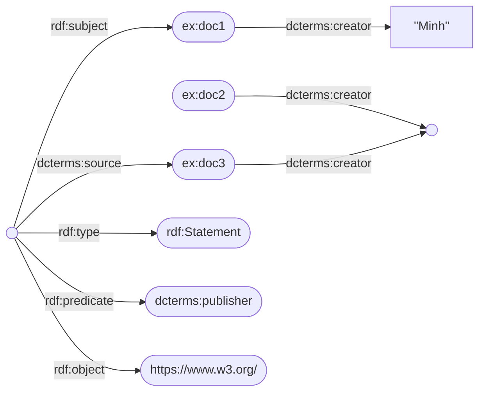
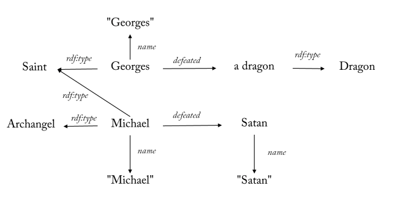
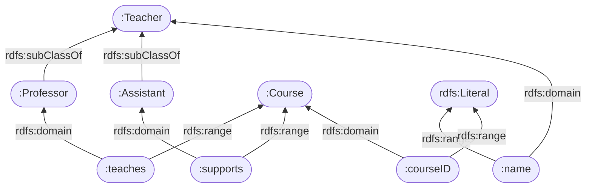
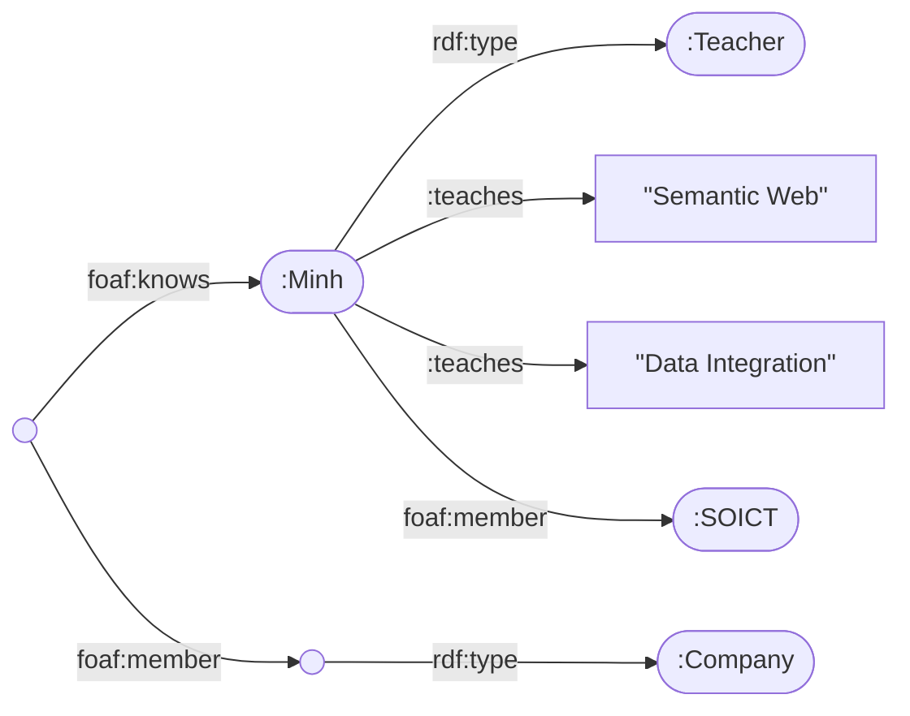
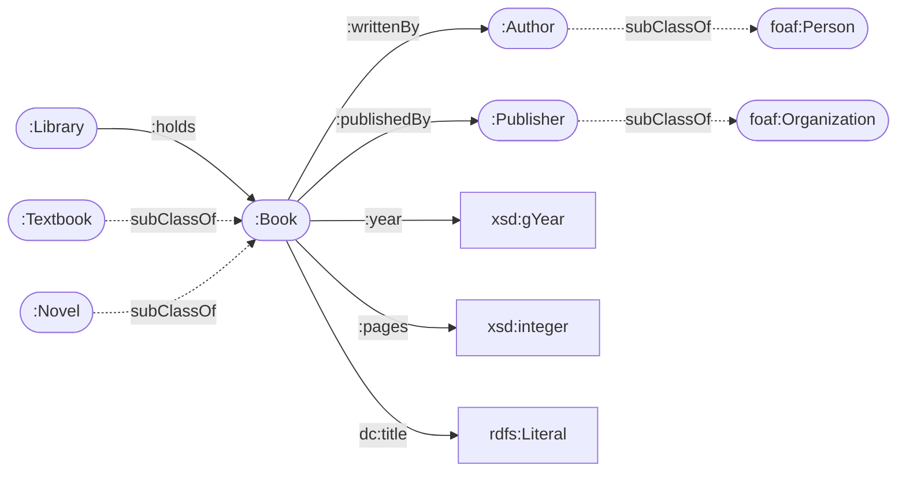
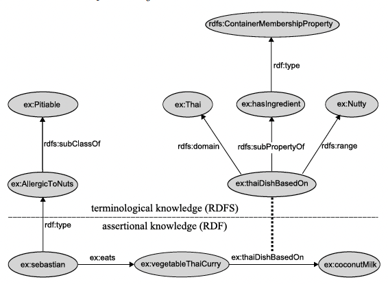
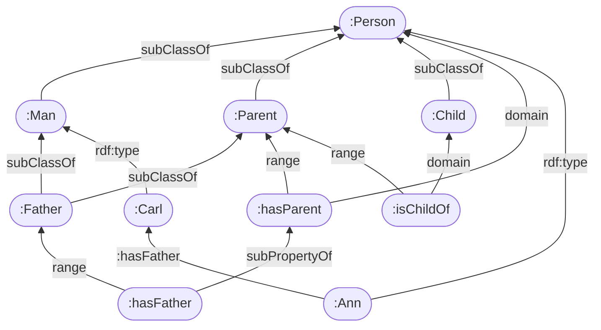

# 01 — RDF & RDFS (★★★)

> Slide: `02_RDF.pdf`, `03_RDFS.pdf` · Bài tập: `Exercises-en.docx` Part 1 (Ex1–7), Part 2 (Ex1–2)
> Bài về nhà đã nộp: `Exercise_29.08_…pdf` (Part 1 Ex2), `5.9-RDFS-…pdf` (Part 2 Ex2, câu 10–13), `12.9_RDFS.pdf` (Part 2 Ex2, câu 14–18)
> Dạng bài: **D4** suy diễn RDFS · **D5** vẽ đồ thị RDF · **D6** chuyển đổi serialization · **D7** thiết kế schema RDFS

---

## Phần A — Kiến thức RDF (02_RDF)

### A1. Mô hình dữ liệu (★★★)
- **Knowledge graph** (theo slide): đồ thị **có hướng, có nhãn, không đồng nhất** (heterogeneous), **có thể có chu trình**. Kiểu nút = class, kiểu cạnh = property.
- **Triple** = (subject, predicate, object) — đọc như một câu hoặc một cạnh của đồ thị.

| Vị trí | Được phép |
|---|---|
| subject | URI (IRI) hoặc blank node |
| predicate | **chỉ URI** |
| object | URI, blank node hoặc **literal** |

- **Literal chỉ được đứng ở vị trí object** ⇒ không thể nói gì "về" một literal (lý do OWL cấm DatatypeProperty là transitive/symmetric/inverse).
- **Literal** có **hoặc** datatype **hoặc** language tag, **không bao giờ cả hai**:
  - `"1356594"^^xsd:integer`, `"1158-01-01"^^xsd:date`, `"München"@de`
  - `"München"@en`, `"München"@de`, `"München"^^xsd:string` là **3 literal khác nhau**.
  - *(bổ sung, RDF 1.1)* `"abc"` và `"abc"^^xsd:string` là **cùng một** literal; literal có lang tag có datatype `rdf:langString`.
- **URI vs URL:** URI = định danh (scheme://authority/path?query#fragment); URL là URI **dereference được** (truy cập được qua HTTP).

### A2. Blank node (★★★)
- Tài nguyên **không có tên** — "có một cái gì đó tồn tại" (**biến tồn tại**).
- Hai cách viết tương đương: `_:x` và `[ … ]`. Đổi tên `_:x` → `_:y` **không** đổi nghĩa.
- Tên blank node chỉ có nghĩa **trong một tài liệu**.
- Dùng khi: (1) đối tượng không biết danh tính ("ai đó viết cuốn sách"), (2) **quan hệ n-ngôi** (n-ary), (3) cấu trúc phụ (địa chỉ, số lượng + đơn vị).
- Ví dụ n-ary trên slide:
  ```turtle
  # fragment
  :Recipe :hasIngredient [ :ingredient :Sugar ; :amount [ :value 100 ; :unit :Gram ] ] .
  ```

### A3. Các cách viết (serialization) (★★★ — đề hay bắt viết 2–3 dạng)
| Dạng | Đặc điểm cần nhớ |
|---|---|
| **N-Triples** | mỗi dòng một triple, URI đầy đủ `<…>`, kết thúc `.`; **không** prefix, không `a`, `;`, `,`, `[]`, `()` |
| **Turtle** | `@prefix p: <…> .` (hoặc `PREFIX p: <…>` không dấu chấm); `a` = `rdf:type`; `;` lặp subject; `,` lặp subject+predicate; `[ … ]` blank node; `( … )` danh sách; `42` = xsd:integer, `4.2` = xsd:decimal, `4.2e0` = xsd:double, `true` = xsd:boolean |
| **RDF/XML** | `rdf:RDF` gốc; `rdf:Description rdf:about="URI"`; object là URI → `rdf:resource="URI"`; blank node dùng chung → `rdf:nodeID="x"`; lồng `rdf:Description` không `about` = blank node; `rdf:datatype="URI đầy đủ"`, `xml:lang="vi"`; **chu trình phải dùng tham chiếu, không lồng được** |
| **JSON-LD** | `@context`, `@id`, `@type`, `@value`, `@language`; node không `@id` = blank node |

**RDF/XML — bảng tra nhanh *(bổ sung, W3C RDF 1.1 XML Syntax)*:**
| Muốn viết | RDF/XML |
|---|---|
| object là URI | `<ex:homePage rdf:resource="http://…"/>` |
| object là literal | `<ex:name>Minh</ex:name>` |
| literal có ngôn ngữ | `<dc:title xml:lang="vi">Truyện Kiều</dc:title>` |
| literal có kiểu | `<ex:age rdf:datatype="http://www.w3.org/2001/XMLSchema#integer">42</ex:age>` |
| kiểu của subject | `<rdf:type rdf:resource="…#Person"/>` **hoặc** typed node `<ex:Person rdf:about="…">` |
| blank node dùng nhiều lần | `rdf:nodeID="author"` ở cả property element lẫn `rdf:Description` |
| blank node dùng một lần | lồng `<rdf:Description>…</rdf:Description>` hoặc `rdf:parseType="Resource"` |
| danh sách đóng | `rdf:parseType="Collection"` (chỉ chứa node, không literal) |
| container | `<rdf:Bag>`/`<rdf:Seq>`/`<rdf:Alt>` + `<rdf:li>` (→ `rdf:_1`, `rdf:_2`…) |
| reify triple | `rdf:ID="t1"` **trên property element** (trên node element thì `rdf:ID` chỉ là `#t1`) |

### A4. Reification & provenance (★★★ — đã ra bài về nhà 29.08)
- Nói **về một phát biểu** ("Peter **nói rằng** Rome là thủ đô của Tây Ban Nha"): dùng `rdf:Statement` + `rdf:subject`, `rdf:predicate`, `rdf:object`.
- **Reification không khẳng định triple gốc** (không entail triple gốc) — đúng ý "doc3 *nói* doc1 do W3C xuất bản" chứ không phải sự thật.
- Tốn 4 triple / 1 phát biểu ⇒ các phương án khác: named graph (TriG), **RDF-star** `<< s p o >>` (xem `06-ly-thuyet.md`), PROV-O (`prov:wasDerivedFrom`, `prov:wasAttributedTo`).

### A5. Container vs Collection *(bổ sung)*
| | Container `rdf:Bag/Seq/Alt` | Collection `( … )` |
|---|---|---|
| Từ vựng | `rdf:_1, rdf:_2…` | `rdf:first`, `rdf:rest`, `rdf:nil` |
| Đóng? | **Mở** — luôn thêm được phần tử | **Đóng** — kết thúc bằng `rdf:nil` |
| Dùng trong OWL | không | `owl:unionOf`, `owl:intersectionOf`, `owl:oneOf` |

### A6. Hai nguyên lý ngữ nghĩa (★★★ — gốc của rất nhiều câu "vì sao")
- **Non-unique name assumption (không giả định tên duy nhất):** hai URI khác nhau **có thể** chỉ cùng một thực thể (`:Munich`, `:München`).
- **Open World Assumption (OWA):** điều không được nói ra **không phải là sai**, chỉ là **chưa biết**.
- Ví dụ slide: `:Peter :fatherOf :Julia , :Mary .` — Peter có mấy con? **Ít nhất 1** (Julia và Mary có thể là một người — vì **không có** UNA), **có thể nhiều hơn 2** (OWA). Muốn kết luận ≥ 2 con phải thêm `:Julia owl:differentFrom :Mary`.

### A7. RDF trên Web (★)
- `<link rel="meta" href="…rdf">` trong HTML; **content negotiation**: header `Accept: text/turtle` → server trả `303 See Other` tới bản RDF.
- MIME: `application/rdf+xml`, `text/turtle`, `application/n-triples`, `application/ld+json`, `application/sparql-query`.
- Nhúng trong HTML: **RDFa** (`about`, `property`, `rel`, `href`, `typeof`), **Microdata** (kém hơn RDFa: chỉ blank node, không chu trình, không reification), **JSON-LD** trong `<script type="application/ld+json">`, Microformats. Dự án thu thập: WebDataCommons.
- Câu hỏi kết bài của slide: **"RDF có mạnh hơn XML không?"** — Không hẳn: tên trong RDF vẫn vô nghĩa với máy nếu không có RDFS/OWL để định nghĩa ý nghĩa.

---

## Phần B — Kiến thức RDFS (03_RDFS)

### B1. Ontology là gì (★★)
- **Gruber 1993:** "an explicit specification of a conceptualization". Các định nghĩa khác: Guarino & Giaretta, Uschold & Grüninger, Guarino 1998.
- Tính chất: **explicit, formal, shared, partial**.
- Các loại ngữ nghĩa: lexical (đồng nghĩa, đồng âm, hyponym, meronym), extensional (tập thể hiện), intensional (đặc trưng/seme — bảng duck/bird/bee/dolphin), prototype.

### B2. Từ vựng RDFS (★★★)
| Term | Ý nghĩa |
|---|---|
| `rdfs:Class`, `rdf:Property` | khai báo lớp, thuộc tính |
| `rdfs:subClassOf` | phân cấp lớp (cho phép đa kế thừa) |
| `rdfs:subPropertyOf` | phân cấp thuộc tính |
| `rdfs:domain`, `rdfs:range` | kiểu của subject / object khi dùng property — **dùng để SUY RA kiểu, không phải để kiểm tra ràng buộc** |
| `rdfs:label`, `rdfs:comment`, `rdfs:seeAlso`, `rdfs:isDefinedBy` | chú thích (URI cho máy, label cho người) |
| `rdfs:Resource`, `rdfs:Literal`, `rdfs:Datatype`, `rdfs:Container`, `rdfs:member` | lớp/thuộc tính hệ thống |

- **T-Box** (terminological: schema, class/property) vs **A-Box** (assertional: dữ liệu cá thể).
- **Nhiều domain = GIAO**, không phải hợp: `:knows rdfs:domain :Person , :MemberOfSocialNetwork` ⇒ ai `:knows` ai đó thì thuộc **cả hai** lớp.
- **Property là first-class citizen:** domain/range gắn vào property (toàn cục), không gắn vào class.

### B3. Luật suy diễn RDFS (★★★ — trích đúng tên luật khi làm bài)
| Luật | Nếu có | Thì suy ra | Nhớ nhanh |
|---|---|---|---|
| **rdfs2** | `p rdfs:domain C .` `x p y .` | `x rdf:type C .` | domain |
| **rdfs3** | `p rdfs:range C .` `x p y .` | `y rdf:type C .` | range (y không phải literal) |
| **rdfs4a** | `x p y .` | `x rdf:type rdfs:Resource .` | mọi thứ là Resource |
| **rdfs4b** | `x p y .` | `y rdf:type rdfs:Resource .` | |
| **rdfs5** | `p subPropertyOf q .` `q subPropertyOf r .` | `p subPropertyOf r .` | subProp bắc cầu |
| **rdfs6** | `p rdf:type rdf:Property .` | `p subPropertyOf p .` | subProp phản xạ |
| **rdfs7** | `p subPropertyOf q .` `x p y .` | `x q y .` | kế thừa property |
| **rdfs8** | `C rdf:type rdfs:Class .` | `C subClassOf rdfs:Resource .` | |
| **rdfs9** | `C subClassOf D .` `x rdf:type C .` | `x rdf:type D .` | kế thừa kiểu |
| **rdfs10** | `C rdf:type rdfs:Class .` | `C subClassOf C .` | subClass phản xạ |
| **rdfs11** | `C subClassOf D .` `D subClassOf E .` | `C subClassOf E .` | subClass bắc cầu |
| **rdfs12** | `p rdf:type rdfs:ContainerMembershipProperty .` | `p subPropertyOf rdfs:member .` | |
| **rdfs13** | `D rdf:type rdfs:Datatype .` | `D subClassOf rdfs:Literal .` | |
| **rdf1** (1.1: **rdfD2**) | `x p y .` | `p rdf:type rdf:Property .` | |
| **se1** *(RDF 1.0)* | `x p y .` | `x p _:b .` | thay **object** bằng blank node |
| **se2** *(RDF 1.0)* | `x p y .` | `_:b p y .` | thay **subject** bằng blank node |

- **Axiomatic triples** (luôn đúng, kể cả với đồ thị rỗng), ví dụ: `rdf:type rdfs:domain rdfs:Resource`, `rdfs:domain rdfs:domain rdf:Property`, `rdfs:range rdfs:domain rdf:Property`, `rdfs:subClassOf rdfs:domain rdfs:Class`, `rdfs:subPropertyOf rdfs:range rdf:Property`, `rdfs:Datatype rdfs:subClassOf rdfs:Class`… ⇒ mọi URI đều `rdf:type rdfs:Resource`.
- **Blank node trong câu hỏi = biến tồn tại** *(Interpolation Lemma, RDF 1.1)*: đồ thị G entail E ⇔ tồn tại cách thay blank node của E bằng term của G sao cho mọi triple của E nằm trong bao đóng của G.
- **KHÔNG có luật nào** (trong RDFS chuẩn) sinh ra bộ-3 schema `subP rdfs:domain C` từ domain/range của property cha (→ hỏi bộ-3 đó thì trả lời **UNKNOWN**) — nhưng ở mức cá thể domain/range vẫn "truyền": `x subP y` ⇒ rdfs7 ⇒ `x P y` ⇒ rdfs2 ⇒ `x a C` (rdfs3 tương tự cho range; slide: *"inherited by sub properties"*); domain **không** đi lên superclass; **không** có inverse; **không** có phủ định. *(Các luật ext1–ext4 kiểu "domain kế thừa" chỉ có trong ngữ nghĩa extensional của RDF 1.0 — không dùng khi làm bài.)*

### B4. Forward chaining (★★)
```
lặp:
  với mỗi luật, với mỗi cách khớp tiền đề trong đồ thị:
      thêm kết luận nếu chưa có
đến khi không thêm được triple nào  (điểm bất động)
```
- Suy diễn **không tạo tài nguyên mới** (chỉ dùng URI đã có) ⇒ luôn dừng.
- Ví dụ slide: `:Tim :worksIn :B626B01`, `worksIn ⊑ hasOffice`, `hasOffice domain Employee, range Room`, `Employee ⊑ Human` ⇒ `Tim hasOffice B626B01` (rdfs7) ⇒ `Tim a Employee` (rdfs2), `B626B01 a Room` (rdfs3) ⇒ `Tim a Human` (rdfs9).
- Ví dụ Madrid: `:Madrid :capitalOf :Spain` + domain City, range Country, `capitalOf ⊑ locatedIn` ⇒ Madrid là City, Spain là Country, Madrid locatedIn Spain.

### B5. Giới hạn của RDFS (★★★ — cầu nối sang OWL)
- Không có: cardinality, functional property, disjointness, **phủ định**, inverse, equality (sameAs), lớp định nghĩa bằng điều kiện.
- **Không có phủ định ⇒ không bao giờ có mâu thuẫn** (monotonic; hợp nguyên tắc AAA — *Anybody can say Anything about Anything*).
- Ví dụ: `:Peter a :Baby , :Adult .` không mâu thuẫn với máy; "động vật có vú không đẻ trứng, chim cánh cụt đẻ trứng ⇒ chim cánh cụt không phải động vật có vú" — **không biểu diễn được**.
- Câu hỏi "Barcelona không phải thủ đô Tây Ban Nha?", "Madrid không phải thủ đô Pháp?", "Madrid không phải là một bang?" — RDFS không trả lời được → OWL giải bằng InverseFunctional + differentFrom, Functional, disjointWith (xem `02-owl.md`).

---

## Phần C — Khuôn làm bài

### D4. Suy diễn RDFS: "true hay unknown?" (khuôn của thầy — bài 5.9 / 12.9)
1. Chép **đồ thị gốc**, tách **Schema (T-Box)** / **Data (A-Box)**.
2. Liệt kê **các luật sẽ dùng** (bảng B3) — chỉ cần những luật thực sự dùng.
3. Tính **bao đóng**, đánh số `(D1)…(Dn)`, mỗi dòng ghi *luật + tiền đề*.
4. Trả lời từng mệnh đề: **TRUE** (chỉ ra Dk hoặc triple gốc) / **UNKNOWN** (giải thích vì sao không luật nào sinh ra được).
   - **Không viết "false"**: RDFS không có phủ định + OWA ⇒ chưa suy ra được thì chỉ là *unknown*.
   - Mệnh đề có blank node: chỉ ra **phép thay** `_:x ↦ :Carl` rồi kiểm từng triple.
5. **Bảng tổng kết** (No. | Statement | Value | Justification).

### D5. Vẽ đồ thị RDF (quy ước như bài 29.08)
- **Ellipse** = resource (URI), **chữ nhật** = literal, **elip rỗng (không nhãn)** = blank node; mũi tên **subject → object**, nhãn = predicate (viết dạng prefix).
- Vẽ T-Box phía trên, A-Box phía dưới, kẻ đường ngang phân cách (như hình Part 2 Ex1).
- Đếm lại số cạnh = số triple — ghi "Đồ thị có N triple".

### D6. Chuyển đổi serialization
- Turtle → N-Triples: bung prefix thành URI đầy đủ, mỗi `;`/`,` thành một dòng, `a` → `<…#type>`, `[ ]` → `_:b0`.
- Turtle → RDF/XML: mỗi subject một `rdf:Description rdf:about`; object URI → `rdf:resource`; blank node dùng >1 lần → `rdf:nodeID`; có `rdf:type` có thể dùng typed node.

### D7. Thiết kế schema RDFS
1. Danh từ chung → `rdfs:Class`; quan hệ "là một loại" → `rdfs:subClassOf`.
2. Động từ/quan hệ → `rdf:Property` + **domain/range** (cẩn thận: domain/range toàn cục, gây suy diễn ở mọi nơi dùng property).
3. Thuộc tính giá trị (tên, mã, năm) → property có range `xsd:…`/`rdfs:Literal`.
4. Tái dùng từ vựng chuẩn: `foaf:name`, `foaf:Person`, `dc:title`, `dc:creator`…
5. Vẽ sơ đồ + viết triple. Nêu rõ những gì **RDFS không diễn đạt được** (ví dụ "chỉ", "ít nhất một") → cần OWL.

---

## Phần D — Lời giải Part 1 (RDF)

### Part 1 Ex1 — SOICT (mỗi câu ≥ 3 triple)
```turtle
@prefix :     <http://example.org/hust#> .
@prefix foaf: <http://xmlns.com/foaf/0.1/> .
@prefix dc:   <http://purl.org/dc/terms/> .
@prefix rdfs: <http://www.w3.org/2000/01/rdf-schema#> .

# (1) SOICT is located at No. 1, Dai Co Viet, Hai Ba Trung, Hanoi  -> địa chỉ là cấu trúc n-ary: blank node
:SOICT a foaf:Organization ;
    :locatedAt [ :street "No. 1 Dai Co Viet" ; :district "Hai Ba Trung" ; :city "Hanoi" ] .

# (2) Website https://soict.hust.edu.vn/ is the homepage of SOICT
:SOICT foaf:homepage <https://soict.hust.edu.vn/> .
<https://soict.hust.edu.vn/> a foaf:Document ;
    dc:title "SOICT homepage"@en .

# (3) URI1 is a course on Semantic Web, taught by Lecturer Hung in room B1-404
:URI1 a :Course ;
    :subject "Semantic Web" ;
    :taughtBy :Hung ;
    :room :B1-404 .
:Hung a :Lecturer ; foaf:name "Hung" .
:B1-404 a :Room ; rdfs:label "B1-404" .
```
*Lưu ý trình bày:* câu (3) có thể bị hỏi "ai dạy ở phòng nào" — nếu cùng một môn có nhiều buổi ở nhiều phòng thì phải dùng nút n-ary `:URI1 :hasSession [ :lecturer :Hung ; :room :B1-404 ]`.

### Part 1 Ex2 — doc1/doc2/doc3 (bài về nhà 29.08)

```turtle
@prefix rdf:     <http://www.w3.org/1999/02/22-rdf-syntax-ns#> .
@prefix dcterms: <http://purl.org/dc/terms/> .
@prefix ex:      <http://example.org/> .

ex:doc1 dcterms:creator "Minh" .
ex:doc2 dcterms:creator _:author .          # cùng MỘT tác giả không rõ danh tính -> cùng một blank node
ex:doc3 dcterms:creator _:author .
_:stmt a rdf:Statement ;                    # doc3 NÓI RẰNG doc1 do W3C xuất bản -> reification
    rdf:subject   ex:doc1 ;
    rdf:predicate dcterms:publisher ;
    rdf:object    <https://www.w3.org/> ;
    dcterms:source ex:doc3 .
```
```xml
<?xml version="1.0" encoding="UTF-8"?>
<rdf:RDF xmlns:rdf="http://www.w3.org/1999/02/22-rdf-syntax-ns#"
         xmlns:dcterms="http://purl.org/dc/terms/">
  <rdf:Description rdf:about="http://example.org/doc1">
    <dcterms:creator>Minh</dcterms:creator>
  </rdf:Description>
  <rdf:Description rdf:about="http://example.org/doc2">
    <dcterms:creator rdf:nodeID="author"/>
  </rdf:Description>
  <rdf:Description rdf:about="http://example.org/doc3">
    <dcterms:creator rdf:nodeID="author"/>
  </rdf:Description>
  <rdf:Statement rdf:nodeID="stmt">
    <rdf:subject rdf:resource="http://example.org/doc1"/>
    <rdf:predicate rdf:resource="http://purl.org/dc/terms/publisher"/>
    <rdf:object rdf:resource="https://www.w3.org/"/>
    <dcterms:source rdf:resource="http://example.org/doc3"/>
  </rdf:Statement>
</rdf:RDF>
```
**Điểm ăn điểm:** (1) blank node **dùng chung** cho doc2/doc3 (không phải hai blank node khác nhau — vì "cùng một tác giả"); (2) **reification** thay vì khẳng định trực tiếp `ex:doc1 dcterms:publisher <W3C>`; (3) biết `dcterms:creator` có range `dcterms:Agent` nên cách chặt chẽ hơn là `ex:doc1 dcterms:creator [ a dcterms:Agent ; rdfs:label "Minh" ]` (literal hợp lệ với `dc:` 1.1 cũ).

### Part 1 Ex3 — URI1…URI6
```turtle
@prefix ex:   <http://example.org/> .
@prefix rdf:  <http://www.w3.org/1999/02/22-rdf-syntax-ns#> .
@prefix rdfs: <http://www.w3.org/2000/01/rdf-schema#> .

ex:URI1 a rdfs:Class .
ex:URI2 a rdfs:Class .
ex:URI3 a rdf:Property ;
    rdfs:domain ex:URI1 ;
    rdfs:range  ex:URI2 .
ex:URI4 a ex:URI1 .
ex:URI5 a ex:URI2 .
ex:URI6 a ex:URI2 .
```
```xml
<?xml version="1.0"?>
<rdf:RDF xmlns:rdf="http://www.w3.org/1999/02/22-rdf-syntax-ns#"
         xmlns:rdfs="http://www.w3.org/2000/01/rdf-schema#">
  <rdfs:Class rdf:about="http://example.org/URI1"/>
  <rdfs:Class rdf:about="http://example.org/URI2"/>
  <rdf:Property rdf:about="http://example.org/URI3">
    <rdfs:domain rdf:resource="http://example.org/URI1"/>
    <rdfs:range rdf:resource="http://example.org/URI2"/>
  </rdf:Property>
  <rdf:Description rdf:about="http://example.org/URI4">
    <rdf:type rdf:resource="http://example.org/URI1"/>
  </rdf:Description>
  <rdf:Description rdf:about="http://example.org/URI5">
    <rdf:type rdf:resource="http://example.org/URI2"/>
  </rdf:Description>
  <rdf:Description rdf:about="http://example.org/URI6">
    <rdf:type rdf:resource="http://example.org/URI2"/>
  </rdf:Description>
</rdf:RDF>
```
*Câu hỏi mở rộng hay gặp:* thêm `ex:URI5 ex:URI3 ex:URI6 .` thì suy ra gì? → `URI5 a URI1` (rdfs2), `URI6 a URI2` (rdfs3, đã có). Không mâu thuẫn dù URI5 vừa là URI1 vừa là URI2 (RDFS không có disjoint).

### Part 1 Ex4 — Đồ thị Georges/Michael → Turtle

```turtle
@prefix :     <http://example.org/> .
@prefix rdf:  <http://www.w3.org/1999/02/22-rdf-syntax-ns#> .
@prefix foaf: <http://xmlns.com/foaf/0.1/> .

:Georges rdf:type :Saint ;
    foaf:name "Georges" ;
    :defeated [ rdf:type :Dragon ] .        # "a dragon" = blank node (không có tên)
:Michael rdf:type :Saint , :Archangel ;
    foaf:name "Michael" ;
    :defeated :Satan .
:Satan foaf:name "Satan" .
```
**Bẫy:** nút "a dragon" viết thường, không phải URI → **blank node**; Michael có **hai** `rdf:type`. Đồ thị có **9 triple**.
```xml
<?xml version="1.0"?>
<rdf:RDF xmlns:rdf="http://www.w3.org/1999/02/22-rdf-syntax-ns#"
         xmlns:foaf="http://xmlns.com/foaf/0.1/"
         xmlns:ex="http://example.org/">
  <ex:Saint rdf:about="http://example.org/Georges">
    <foaf:name>Georges</foaf:name>
    <ex:defeated>
      <ex:Dragon/>
    </ex:defeated>
  </ex:Saint>
  <ex:Saint rdf:about="http://example.org/Michael">
    <rdf:type rdf:resource="http://example.org/Archangel"/>
    <foaf:name>Michael</foaf:name>
    <ex:defeated>
      <rdf:Description rdf:about="http://example.org/Satan">
        <foaf:name>Satan</foaf:name>
      </rdf:Description>
    </ex:defeated>
  </ex:Saint>
</rdf:RDF>
```
*(`<ex:Dragon/>` lồng không có `rdf:about` = blank node có kiểu Dragon — typed node element.)*

### Part 1 Ex5 — Teacher/Professor/Assistant/Course (D7)

```turtle
@prefix :     <http://example.org/school#> .
@prefix rdf:  <http://www.w3.org/1999/02/22-rdf-syntax-ns#> .
@prefix rdfs: <http://www.w3.org/2000/01/rdf-schema#> .

:Teacher   a rdfs:Class .
:Professor a rdfs:Class ; rdfs:subClassOf :Teacher .
:Assistant a rdfs:Class ; rdfs:subClassOf :Teacher .
:Course    a rdfs:Class .

:name     a rdf:Property ; rdfs:domain :Teacher ; rdfs:range rdfs:Literal .
:courseID a rdf:Property ; rdfs:domain :Course  ; rdfs:range rdfs:Literal .
:teaches  a rdf:Property ; rdfs:domain :Professor ; rdfs:range :Course .
:supports a rdf:Property ; rdfs:domain :Assistant ; rdfs:range :Course .   # "supports the course management"
```
**Nhận xét ăn điểm:** "Each Teacher has a name" / "Each Course has a courseID" là ràng buộc **bắt buộc có** — RDFS **không** diễn đạt được (domain chỉ nói: *ai có* name thì là Teacher). Cần OWL: `Teacher ⊑ ∃name.xsd:string` (hoặc `min 1`). Tương tự, domain `teaches` = Professor nghĩa là *ai dạy thì là Professor* ⇒ nếu Assistant cũng `teaches` thì bị suy ra là Professor (side-effect của domain toàn cục).

### Part 1 Ex6 — Turtle → đồ thị

Đọc thành lời: *Minh là giáo viên, dạy "Semantic Web" và "Data Integration", là thành viên SOICT. Có một người (không rõ là ai) quen Minh và là thành viên của một công ty nào đó.* — **7 triple**, 2 blank node.

N-Triples:
```
<http://example.org/Minh> <http://www.w3.org/1999/02/22-rdf-syntax-ns#type> <http://example.org/Teacher> .
<http://example.org/Minh> <http://example.org/teaches> "Semantic Web" .
<http://example.org/Minh> <http://example.org/teaches> "Data Integration" .
<http://example.org/Minh> <http://xmlns.com/foaf/0.1/member> <http://example.org/SOICT> .
_:b1 <http://xmlns.com/foaf/0.1/knows> <http://example.org/Minh> .
_:b1 <http://xmlns.com/foaf/0.1/member> _:b2 .
_:b2 <http://www.w3.org/1999/02/22-rdf-syntax-ns#type> <http://example.org/Company> .
```

### Part 1 Ex7 — Thư viện (D7, đề mở)
Dữ liệu đầy đủ, chạy được: [`files/library.ttl`](files/library.ttl). Sơ đồ schema:

**Gợi ý chấm:** có phân cấp lớp; property có domain/range; dùng lại vocab chuẩn (`dc:title`, `foaf:name`); literal có datatype (`"2012"^^xsd:gYear`) và lang tag (`"Truyện Kiều"@vi`); ít nhất một ví dụ nhiều tác giả.

---

## Phần E — Lời giải Part 2 (RDFS)

### Part 2 Ex1 — Mô tả ontology trong hình

```turtle
@prefix ex:   <http://example.org/> .
@prefix rdf:  <http://www.w3.org/1999/02/22-rdf-syntax-ns#> .
@prefix rdfs: <http://www.w3.org/2000/01/rdf-schema#> .

# T-Box (terminological knowledge)
ex:AllergicToNuts rdfs:subClassOf ex:Pitiable .
ex:hasIngredient  rdf:type rdfs:ContainerMembershipProperty .
ex:thaiDishBasedOn rdfs:subPropertyOf ex:hasIngredient ;
    rdfs:domain ex:Thai ;
    rdfs:range  ex:Nutty .
# A-Box (assertional knowledge)
ex:sebastian rdf:type ex:AllergicToNuts ;
    ex:eats ex:vegetableThaiCurry .
ex:vegetableThaiCurry ex:thaiDishBasedOn ex:coconutMilk .
```
- **5 class:** Pitiable, AllergicToNuts, Thai, Nutty, rdfs:ContainerMembershipProperty · **properties:** hasIngredient, thaiDishBasedOn (+ eats ở A-Box) · **instances:** sebastian, vegetableThaiCurry, coconutMilk.
- **Suy diễn:** `sebastian a Pitiable` (rdfs9) · `vegetableThaiCurry a Thai` (rdfs2) · `coconutMilk a Nutty` (rdfs3) · `vegetableThaiCurry hasIngredient coconutMilk` (rdfs7) · `hasIngredient subPropertyOf rdfs:member` (rdfs12) ⇒ `vegetableThaiCurry rdfs:member coconutMilk` (rdfs7).
- Ý nghĩa: Sebastian dị ứng hạt, ăn cà ri Thái làm từ nước cốt dừa (một thứ "Nutty") ⇒ đáng thương (Pitiable). Đây là ví dụ kinh điển trong sách Hitzler et al., *Foundations of Semantic Web Technologies*.

### Part 2 Ex2 — Đồ thị gia đình (Person/Father/Ann/Carl)
**A. Đồ thị**

*(Ngoài ra mỗi class có `rdf:type rdfs:Class`, mỗi property có `rdf:type rdf:Property` — khi thi vẽ đủ hoặc ghi chú "các nút class đều có rdf:type rdfs:Class".)*

**B. Bao đóng (chỉ phần dùng tới)**
- (D1) `:Ann :hasParent :Carl` — rdfs7 (hasFather ⊑ hasParent)
- (D2) `:Carl a :Father` — rdfs3 (range hasFather)
- (D3) `:Carl a :Parent` — rdfs9 (D2 + Father ⊑ Parent); cũng từ rdfs3 với range hasParent
- (D4) `:Carl a :Person` — rdfs9 (Man ⊑ Person)
- (D5) `:Ann a :Person` — rdfs2 (domain hasParent) + có sẵn
- (D6) `:Father rdfs:subClassOf :Person` — rdfs11 (Father ⊑ Parent ⊑ Person)
- (D7) `:Person rdfs:subClassOf :Person` — rdfs10
- (D8) `:Child a rdfs:Resource`, `rdfs:range a rdfs:Resource` — rdfs4a

**Bảng 18 mệnh đề** (đã kiểm bằng máy: [`files/rdfs_closure.py`](files/rdfs_closure.py))
| # | Mệnh đề | Kết quả | Lý do |
|---|---|---|---|
| 1 | `:Father rdfs:subClassOf :Person` | **TRUE** | rdfs11: Father ⊑ Parent ⊑ Person (D6) |
| 2 | `:Man rdfs:subClassOf :Person` | **TRUE** | có sẵn trong G |
| 3 | `:Carl a :Person` | **TRUE** | rdfs9 (D4) |
| 4 | `:Carl a :Parent` | **TRUE** | rdfs3 + rdfs9 (D3) |
| 5 | `:Carl :hasChild :Ann` | UNKNOWN | `:hasChild` không xuất hiện trong G — RDFS không có inverse; các luật RDFS không tạo ra IRI mới, nên không luật nào sinh được triple có predicate `:hasChild` |
| 6 | `:Carl a :Man` | **TRUE** | có sẵn |
| 7 | `:Carl a :Father` | **TRUE** | rdfs3 (D2) |
| 8 | `:Child rdf:type rdfs:Resource` | **TRUE** | rdfs4a (Child là subject của triple) |
| 9 | `:Ann a :Child` | UNKNOWN | chỉ suy ra được nếu Ann là subject của `:isChildOf` (rdfs2) — không có |
| 10 | `:Ann :isChildOf :Carl` | UNKNOWN | `isChildOf` chỉ xuất hiện trong schema, không có subPropertyOf nối với hasParent/hasFather; tên "nghịch đảo" không mang nghĩa hình thức |
| 11 | `:Ann :hasParent :Carl` | **TRUE** | rdfs7 (D1) |
| 12 | `:Ann :hasParent _:x` | **TRUE** | blank node = biến tồn tại: `_:x ↦ :Carl` cho D1 (luật se1: thay object bằng blank node) |
| 13 | `:Ann :hasParent [ rdf:type :Person ]` | **TRUE** | `_:b ↦ :Carl`: D1 và D4 cùng đúng |
| 14 | `:hasFather rdfs:domain :Person` | UNKNOWN | không luật RDFS nào sinh ra bộ-3 `subP rdfs:domain C` (rdfs2 chỉ *dùng* domain có sẵn). Ở mức cá thể thì domain vẫn "truyền": `:Ann :hasFather :Carl` ⇒ rdfs7 ⇒ rdfs2 ⇒ `:Ann a :Person` (slide: *"inherited by sub properties"*) — nhưng mệnh đề hỏi bộ-3 schema |
| 15 | `rdfs:range rdf:type rdfs:Resource` | **TRUE** | rdfs4a trên axiomatic triple `rdfs:range rdfs:domain rdf:Property` |
| 16 | `:hasFather rdfs:range :Father` | **TRUE** | **có sẵn trong G** (`:hasFather … rdfs:range :Father`) |
| 17 | `:hasFather rdfs:domain [ rdfs:subClassOf :Person ]` | UNKNOWN | không suy ra được bộ-3 `rdfs:domain` nào cho hasFather (cùng lý do mệnh đề 14 — bộ-3 schema không được sinh, dù ở mức cá thể domain vẫn "truyền") ⇒ không có ứng viên cho blank node |
| 18 | `:Father rdfs:subClassOf [ rdfs:subClassOf :Person ]` | **TRUE** | `_:b ↦ :Person`: D6 + D7 (rdfs10) — hoặc `_:b ↦ :Parent` (Father ⊑ Parent có sẵn, Parent ⊑ Person có sẵn) |

> ⚠️ **Đính chính bài về nhà 12.9 (câu 3 = mệnh đề 16):** bài nộp ghi *Unknown* với lý do "No range is declared for :hasFather in G" — **sai**: đề gốc có `:hasFather a rdf:Property ; rdfs:subPropertyOf :hasParent ; rdfs:range :Father .` ⇒ mệnh đề có sẵn trong G ⇒ **TRUE** (bài 5.9 của chính bạn cũng dùng triple này ở bước D2). Lý luận "bộ-3 `rdfs:range` không suy ra được từ superproperty" vẫn đúng nhưng không áp dụng ở đây.
> ⚠️ **Đính chính nhỏ bài 5.9:** luật "thay IRI ở vị trí **object** bằng blank node" trong RDF 1.0 Semantics tên là **se1**; **se2** là thay ở vị trí **subject**. (RDF 1.1 không đặt tên luật, dùng Interpolation Lemma.)

---

## Phần F — Bài tự luyện

**R1 (D5+D6).** Vẽ đồ thị và viết RDF/XML cho: *"Bác sĩ Mark Smith, chuyên khoa nội, làm việc tại bệnh viện Smalltown, số điện thoại 0123-456; một bệnh nhân không rõ tên đã đặt lịch khám với ông ngày 2026-10-20."*
<details><summary>Đáp án (Turtle)</summary>

```turtle
@prefix :    <http://example.org/med#> .
@prefix foaf:<http://xmlns.com/foaf/0.1/> .
@prefix xsd: <http://www.w3.org/2001/XMLSchema#> .
:markSmith a :Physician ; foaf:name "Mark Smith" ; :specialty :InternalMedicine ;
    :worksAt :smalltownHospital ; foaf:phone "0123-456" .
[] a :Appointment ;                       # lịch hẹn là quan hệ n-ary -> nút riêng (blank node)
   :patient [ a :Patient ] ; :physician :markSmith ; :date "2026-10-20"^^xsd:date .
```
Điểm mấu chốt: bệnh nhân không rõ tên → blank node; lịch hẹn có 3 thành phần (bệnh nhân, bác sĩ, ngày) → **n-ary** qua nút trung gian; ngày có datatype.
</details>

**R2 (D4).** G: `:Student rdfs:subClassOf :Person . :enrolledIn rdfs:domain :Student ; rdfs:range :Course . :takesExam rdfs:subPropertyOf :enrolledIn . :lan :takesExam :SW .` — true hay unknown? (a) `:lan a :Person` (b) `:SW a :Course` (c) `:takesExam rdfs:range :Course` (d) `:lan :enrolledIn [ a :Course ]` (e) `:SW a :Student`.
<details><summary>Đáp án</summary>

(a) TRUE — rdfs7 → `lan enrolledIn SW`, rdfs2 → Student, rdfs9 → Person. (b) TRUE — rdfs3. (c) UNKNOWN — không luật RDFS nào sinh ra bộ-3 `subP rdfs:range C` (dù ở mức cá thể range vẫn "truyền": `x takesExam y` ⇒ rdfs7 ⇒ rdfs3 ⇒ `y a :Course`, chính là câu b). (d) TRUE — `_:b ↦ :SW`. (e) UNKNOWN — không có gì nói SW là Student (và cũng không mâu thuẫn nếu thêm vào: RDFS không có disjoint).
</details>

**R3 (D6).** Viết N-Triples cho `:a :p ( :x :y ) .` (collection).
<details><summary>Đáp án</summary>

```
<http://example.org/a> <http://example.org/p> _:l1 .
_:l1 <http://www.w3.org/1999/02/22-rdf-syntax-ns#first> <http://example.org/x> .
_:l1 <http://www.w3.org/1999/02/22-rdf-syntax-ns#rest> _:l2 .
_:l2 <http://www.w3.org/1999/02/22-rdf-syntax-ns#first> <http://example.org/y> .
_:l2 <http://www.w3.org/1999/02/22-rdf-syntax-ns#rest> <http://www.w3.org/1999/02/22-rdf-syntax-ns#nil> .
```
(collection n phần tử ⇒ 2n triple + 1 triple trỏ vào đầu danh sách)
</details>

**R4 (lý thuyết).** Vì sao `:Peter a :Baby , :Adult .` không gây mâu thuẫn trong RDFS? Muốn máy phát hiện mâu thuẫn thì cần gì?
<details><summary>Đáp án</summary>

RDFS không có phủ định/disjointness ⇒ không thể có mâu thuẫn (mọi đồ thị RDFS đều thỏa được, trừ trường hợp literal sai kiểu). Cần OWL: `:Baby owl:disjointWith :Adult .` ⇒ reasoner báo inconsistent (Peter ∈ owl:Nothing).
</details>

---
**Nguồn:** slide 02_RDF, 03_RDFS (Paulheim, IE650); bài về nhà 29.08, 5.9, 12.9. *(bổ sung)* W3C RDF 1.1 Semantics https://www.w3.org/TR/rdf11-mt/ · RDF 1.0 Semantics https://www.w3.org/TR/rdf-mt/ · RDF 1.1 XML Syntax https://www.w3.org/TR/rdf-syntax-grammar/ · RDF 1.1 Turtle https://www.w3.org/TR/turtle/ · N-Triples https://www.w3.org/TR/n-triples/ · JSON-LD 1.1 https://www.w3.org/TR/json-ld11/
