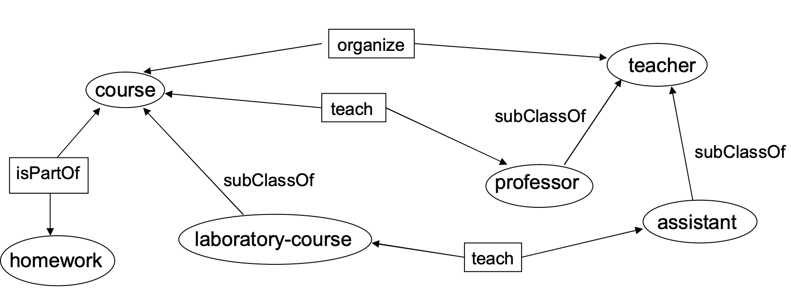
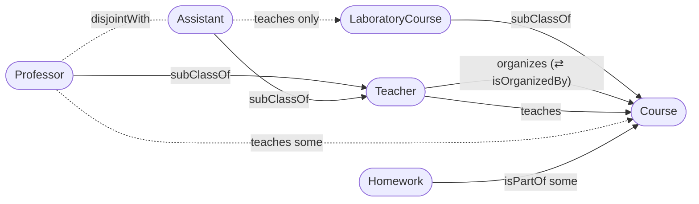
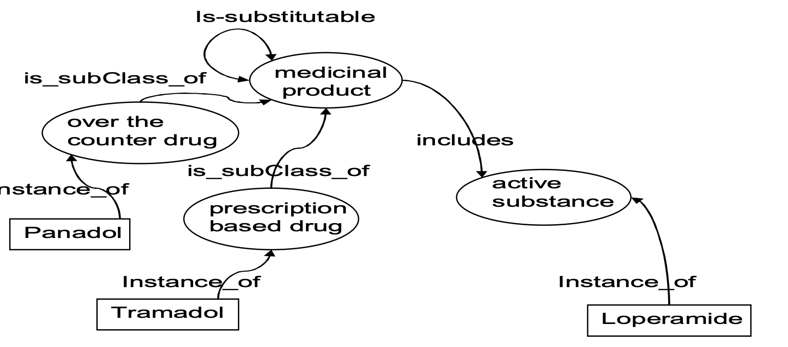

# 02 — OWL: kiến thức, thiết kế ontology, giải thích reasoner (★★★ — trọng tâm số 1)

> Slide: `05_OWL.pdf`, `06-OWL2.pdf` (phần cú pháp OWL 2, tr. 1–21) · Bài tập: `Exercises-en.docx` Part 3 Ex1–Ex4 · `pizza.owl`
> Dạng bài: **D1** thiết kế ontology OWL từ mô tả (*"bài 3"* theo tin đồn) · **D8** giải thích kết quả reasoner
> File chạy được: [`files/ex2-drugs.ttl`](files/ex2-drugs.ttl), [`files/ex3-lab-course.ttl`](files/ex3-lab-course.ttl), [`files/ex4-film.ttl`](files/ex4-film.ttl)

---

## Phần A — Kiến thức OWL

### A1. Ba biến thể OWL 1 và OWL 2 (★★)
| | OWL Lite | OWL DL | OWL Full |
|---|---|---|---|
| Biểu đạt | thấp (cardinality chỉ 0/1, không union/complement/oneOf) | cao, vẫn **quyết định được** | cao nhất, **không quyết định được** |
| Tương thích RDFS | một phần | một phần (tách bạch class / property / individual) | **hoàn toàn** (một URI vừa là class vừa là instance: `:Elephant a :Species`) |
| DL tương ứng | SHIF(D) | SHOIN(D) | — |

Đánh đổi: **biểu đạt ↔ độ phức tạp suy diễn ↔ tính quyết định được**. OWL 2 DL = SROIQ(D); OWL 2 có 3 profile EL / QL / RL (xem `03-owl2-tableau.md` §1.6).

### A2. Class, property, cá thể (★★★)
- `owl:Class` ⊑ `rdfs:Class`; `owl:Thing` (⊤) là lớp của mọi cá thể; `owl:Nothing` (⊥) rỗng; với mọi C: `C ⊑ owl:Thing`, `owl:Nothing ⊑ C`.
- **`owl:ObjectProperty`** (cá thể → cá thể) vs **`owl:DatatypeProperty`** (cá thể → literal). RDFS cho "dùng lẫn", OWL DL thì không.
- **Bằng nhau / khác nhau:**

| Đối tượng | Bằng nhau | Khác nhau |
|---|---|---|
| Cá thể | `owl:sameAs` | `owl:differentFrom`, `owl:AllDifferent` + `owl:members` (OWL 1: `owl:distinctMembers`) |
| Class | `owl:equivalentClass` | `owl:disjointWith`, `owl:AllDisjointClasses` |
| Property | `owl:equivalentProperty` | `owl:propertyDisjointWith` |

  *Vì sao không dùng sameAs cho mọi thứ?* Vì OWL Lite/DL tách bạch class, property, individual.

### A3. Đặc tính property (★★★ — ví dụ của slide, nên thuộc)
| Đặc tính | Nghĩa | Ví dụ slide | DL |
|---|---|---|---|
| `owl:SymmetricProperty` | p(a,b) ⇒ p(b,a) | `sitsOppositeOf` | `p ⊑ p⁻` |
| `owl:inverseOf` | p(a,b) ⇔ q(b,a) | `supervises` / `supervisedBy` | `p ≡ q⁻` |
| `owl:TransitiveProperty` | p(a,b), p(b,c) ⇒ p(a,c) | `hasOfficeMate` | `p∘p ⊑ p` |
| `owl:ReflexiveProperty` *(OWL 2)* | p(a,a) với mọi a | `relativeOf` | `⊤ ⊑ ∃p.Self` |
| `owl:IrreflexiveProperty` *(OWL 2)* | không bao giờ p(a,a) | `parentOf` | `⊤ ⊑ ¬∃p.Self` |
| `owl:AsymmetricProperty` *(OWL 2)* | p(a,b) ⇒ ¬p(b,a) | `tallerThan` | |
| `owl:FunctionalProperty` | mỗi a có tối đa 1 giá trị | `hasCapital`: `:Finland :hasCapital :Helsinki , :Helsingfors` ⇒ **Helsinki sameAs Helsingfors** (không phải mâu thuẫn — UNA!) | `⊤ ⊑ ≤1 p` |
| `owl:InverseFunctionalProperty` | giá trị xác định duy nhất chủ thể — "khóa chính" | `capitalOf` | `⊤ ⊑ ≤1 p⁻` |

- **Chỉ ObjectProperty** được Symmetric/Transitive/Inverse/Reflexive… (literal không làm subject được). DatatypeProperty chỉ được Functional.
- **Hoàn thiện ví dụ Madrid (slide):**

| Muốn máy trả lời "false" | Cần thêm |
|---|---|
| "Barcelona không phải thủ đô Tây Ban Nha" | `capitalOf` **InverseFunctional** + `Madrid owl:differentFrom Barcelona` |
| "Madrid không phải thủ đô Pháp" | `capitalOf` **Functional** + `Spain owl:differentFrom France` |
| "Madrid không phải là một bang" | `City owl:disjointWith State` |

  ⇒ Không có `differentFrom` thì Functional chỉ sinh ra sameAs, không sinh mâu thuẫn (**non-unique name assumption**).

### A4. Restriction (★★★)
Cú pháp chung: một blank node `a owl:Restriction ; owl:onProperty :p ; <ràng buộc>`.

| Ràng buộc | Manchester | DL | Ví dụ slide |
|---|---|---|---|
| `owl:someValuesFrom C` | `p some C` | `∃p.C` | `BallSports ≡ ∃requires.Ball` |
| `owl:allValuesFrom C` | `p only C` | `∀p.C` | `VeganRecipe ⊑ ∀hasIngredient.Vegetable` |
| `owl:hasValue a` | `p value a` | `∃p.{a}` | `AfricanStates ⊑ ∃locatedOnContinent.{Africa}` |
| `owl:minCardinality n` | `p min n` | `≥n p` | |
| `owl:maxCardinality n` | `p max n` | `≤n p` | `StandardBicycle`: `hasMotor` cardinality 0 |
| `owl:cardinality n` | `p exactly n` | `=n p` | `Human`: `hasMother` exactly 1 |
| `owl:minQualifiedCardinality n` + `owl:onClass C` *(OWL 2)* | `p min n C` | `≥n p.C` | `LiteratePerson ⊑ ≥1000 hasRead.Book` |
| `owl:hasSelf true` *(OWL 2)* | `p Self` | `∃p.Self` | `AutoDidact ≡ ∃teaches.Self` |

**Năm điều hay bị hỏi:**
1. **`only` không khẳng định tồn tại.** Cá thể không có `p` nào vẫn thỏa `p only C` (thỏa một cách tầm thường).
2. **`some` không đóng.** `p some C` vẫn cho phép có thêm giá trị khác ngoài C ⇒ muốn "chỉ gồm" phải thêm **closure axiom** `p only (C1 or C2 …)`.
3. **Restriction là cục bộ, range là toàn cục.** `Assistant ⊑ ∀teaches.LabCourse` chỉ áp cho Assistant; `teaches rdfs:range LabCourse` thì áp cho **mọi** người dạy.
4. **subClassOf vs equivalentClass** (primitive vs defined class):
   - `Soccer ⊑ ∃requires.Ball` + `BallSports ⊑ ∃requires.Ball` ⇒ **không** suy ra Soccer ⊑ BallSports.
   - `BallSports ≡ ∃requires.Ball` ⇒ reasoner **xếp Soccer vào BallSports** (điều kiện đủ). Cẩn thận: thể dục dụng cụ có dùng bóng cũng bị xếp vào.
   - *Reasoner chỉ tự xếp lớp vào dưới **defined class** (lớp có EquivalentTo).*
5. **Restriction lồng nhau / làm domain-range:** `GrandParent ≡ ∃hasChild.(≥1 hasChild)`; range = `≥1 containsLetter`; domain = `∃hasBodyPart.Brain` (chỉ DL/Full).

OWL 1 không kết hợp được cardinality với class filler — OWL 2 có **qualified cardinality** (`onClass`).

### A5. Toán tử tập hợp, lớp đóng (★★★)
- `owl:unionOf` (FacultyMembers = Professor ⊔ Lecturer …), `owl:intersectionOf` (SwimmingMammals = Mammal ⊓ SwimmingAnimal), `owl:complementOf` (LivingThings ↔ non-living), `owl:disjointWith` (nấm ăn được vs nấm độc).
- Kết hợp: `VegetarianRecipe ⊑ ∀hasIngredient.¬(Meat ⊔ Fish)`.
- **`owl:oneOf` — lớp đóng (closed class):** `PeopleInOfficeD219 ≡ {Tim, John, Mary}`. Câu hỏi slide: thêm `:Mike a :PeopleInD219` thì sao? ⇒ Mike phải **sameAs** một trong ba người; nếu Mike `differentFrom` cả ba ⇒ **inconsistent**.
- **Sudoku (slide):** ô = cá thể, lớp `Number` đóng `{1,…,9}`, các ô cùng hàng/cột/khối `differentFrom` nhau, ô cho trước `sameAs` số ⇒ reasoner giải được — cần **O** (nominals) nên chỉ Pellet/HermiT.

### A6. OWL 2 — cú pháp mới (★★)
| Construct | Turtle | Ví dụ slide |
|---|---|---|
| Disjoint union | `:Wine owl:disjointUnionOf ( :Red :Rose :White )` | Wine = Red ⊔ Rosé ⊔ White, đôi một rời nhau |
| Nhiều lớp rời nhau | `[] a owl:AllDisjointClasses ; owl:members ( … )` | |
| Phủ định quan hệ | `[] a owl:NegativePropertyAssertion ; owl:sourceIndividual :Paul ; owl:assertionProperty :fatherOf ; owl:targetIndividual :Peter` | "Paul không phải bố Peter" ≡ `Paul a ¬∃fatherOf.{Peter}` |
| Property chain | `:hasGrandparent owl:propertyChainAxiom ( :hasParent :hasParent )` | `hasSibling ← hasParent ∘ hasParent⁻` |
| Self | `owl:hasSelf true` | AutoDidact |
| Key | `:Person owl:hasKey ( :hasSSN )` | *(bổ sung)* |

- **Nghịch lý thợ cạo (slide):** disjointUnion người tự cạo / không tự cạo + `shavedBy` exactly 1 + `Barbers ≡ {theBarber}` + hasSelf ⇒ **inconsistent**.
- **Giới hạn của OWL:** "A là Woman và A childOf B ⇒ A daughterOf B" không viết được trực tiếp ⇒ cần SWRL/RIF. *(Mẹo OWL 2 — bổ sung: `Woman ≡ ∃isWoman.Self` rồi `daughterOf ⊒ isWoman ∘ childOf` bằng property chain.)*

### A7. Bảng tra 3 chiều DL ↔ Manchester ↔ Turtle (★★★ — chép được ra giấy là ăn điểm)
*(bổ sung, W3C OWL 2 Manchester Syntax & Primer — slide không dạy Manchester nhưng đây là cú pháp Protégé hiển thị)*

**Frame Manchester:**
```
Class: Professor
    SubClassOf: Teacher, teaches some Course
    EquivalentTo: …
    DisjointWith: Assistant
ObjectProperty: teaches
    Domain: Teacher
    Range: Course
    Characteristics: Functional, InverseFunctional, Transitive, Symmetric, Asymmetric, Reflexive, Irreflexive
    InverseOf: isTaughtBy
    SubPropertyOf: involvedIn
    SubPropertyChain: hasParent o hasParent
DataProperty: credits
    Domain: Course
    Range: xsd:integer
    Characteristics: Functional
Individual: hung
    Types: Professor
    Facts: teaches SemanticWeb, not teaches MachineLearning
    SameAs: … DifferentFrom: …
DisjointClasses: Course, Teacher, Homework
DifferentIndividuals: hung, lan, minh
```
**Thứ tự ưu tiên (lỏng → chặt):** `or` < `and` < `not` < `some/only/value/min/max/exactly` ⇒ `not p some C` = ¬∃p.C; `p some A and B` = (∃p.A) ⊓ B ⇒ **filler phức phải có ngoặc**: `hasTopping only (CheeseTopping or VegetableTopping)`.

| Ý nghĩa | DL | Manchester | Turtle |
|---|---|---|---|
| giao | `A ⊓ B` | `A and B` | `[ a owl:Class ; owl:intersectionOf ( :A :B ) ]` |
| hợp | `A ⊔ B` | `A or B` | `[ a owl:Class ; owl:unionOf ( :A :B ) ]` |
| phần bù | `¬A` | `not A` | `[ a owl:Class ; owl:complementOf :A ]` |
| tồn tại | `∃p.C` | `p some C` | `[ a owl:Restriction ; owl:onProperty :p ; owl:someValuesFrom :C ]` |
| với mọi | `∀p.C` | `p only C` | `… owl:allValuesFrom :C ]` |
| giá trị | `∃p.{a}` | `p value a` | `… owl:hasValue :a ]` |
| ít nhất n (định tính) | `≥n p.C` | `p min n C` | `… owl:minQualifiedCardinality "n"^^xsd:nonNegativeInteger ; owl:onClass :C ]` |
| tối đa n | `≤n p` | `p max n` | `… owl:maxCardinality "n"^^xsd:nonNegativeInteger ]` |
| đúng n | `=n p` | `p exactly n` | `… owl:cardinality "n"^^xsd:nonNegativeInteger ]` |
| liệt kê | `{a, b}` | `{a, b}` | `[ a owl:Class ; owl:oneOf ( :a :b ) ]` |
| nghịch đảo | `p⁻` | `inverse p` | `[ owl:inverseOf :p ]` |
| tự thân | `∃p.Self` | `p Self` | `… owl:hasSelf true ]` |
| dữ liệu có ngưỡng | `∃age.int[≥18]` | `age some xsd:integer[>= 18]` | `owl:onDatatype xsd:integer ; owl:withRestrictions ( [ xsd:minInclusive 18 ] )` |

**Lỗi cú pháp Turtle hay gặp:** cardinality phải là `"n"^^xsd:nonNegativeInteger`; đã dùng `owl:onClass` thì phải dùng `…QualifiedCardinality`; `intersectionOf/unionOf/oneOf/members/disjointUnionOf/propertyChainAxiom` nhận **danh sách `( )`**, còn `complementOf` nhận **một** lớp.

---

## Phần B — Khuôn thiết kế ontology OWL (D1) — 6 bước + trình bày 5 phần

**6 bước suy nghĩ** (gộp Noy & McGuinness "Ontology Development 101" và Methontology — slide 07):
1. **Danh từ → class.** Gạch chân mọi danh từ chung trong đề; danh từ riêng → individual.
2. **"là một (loại)" → subClassOf.** "A laboratory-course *is a* course".
3. **Động từ / quan hệ → ObjectProperty**, thuộc tính giá trị → DatatypeProperty; quyết định **domain/range** (toàn cục!) và **inverse** nếu đề nói hai chiều ("organized by").
4. **Lượng từ trong câu → restriction:** "mỗi/có (ít nhất) một" → `some`; "chỉ" → `only`; "đúng/ít nhất/nhiều nhất n" → `exactly/min/max`; "0 hoặc nhiều" → **không cần** restriction; "không có" → `max 0` hoặc `not (p some …)`.
5. **"hoặc… hoặc", "chỉ có thể là"** → union / covering axiom (`C ≡ A ⊔ B`); **"không thể vừa… vừa"** → disjoint; cả hai → `disjointUnionOf`.
6. **Định nghĩa hay điều kiện cần?** Câu dạng *"X là Y mà …"* (đủ để nhận diện) → `EquivalentTo`; câu *"X thì …"* → `SubClassOf`.

**Trình bày bài làm (5 phần — mỗi phần là điểm):**
1. Bảng **câu đề → tiên đề** (nêu rõ giả định nếu đề mơ hồ).
2. **Sơ đồ** ontology (ellipse = class, hộp chữ nhật = property, mũi tên subClassOf, mũi tên domain→range — giống hình đề).
3. **DL** (T-Box + A-Box).
4. **Turtle** (hoặc RDF/XML nếu đề yêu cầu) — có khai báo `owl:Class`, `owl:ObjectProperty`.
5. **Giải thích lựa chọn + suy diễn rút ra được** (ví dụ "reasoner suy ra …") — phần này phân biệt bài khá với bài giỏi.

**Checklist trước khi nộp:** ☐ đã khai báo kiểu cho mọi class/property ☐ dùng `only` có cần thêm `some` không? ☐ dùng `some` có cần closure `only` không? ☐ lớp anh em có cần disjoint không? ☐ domain/range có gây suy diễn ngoài ý muốn không? ☐ cá thể đã có `rdf:type` chưa? ☐ ngoặc trong Manchester đúng ưu tiên chưa?

---

## Phần C — Lời giải Part 3 Ex3 (★★★ "bài 3")

> **Đề:** *"A laboratory-course is a course. Courses are organized by teachers. Teachers can be professors or assistants. The professor teaches the courses, while the assistant only teaches the practical courses. Homework is part of the course."*



### C1. Câu đề → tiên đề
| # | Câu | Tiên đề | Ghi chú |
|---|---|---|---|
| 1 | A laboratory-course is a course | `LaboratoryCourse ⊑ Course` | "practical course" = laboratory-course |
| 2 | Courses are organized by teachers | `organizes`: domain Teacher, range Course; `isOrganizedBy ≡ organizes⁻`; `Course ⊑ ∃isOrganizedBy.Teacher` | "are organized" ⇒ mỗi course có ≥1 người tổ chức |
| 3 | Teachers can be professors or assistants | `Professor ⊑ Teacher`, `Assistant ⊑ Teacher`; *(giả định)* `Teacher ≡ Professor ⊔ Assistant`, `Professor ⊓ Assistant ⊑ ⊥` | "can be" — tối thiểu là 2 subClassOf; covering + disjoint là giả định hợp lý, **ghi rõ trong bài** |
| 4 | The professor teaches the courses | `teaches`: domain Teacher, range Course; `Professor ⊑ ∃teaches.Course` | |
| 5 | the assistant **only** teaches the practical courses | `Assistant ⊑ ∀teaches.LaboratoryCourse` | **từ khóa "only" ⇒ allValuesFrom** — đây là điểm mấu chốt của bài |
| 6 | Homework is part of the course | `Homework ⊑ ∃isPartOf.Course`; `isPartOf`: domain Homework, range Course | có thể thêm `hasPart ≡ isPartOf⁻` |
| + | (thiết kế tốt) | `AllDisjointClasses(Course, Teacher, Homework)` | để reasoner phát hiện dùng sai |

### C2. Sơ đồ


### C3. DL
```
T-Box:
  LaboratoryCourse ⊑ Course
  Professor ⊑ Teacher            Assistant ⊑ Teacher
  Teacher ≡ Professor ⊔ Assistant          (giả định: covering)
  Professor ⊓ Assistant ⊑ ⊥                (giả định: disjoint)
  Course ⊑ ∃isOrganizedBy.Teacher          isOrganizedBy ≡ organizes⁻
  ∃organizes.⊤ ⊑ Teacher     ⊤ ⊑ ∀organizes.Course
  ∃teaches.⊤ ⊑ Teacher       ⊤ ⊑ ∀teaches.Course
  Professor ⊑ ∃teaches.Course
  Assistant ⊑ ∀teaches.LaboratoryCourse
  Homework ⊑ ∃isPartOf.Course
  ∃isPartOf.⊤ ⊑ Homework     ⊤ ⊑ ∀isPartOf.Course
  Course ⊓ Teacher ⊑ ⊥   Course ⊓ Homework ⊑ ⊥   Teacher ⊓ Homework ⊑ ⊥
A-Box (ví dụ):
  Professor(hung), teaches(hung, SemanticWeb), Course(SemanticWeb)
  Assistant(minh), teaches(minh, SemanticWebLab), LaboratoryCourse(SemanticWebLab)
  Homework(hw1), isPartOf(hw1, SemanticWeb)
```

### C4. Manchester
```
Class: Course
    SubClassOf: isOrganizedBy some Teacher
Class: LaboratoryCourse
    SubClassOf: Course
Class: Teacher
    EquivalentTo: Professor or Assistant
Class: Professor
    SubClassOf: Teacher, teaches some Course
    DisjointWith: Assistant
Class: Assistant
    SubClassOf: Teacher, teaches only LaboratoryCourse
Class: Homework
    SubClassOf: isPartOf some Course
DisjointClasses: Course, Teacher, Homework

ObjectProperty: organizes     Domain: Teacher    Range: Course
ObjectProperty: isOrganizedBy InverseOf: organizes
ObjectProperty: teaches       Domain: Teacher    Range: Course
ObjectProperty: isPartOf      Domain: Homework   Range: Course
ObjectProperty: hasPart       InverseOf: isPartOf
```

### C5. Turtle (phần T-Box — bản đầy đủ kèm dữ liệu ở `files/ex3-lab-course.ttl`)
```turtle
@prefix :     <http://example.org/course#> .
@prefix owl:  <http://www.w3.org/2002/07/owl#> .
@prefix rdfs: <http://www.w3.org/2000/01/rdf-schema#> .

:Course a owl:Class ;
    rdfs:subClassOf [ a owl:Restriction ; owl:onProperty :isOrganizedBy ; owl:someValuesFrom :Teacher ] .
:LaboratoryCourse a owl:Class ; rdfs:subClassOf :Course .
:Teacher a owl:Class ;
    owl:equivalentClass [ a owl:Class ; owl:unionOf ( :Professor :Assistant ) ] .
:Professor a owl:Class ;
    rdfs:subClassOf :Teacher ,
        [ a owl:Restriction ; owl:onProperty :teaches ; owl:someValuesFrom :Course ] ;
    owl:disjointWith :Assistant .
:Assistant a owl:Class ;
    rdfs:subClassOf :Teacher ,
        [ a owl:Restriction ; owl:onProperty :teaches ; owl:allValuesFrom :LaboratoryCourse ] .
:Homework a owl:Class ;
    rdfs:subClassOf [ a owl:Restriction ; owl:onProperty :isPartOf ; owl:someValuesFrom :Course ] .
[] a owl:AllDisjointClasses ; owl:members ( :Course :Teacher :Homework ) .

:organizes     a owl:ObjectProperty ; rdfs:domain :Teacher ; rdfs:range :Course .
:isOrganizedBy a owl:ObjectProperty ; owl:inverseOf :organizes .
:teaches       a owl:ObjectProperty ; rdfs:domain :Teacher ; rdfs:range :Course .
:isPartOf      a owl:ObjectProperty ; rdfs:domain :Homework ; rdfs:range :Course .
:hasPart       a owl:ObjectProperty ; owl:inverseOf :isPartOf .
```

### C6. Giải thích lựa chọn (phần "ăn điểm")
- **Vì sao `only` chứ không phải range?** Nếu viết `teaches rdfs:range LaboratoryCourse` thì **giáo sư** cũng chỉ dạy được môn thực hành — sai. Restriction `Assistant ⊑ ∀teaches.LaboratoryCourse` là **cục bộ** cho Assistant.
- **Vì sao Professor dùng `some`?** "The professor teaches the courses" = giáo sư (có) dạy môn học — khẳng định tồn tại; không giới hạn chỉ dạy loại nào.
- **Có cần `Assistant ⊑ ∃teaches.LaboratoryCourse` không?** Đề không nói trợ giảng *bắt buộc* phải dạy; `only` một mình cho phép trợ giảng không dạy gì. Nếu muốn "trợ giảng dạy (ít nhất) một môn thực hành và chỉ môn thực hành" thì thêm `some` — nêu như một lựa chọn.
- **Covering axiom** `Teacher ≡ Professor ⊔ Assistant`: "can be" có thể hiểu là "chỉ có thể là" ⇒ thêm; nếu không chắc, ghi là giả định.

### C7. Các biến thể có thể ra thi (tự làm trước, rồi mở đáp án)
**V1. Trợ giảng Minh dạy môn Semantic Web (một `:Course` thường). Reasoner kết luận gì? Có mâu thuẫn không?**
<details><summary>Đáp án</summary>

`Assistant(minh)`, `teaches(minh, SemanticWeb)` + `Assistant ⊑ ∀teaches.LaboratoryCourse` ⇒ reasoner **suy ra `LaboratoryCourse(SemanticWeb)`** — **không** báo lỗi (OWA: không có gì nói SemanticWeb *không phải* lab course). Chỉ mâu thuẫn nếu thêm `SemanticWeb a [ owl:complementOf :LaboratoryCourse ]` hoặc một lớp `TheoryCourse` disjoint với LaboratoryCourse. ⇒ **OWL suy diễn, không kiểm tra ràng buộc**; muốn kiểm tra kiểu "đóng" dùng SPARQL (`files/queries/q08`) hoặc SHACL.
</details>

**V2. Thêm `:x :teaches :SemanticWeb .` (không nói x là gì). Suy ra gì về x?**
<details><summary>Đáp án</summary>

Domain ⇒ `Teacher(x)`; `Teacher ≡ Professor ⊔ Assistant` ⇒ x là Professor **hoặc** Assistant (không biết cái nào). Nếu thêm `¬LaboratoryCourse(SemanticWeb)` thì x không thể là Assistant (∀) ⇒ **x là Professor** — ví dụ đẹp về suy diễn qua phép hợp (tableau tách nhánh, một nhánh đóng).
</details>

**V3. Bổ sung: "mỗi môn học có ít nhất 2 bài tập về nhà", "mỗi môn thực hành do đúng một trợ giảng phụ trách", "giáo sư không tổ chức quá 3 môn".**
<details><summary>Đáp án</summary>

```
Course ⊑ ≥2 hasPart.Homework                     Manchester: Course SubClassOf: hasPart min 2 Homework
LaboratoryCourse ⊑ =1 isTaughtBy.Assistant       LaboratoryCourse SubClassOf: isTaughtBy exactly 1 Assistant
Professor ⊑ ≤3 organizes.Course                  Professor SubClassOf: organizes max 3 Course
```
(`isTaughtBy ≡ teaches⁻`.) Turtle dùng `owl:minQualifiedCardinality "2"^^xsd:nonNegativeInteger ; owl:onClass :Homework`. Lưu ý OWA + UNA: 2 homework phải `differentFrom` nhau mới được tính là 2; reasoner không báo lỗi khi môn chỉ có 1 homework (có thể còn homework chưa biết).
</details>

**V4. Định nghĩa lớp: "LabTeacher là giáo viên dạy ít nhất một môn thực hành"; "BusyProfessor là giáo sư dạy ít nhất 3 môn". Ai trong dữ liệu mẫu được xếp vào?**
<details><summary>Đáp án</summary>

`LabTeacher ≡ Teacher ⊓ ∃teaches.LaboratoryCourse` (Manchester: `Teacher and teaches some LaboratoryCourse`) — phải là **EquivalentTo** để reasoner tự xếp ⇒ minh, an. `BusyProfessor ≡ Professor ⊓ ≥3 teaches.Course` ⇒ không ai (hung dạy 2 môn; và kể cả có 3 tên khác nhau, cần `differentFrom` vì UNA).
</details>

**V5 (nối sang tableau). Chứng minh `Assistant ⊓ ∃teaches.Course ⊑ ∃teaches.LaboratoryCourse`.**
<details><summary>Đáp án</summary>

NNF a) `¬Assistant ⊔ ∀teaches.LaboratoryCourse`. Phản chứng: `Assistant(i)`, `∃teaches.Course(i)`, `∀teaches.¬LaboratoryCourse(i)`. Luật 6: `teaches(i,b)`, `Course(b)`. Luật 7 (từ phản chứng): `¬LaboratoryCourse(b)`. 3a(i) → 5: `¬Assistant(i)` ✗ | `∀teaches.LaboratoryCourse(i)` → 7: `LaboratoryCourse(b)` ✗. Mọi nhánh đóng ⇒ **đúng**.
</details>

**V6. Viết SPARQL trên ontology này** → xem `04-sparql.md` (Q1–Q10 chạy trên `files/ex3-lab-course.ttl`).

---

## Phần D — Lời giải Part 3 Ex2 (thuốc)

> **Đề:** *Medicinal products include over-the-counter drugs and prescription based drugs. Each drug consists of an active substance. In addition, each drug can be replaced by zero or more other drugs. Panadol is an OTC drug. Tramadol is a prescription based drug. Loperamide is an active substance.*



| Câu | Tiên đề | Ghi chú |
|---|---|---|
| include OTC & prescription drugs | `OTCDrug ⊑ MedicinalProduct`, `PrescriptionDrug ⊑ MedicinalProduct`, `OTCDrug ⊓ PrescriptionDrug ⊑ ⊥` | covering (`MedicinalProduct ≡ OTC ⊔ Prescription`) chỉ thêm nếu hiểu "include" là "gồm đúng" |
| Each drug consists of an active substance | `MedicinalProduct ⊑ ∃includes.ActiveSubstance` | "an" = ít nhất một; nếu hiểu "đúng một" thì `=1 includes.ActiveSubstance` |
| can be replaced by **zero or more** other drugs | `isSubstitutableBy`: domain/range MedicinalProduct; *(tùy chọn)* Symmetric, Irreflexive ("other") | **zero or more ⇒ không cần restriction** (`min 0` luôn đúng) — câu bẫy |
| Panadol / Tramadol / Loperamide | `OTCDrug(Panadol)`, `PrescriptionDrug(Tramadol)`, `ActiveSubstance(Loperamide)` | |
| (thiết kế tốt) | `ActiveSubstance ⊓ MedicinalProduct ⊑ ⊥` | |

```
Class: MedicinalProduct      SubClassOf: includes some ActiveSubstance
Class: OverTheCounterDrug    SubClassOf: MedicinalProduct
Class: PrescriptionBasedDrug SubClassOf: MedicinalProduct   DisjointWith: OverTheCounterDrug
Class: ActiveSubstance       DisjointWith: MedicinalProduct
ObjectProperty: includes           Domain: MedicinalProduct   Range: ActiveSubstance
ObjectProperty: isSubstitutableBy  Domain: MedicinalProduct   Range: MedicinalProduct
                                   Characteristics: Symmetric, Irreflexive
Individual: Panadol    Types: OverTheCounterDrug
Individual: Tramadol   Types: PrescriptionBasedDrug
Individual: Loperamide Types: ActiveSubstance
```
**Suy diễn đáng nói:** Panadol là MedicinalProduct (subClassOf) và **có một hoạt chất nào đó** (∃) — chưa biết là gì (OWA). Nếu thêm `Panadol isSubstitutableBy Tramadol` ⇒ `Tramadol isSubstitutableBy Panadol` (Symmetric). Nếu thêm `Loperamide a OverTheCounterDrug` ⇒ **inconsistent** (ActiveSubstance disjoint MedicinalProduct).

---

## Phần E — Lời giải Part 3 Ex4 (phim)

> **Đề:** Class: Movie, Man, Woman, Person, LoveMovie, AnimalDocumentary, AnimatedMovie · Property: title, director, leading-actor, supporting-actor, actor, male-lead, female-lead.

| Mô tả | DL | Manchester |
|---|---|---|
| Any Man or Woman is a Person; Person can only be Man or Woman, not both | `Person ≡ Man ⊔ Woman`, `Man ⊓ Woman ⊑ ⊥` | `Class: Person DisjointUnionOf: Man, Woman` |
| leading actor và supporting actor đều là actor | `leading-actor ⊑ actor`, `supporting-actor ⊑ actor` | `SubPropertyOf: actor` |
| A male-lead is a Man | `⊤ ⊑ ∀male-lead.Man` (range) | `ObjectProperty: male-lead Range: Man` |
| A female-lead is a Woman | `⊤ ⊑ ∀female-lead.Woman` | `Range: Woman` |
| male/female lead là leading actor (vai nối phim → người) | `male-lead ⊑ leading-actor`, `female-lead ⊑ leading-actor`; `actor`: domain Movie, range Person | |
| A love movie has ≥1 male lead and ≥1 female lead | `LoveMovie ⊑ Movie ⊓ ∃male-lead.Man ⊓ ∃female-lead.Woman` | `LoveMovie SubClassOf: Movie, male-lead some Man, female-lead some Woman` |
| A film without an actor is AnimalDocumentary or AnimatedMovie | `Movie ⊓ ¬∃actor.⊤ ⊑ AnimalDocumentary ⊔ AnimatedMovie` (= `Movie ⊓ =0 actor`) | GCI: `Movie and (actor max 0)` SubClassOf `AnimalDocumentary or AnimatedMovie` |

Turtle đầy đủ: [`files/ex4-film.ttl`](files/ex4-film.ttl). Điểm cú pháp: câu cuối là **GCI** (vế trái là biểu thức phức) ⇒ trong Turtle chủ ngữ là một blank node `[ owl:intersectionOf ( :Movie [ … owl:cardinality 0 ] ) ] rdfs:subClassOf [ owl:unionOf ( … ) ]`.

**Các nhận xét ăn điểm:**
1. **OWA với câu cuối:** phim "Our Planet" trong dữ liệu **không có triple actor** nhưng reasoner **không** xếp nó vào AnimalDocumentary ⊔ AnimatedMovie — vì "không ghi actor" ≠ "không có actor". Phải khẳng định đóng: `film:planet a [ a owl:Restriction ; owl:onProperty :actor ; owl:cardinality 0 ]`.
2. **LoveMovie: SubClassOf hay EquivalentTo?** Đề nói "has" (điều kiện cần) ⇒ SubClassOf. Nếu dùng EquivalentTo ⇒ Titanic (`male-lead` Leo, `female-lead` Kate) **tự được xếp** là LoveMovie.
3. **Suy diễn từ dữ liệu Avatar:** `people:sam` là leading-actor ⇒ là actor (subPropertyOf) ⇒ là Person (range) ✓. Nhưng **không** suy ra được `male-lead` từ `leading-actor` + `Man` (OWL không có luật "nếu–thì" kiểu này) ⇒ cần SWRL, hoặc mẹo OWL 2: `Man ≡ ∃isMan.Self`, `leading-actor ∘ isMan ⊑ male-lead`.
4. `director` nên có range Person (James là Man ⇒ Person). `title` là DatatypeProperty (dùng `dc:title` của Dublin Core cho tái sử dụng).

---

## Phần F — Part 3 Ex1: Pizza ontology (D8 — giải thích reasoner)

> Số liệu bên dưới đọc trực tiếp từ `Course materials/pizza.owl` (lớp tên `Margherita`, không phải `MargheritaPizza` như trong tutorial).

**1. Xem định nghĩa class/property** — 99 class, 8 object property, 5 cá thể (America, England, France, Germany, Italy — `AllDifferent`).

**2. Margherita có phải VegetarianPizza không? Vì sao?**
- `Margherita ⊑ NamedPizza ⊓ ∃hasTopping.MozzarellaTopping ⊓ ∃hasTopping.TomatoTopping ⊓ ∀hasTopping.(MozzarellaTopping ⊔ TomatoTopping)` ← **closure axiom** (dòng `only`).
- `VegetarianPizza ≡ Pizza ⊓ ¬∃hasTopping.MeatTopping ⊓ ¬∃hasTopping.FishTopping`.
- Mozzarella ⊑ CheeseTopping, Tomato ⊑ VegetableTopping; `AllDisjointClasses(CheeseTopping, FishTopping, …, MeatTopping, …, VegetableTopping)` ⇒ mọi topping của Margherita không thể là Meat/Fish ⇒ **CÓ, Margherita ⊑ VegetarianPizza** (suy ra, không khai báo).
- **Vì sao cần closure axiom:** bỏ dòng `only` đi thì theo **OWA** Margherita vẫn có thể có topping thịt chưa được nhắc tới ⇒ reasoner **không** xếp vào VegetarianPizza (và cũng **không** xếp vào NonVegetarianPizza — không chứng minh được cả hai chiều).

**3. hasIngredient:** domain `Food`, range `Food`; **subproperties** `hasBase`, `hasTopping`; **inverse** `isIngredientOf`; đặc tính **Transitive** (hasTopping thêm InverseFunctional, domain Pizza, range PizzaTopping).

**4. Classify — asserted vs inferred hierarchy; owl:Nothing.**
- **Asserted** = cây do người viết khai báo; **inferred** = cây reasoner tính ra (thêm subclass suy được từ định nghĩa, đa kế thừa). Khuyến nghị: asserted là cây đơn giản, để reasoner tính đa kế thừa ("normalisation").
- **Lớp là subclass của owl:Nothing** = lớp **không thỏa được** (unsatisfiable): không thể có cá thể nào mà không gây mâu thuẫn. (Khác với *ontology inconsistent* — khi một cá thể bị khẳng định thuộc lớp như vậy.)
- Hai lớp trong pizza.owl:
  - **CheeseyVegetableTopping** ⊑ CheeseTopping ⊓ VegetableTopping, mà hai lớp này **disjoint** ⇒ rỗng. (Tutorial gọi là ProbeInconsistentTopping.)
  - **IceCream** ⊑ `∃hasTopping.FruitTopping`; `hasTopping` có **domain Pizza** ⇒ IceCream ⊑ Pizza; nhưng `AllDisjointClasses(IceCream, Pizza, PizzaBase, PizzaTopping)` ⇒ rỗng. **Bài học: domain là tiên đề suy diễn, không phải ràng buộc kiểm tra** — dùng `hasTopping` cho kem làm kem "trở thành" pizza.
- Siêu lớp suy ra của Margherita: **CheeseyPizza** (`≡ Pizza ⊓ ∃hasTopping.CheeseTopping`), **VegetarianPizza** (và các lớp tương đương VegetarianPizzaEquivalent1/2). *Không* phải InterestingPizza (`≥3 hasTopping` — chỉ biết 2).

**5. Grandiosa** ⊑ NamedPizza ⊓ ∃hasTopping.HamTopping ⊓ ∃hasTopping.TomatoTopping ⊓ ∃hasTopping.CheeseTopping. Siêu lớp suy ra:
| Siêu lớp | Lý do |
|---|---|
| **CheeseyPizza** | Pizza ⊓ ∃hasTopping.CheeseTopping |
| **MeatyPizza** | HamTopping ⊑ MeatTopping ⇒ ∃hasTopping.MeatTopping |
| **NonVegetarianPizza** | có topping thịt ⇒ ¬VegetarianPizza ⇒ `Pizza ⊓ ¬VegetarianPizza` |
| **InterestingPizza** | 3 topping thuộc 3 lớp **đôi một disjoint** (Meat, Vegetable, Cheese) ⇒ chắc chắn là 3 cá thể khác nhau ⇒ `≥3 hasTopping` |

**6. Grandiosa đến từ Norway; Norway khác các nước đã có.**
```turtle
# fragment
:Grandiosa rdfs:subClassOf [ a owl:Restriction ; owl:onProperty :hasCountryOfOrigin ; owl:hasValue :Norway ] .
:Norway a :Country , owl:NamedIndividual .
[] a owl:AllDifferent ; owl:distinctMembers ( :America :England :France :Germany :Italy :Norway ) .
```
- Trong pizza.owl: **`Country ≡ DomainConcept ⊓ {America, England, France, Germany, Italy}`** — **lớp đóng** (oneOf).
- ⇒ Norway là Country thì phải `sameAs` một trong 5 nước; nhưng ta khai báo Norway khác cả 5 ⇒ **ontology INCONSISTENT** (đúng ví dụ "Mike in PeopleInD219" trên slide 05).
- Cách sửa: thêm Norway vào danh sách `oneOf` của Country, **hoặc** không khai báo `:Norway a :Country` (khi đó `hasCountryOfOrigin` không có range ⇒ không suy ra Norway là Country ⇒ consistent).
- Thêm nữa: Grandiosa **không** được suy ra là `RealItalianPizza` (≡ Pizza ⊓ ∃hasCountryOfOrigin.{Italy}), nhưng cũng **không** suy ra được là *không phải* — `hasCountryOfOrigin` không Functional nên pizza có thể có nhiều nước xuất xứ (OWA).

---

## Phần G — Bài tự luyện thiết kế (D1)

**M1 — Bệnh viện.** *"Bác sĩ và y tá là nhân viên y tế. Một người không thể vừa là bác sĩ vừa là y tá. Mỗi bệnh nhân được điều trị bởi ít nhất một bác sĩ. Bác sĩ phẫu thuật là bác sĩ chỉ thực hiện các ca phẫu thuật. Mỗi ca phẫu thuật có đúng một bác sĩ chính. Bệnh nhân nặng là bệnh nhân có ít nhất 2 bệnh."* Viết DL + Manchester; chỉ ra câu nào cần EquivalentTo.
<details><summary>Đáp án</summary>

```
Doctor ⊑ MedicalStaff        Nurse ⊑ MedicalStaff        Doctor ⊓ Nurse ⊑ ⊥
Patient ⊑ ∃isTreatedBy.Doctor                 (isTreatedBy ≡ treats⁻)
Surgeon ⊑ Doctor ⊓ ∀performs.Surgery          ("chỉ" ⇒ only; thêm ∃performs.Surgery nếu muốn bắt buộc)
Surgery ⊑ =1 hasLeadSurgeon.Surgeon
CriticalPatient ≡ Patient ⊓ ≥2 hasDisease.Disease      ← EquivalentTo ("là bệnh nhân có…" = định nghĩa)
```
Manchester: `Class: CriticalPatient EquivalentTo: Patient and hasDisease min 2 Disease`.
</details>

**M2 — Tìm lỗi.** Mỗi thiết kế sau sai ở đâu? (a) `teaches rdfs:range :LaboratoryCourse` để diễn tả "trợ giảng chỉ dạy môn thực hành"; (b) `VegetarianPizza ≡ Pizza ⊓ ∀hasTopping.CheeseTopping ⊓ ∀hasTopping.VegetableTopping`; (c) `:Goethe rdfs:subClassOf :Writer`; (d) `CoastalCity ≡ ∃bordering.Ocean`; (e) `MargheritaPizza ⊑ ∃hasTopping.Mozzarella ⊓ ∃hasTopping.Tomato` rồi hỏi vì sao không thành VegetarianPizza.
<details><summary>Đáp án</summary>

(a) range là toàn cục ⇒ ai dạy cũng chỉ dạy lab ⇒ dùng restriction cục bộ trên Assistant. (b) hai `only` bị **giao** ⇒ topping phải vừa là cheese vừa là vegetable (disjoint) ⇒ chỉ pizza **không topping** thỏa; đúng là `∀hasTopping.(CheeseTopping ⊔ VegetableTopping)`. (c) **rampant classism** — Goethe là cá thể: `:Goethe a :Writer`. (d) **exclusivity anti-pattern** — Đức (giáp biển) bị xếp là CoastalCity ⇒ `CoastalCity ≡ City ⊓ ∃bordering.Ocean`. (e) thiếu **closure axiom** `∀hasTopping.(Mozzarella ⊔ Tomato)` — OWA.
</details>

**M3 — Đại học (dạng đề tổng hợp).** *"Sinh viên đăng ký ít nhất một học phần. Học phần thuộc đúng một khoa. Giảng viên làm việc cho một khoa. Trưởng khoa là giảng viên đứng đầu một khoa. Mỗi khoa có đúng một trưởng khoa. Sinh viên xuất sắc là sinh viên chỉ có điểm A. Một người có thể vừa là sinh viên vừa là giảng viên (trợ giảng)."* Thiết kế + viết 3 câu SPARQL (liệt kê học phần của khoa CNTT; đếm sinh viên mỗi học phần; giảng viên chưa dạy học phần nào).
<details><summary>Đáp án (gợi ý)</summary>

```
Student ⊑ ∃enrolledIn.Module          Module ⊑ =1 belongsTo.Department
Lecturer ⊑ ∃worksFor.Department       Head ≡ Lecturer ⊓ ∃heads.Department
Department ⊑ =1 isHeadedBy.Head       (isHeadedBy ≡ heads⁻)
ExcellentStudent ≡ Student ⊓ ∀hasGrade.{A} ⊓ ∃hasGrade.{A}   (thêm ∃ để loại SV chưa có điểm)
KHÔNG khai báo Student ⊓ Lecturer ⊑ ⊥ (đề nói có thể vừa là cả hai)
```
```sparql
SELECT ?m WHERE { ?m :belongsTo :CNTT }
SELECT ?m (COUNT(?s) AS ?n) WHERE { ?s :enrolledIn ?m } GROUP BY ?m
SELECT ?l WHERE { ?l a :Lecturer . FILTER NOT EXISTS { ?l :teaches ?m } }
```
</details>

---
**Nguồn:** slide 05_OWL, 06-OWL2, 07-Knowledge-Modeling (Paulheim, IE650); `pizza.owl` (CO-ODE). *(bổ sung)* W3C OWL 2 Primer https://www.w3.org/TR/owl2-primer/ · OWL 2 Manchester Syntax https://www.w3.org/TR/owl2-manchester-syntax/ · OWL 2 Mapping to RDF https://www.w3.org/TR/owl2-mapping-to-rdf/ · Horridge et al., *A Practical Guide to Building OWL Ontologies Using Protégé 4* · Noy & McGuinness, *Ontology Development 101*.
