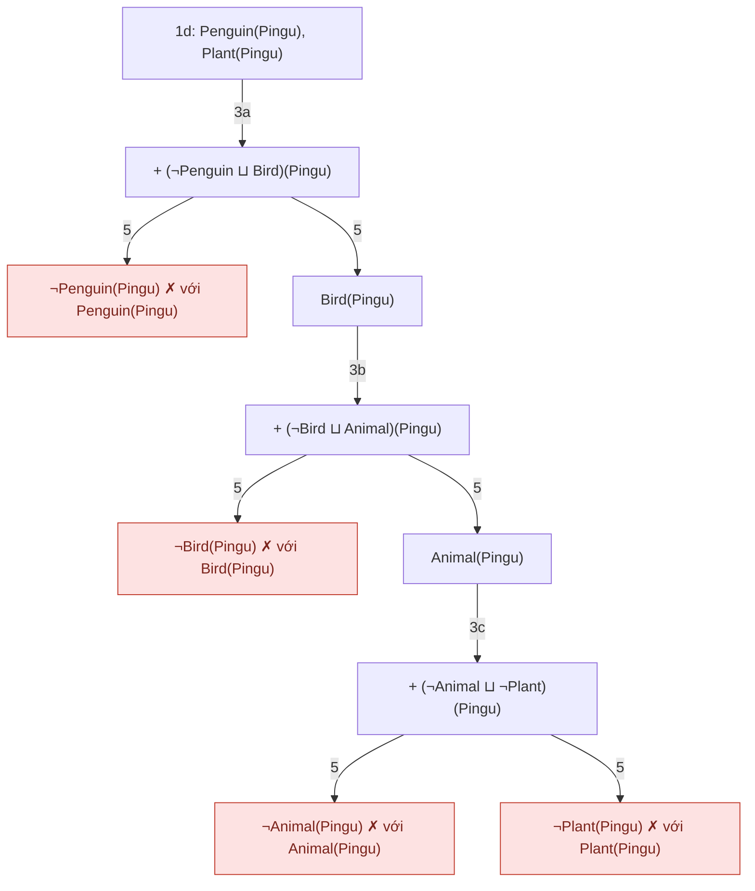
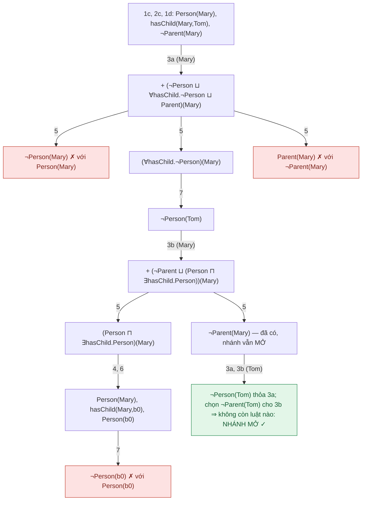
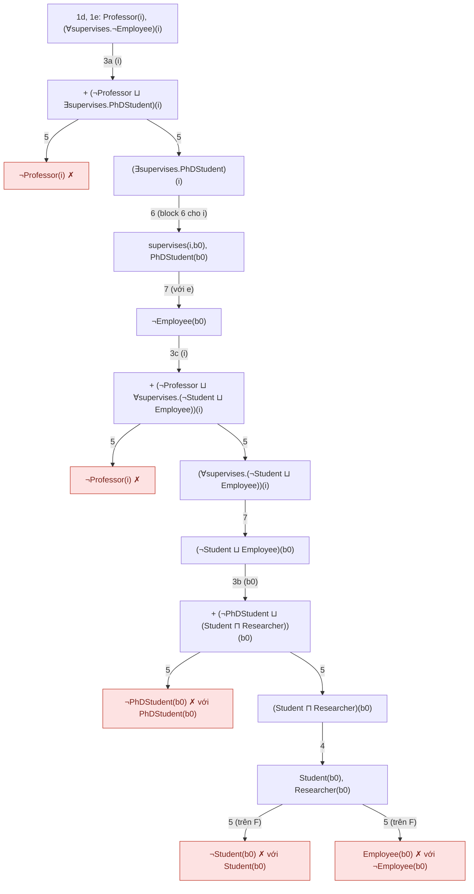

# 03 — OWL 2 reasoning: DL, NNF, Tableau (★★★)

> Slide: `06-OWL2.pdf` trang 22–67 · Bài tập: `Exercises-OWL2.pdf` · Bài giải mẫu của lớp: `ex1_0310.docx` (Ex1), `OWL2_Ex2.pdf` (Ex2)
> Dạng bài **D3**: NNF → vẽ cây tableau → kết luận. Ký hiệu trong file này **giống hệt slide của thầy** (luật đánh số 1–7, axiom đánh chữ a, b, c…, ghi "3a" = áp luật 3 cho axiom a).

---

## 1. Kiến thức cần nhớ

### 1.1 Vì sao cần tableau (★★)
- Forward chaining (như RDFS) **không xử lý được phép tuyển (⊔) và phủ định (¬)**. Ví dụ `TwoWheeledVehicle ≡ Bicycle ⊔ Motorbike`: biết `x` là TwoWheeledVehicle nhưng không biết thêm triple nào chắc chắn đúng.
- Tableau = **chứng minh bằng phản chứng**: giả sử điều ngược lại, mở rộng tập "tableau", gặp mâu thuẫn ở **mọi nhánh** ⇒ điều giả sử sai.

### 1.2 Mọi bài toán suy diễn quy về kiểm tra consistency (★★★)
| Câu hỏi | Thêm vào ontology | Kết luận |
|---|---|---|
| Ontology có consistent không? | (không thêm gì) | còn ≥ 1 nhánh mở ⇒ consistent; mọi nhánh đóng ⇒ inconsistent |
| `C ⊑ D`? (subsumption) | cá thể mới `i`: `C(i)` và `¬D(i)` | mọi nhánh đóng ⇒ **C ⊑ D đúng** |
| `a` là thể hiện của `C`? (instantiation) | `¬C(a)` | mọi nhánh đóng ⇒ **C(a) đúng** |
| Lớp `C` có thỏa được không? (class consistency) | cá thể mới `i`: `C(i)` | mọi nhánh đóng ⇒ C ≡ ⊥ (lớp rỗng, nằm dưới `owl:Nothing`) |
| `C ≡ D`? | kiểm tra `C ⊑ D` và `D ⊑ C` | cả hai đúng |
| `C`, `D` disjoint? | cá thể mới `i`: `C(i)`, `D(i)` | mọi nhánh đóng ⇒ disjoint |

> ⚠️ **Open World Assumption:** nếu còn nhánh mở thì chỉ kết luận được "**không suy ra được**" (not entailed), **không** phải "sai". Ví dụ Ex2(a): không suy ra được Mary là Parent, nhưng cũng không suy ra được Mary *không* là Parent.

### 1.3 Bảng DL ↔ OWL (slide 06-OWL2, tr. 35–37) (★★★)
| DL | OWL (Turtle) | Ý nghĩa |
|---|---|---|
| `C(a)` | `:a a :C` | a thuộc lớp C |
| `R(a,b)` | `:a :R :b` | quan hệ |
| `C ⊑ D` | `:C rdfs:subClassOf :D` | |
| `C ≡ D` | `:C owl:equivalentClass :D` | |
| `C ⊓ D ⊑ ⊥` | `:C owl:disjointWith :D` | (tương đương `C ⊑ ¬D`) |
| `C ≡ ¬D` | `:C owl:complementOf :D` | |
| `C ≡ D ⊓ E` | `owl:intersectionOf (:D :E)` | |
| `C ≡ D ⊔ E` | `owl:unionOf (:D :E)` | |
| `⊤`, `⊥` | `owl:Thing`, `owl:Nothing` | |
| `∃R.⊤ ⊑ C` | `:R rdfs:domain :C` | domain |
| `⊤ ⊑ ∀R.C` | `:R rdfs:range :C` | range |
| `C ⊑ ∀R.D` | restriction `owl:allValuesFrom` | "only" |
| `C ⊑ ∃R.D` | restriction `owl:someValuesFrom` | "some" |
| `C ⊑ ≥n R` | restriction `owl:minCardinality n` | "min n" |
| `D ⊔ E` (đứng một mình) | — | **global statement**: mọi cá thể thuộc D hoặc E |

### 1.4 Chuyển sang Negation Normal Form — NNF (★★★)
1. **Bỏ ⊑:** `C ⊑ D` ⟶ `¬C ⊔ D` (vì C(x)→D(x) ≡ ¬C(x) ∨ D(x)).
2. **Bỏ ≡:** `C ≡ D` ⟶ `C ⊑ D` và `D ⊑ C` ⟶ `¬C ⊔ D` và `¬D ⊔ C`.
3. **Đẩy ¬ vào trong** đến khi ¬ chỉ đứng trước tên lớp nguyên tử:

| Biểu thức | NNF |
|---|---|
| `¬¬C` | `C` |
| `¬(C ⊓ D)` | `¬C ⊔ ¬D` (De Morgan) |
| `¬(C ⊔ D)` | `¬C ⊓ ¬D` (De Morgan) |
| `¬∃R.C` | `∀R.¬C` |
| `¬∀R.C` | `∃R.¬C` |
| `C ⊓ D ⊑ ⊥` (disjoint) | `¬C ⊔ ¬D` |
| `C ⊑ ¬D` | `¬C ⊔ ¬D` |
| `∃R.⊤ ⊑ C` (domain) | `∀R.⊥ ⊔ C` (= `¬∃R.⊤ ⊔ C`) |
| `⊤ ⊑ ∀R.C` (range) | `∀R.C` |

### 1.5 Bảng 7 luật mở rộng (slide tr. 46 — **học thuộc nguyên văn số thứ tự**)
| Nr | Axiom | Action |
|---|---|---|
| 1 | `C(a)` | Add `C(a)` |
| 2 | `R(a,b)` | Add `R(a,b)` |
| 3 | `C` (axiom toàn cục) | Choose an individual `a`, add `C(a)` |
| 4 | `(C ⊓ D)(a)` | Add `C(a)` and `D(a)` |
| 5 | `(C ⊔ D)(a)` | **Split** tableau into T1 and T2. Add `C(a)` to T1, `D(a)` to T2 |
| 6 | `(∃R.C)(a)` | Add `R(a,b)` and `C(b)` for a **new** individual `b` |
| 7 | `(∀R.C)(a)` | For all `b` with `R(a,b) ∈ T`: add `C(b)` |

- **Nhánh đóng (closed):** chứa đồng thời `X` và `¬X` (ví dụ `Person(Peter)` và `¬Person(Peter)`).
- **Consistent** ⇔ không áp được luật nào nữa **và** còn ít nhất 1 nhánh mở.
- **Rule blocking (tr. 62–64):** luật 6 có thể sinh cá thể mới vô hạn (ví dụ Jane: `Woman ⊑ ∃hasMother.Woman`). Quy tắc của slide: *đã dùng luật 6 cho cá thể `a` một lần thì block luật 6 cho `a`* ⇒ thuật toán dừng.
- **Mẹo làm bài nhanh:** ưu tiên luật không tách nhánh (1, 2, 4, 6, 7) trước luật 5; khi áp luật 3 hãy chọn cá thể "có liên quan" (cá thể đang có ∀/∃) để nhánh đóng sớm.

### 1.6 Kiến thức lý thuyết đi kèm (★★)
- **OWL Lite bị giới hạn** (cardinality chỉ 0/1; không unionOf/complementOf…) vì cardinality lớn làm blocking phức tạp, còn union/disjoint/complement sinh thêm nhánh tách (luật 5) ⇒ chậm.
- **Tên logic mô tả (DL naming):**

| Chữ | Ý nghĩa |
|---|---|
| **AL** | Attributive Language: ⊓, ¬ lớp nguyên tử, ∀R.C, ∃R.⊤ |
| **C** | Complement đầy đủ (⇒ ALC có ⊔, ∃R.C) |
| **S** | ALC + transitive properties |
| **H** | Property hierarchy (subPropertyOf) |
| **R** | Property chains & các đặc tính phức (OWL 2) |
| **O** | Nominals — closed class `owl:oneOf`, `hasValue` |
| **I** | Inverse properties |
| **N** | Number restrictions (cardinality không định tính) |
| **Q** | Qualified number restrictions (OWL 2) |
| **F** | Functional properties |
| **(D)** | Datatypes |

  OWL Lite ≈ **SHIF(D)**, OWL 1 DL ≈ **SHOIN(D)**, OWL 2 DL ≈ **SROIQ(D)** *(bổ sung)*.
- **Reasoner (slide):** FaCT (SHIQ), FaCT++/JFact (SHOIQ), Pellet (SHOIN(D)), RacerPro (SHIQ(D)), HermiT (SHOIQ). Bài Sudoku cần **O** (oneOf) ⇒ chỉ Pellet, HermiT giải được.
- **OWL 2 profiles:**

| Profile | Cho phép | Cấm | Dùng khi |
|---|---|---|---|
| **EL** | ∃ (someValuesFrom), ⊓, subClassOf, property chain | ∀, ⊔, ¬, inverse, cardinality | ontology rất lớn nhiều lớp (SNOMED) — phân loại đa thức |
| **QL** | subclass đơn giản, inverse | ⊔, ∀, hasSelf, cardinality, functional | truy vấn dữ liệu lớn trong CSDL quan hệ (viết lại query → SQL) |
| **RL** | các tiên đề dạng luật (Datalog), `Person ← Student` | ∃ ở vế phải, ⊔ ở vế phải, qualified card. ngoài 0/1 | suy diễn bằng luật trên triple store |

  Mỗi profile suy diễn được trong **thời gian đa thức**; gộp lại (OWL 2 DL) thì hàm mũ trở lên.
- **Giới hạn của OWL → luật (SWRL, RIF):** "Nếu A là Woman và A childOf B thì A daughterOf B" — không biểu diễn được bằng OWL thuần, cần rule `Woman(?a) ∧ childOf(?a,?b) → daughterOf(?a,?b)`.

---

## 2. Khuôn làm bài tableau (chấm điểm theo từng bước)
1. **Dịch sang DL** (nếu đề cho Turtle) — viết rõ từng axiom.
2. **Xác định câu hỏi** → thêm giả thiết phản chứng (bảng 1.2). Ghi rõ: *"Thêm ¬Parent(Mary) và kiểm tra consistency"*.
3. **NNF** từng axiom, **đánh chữ a), b), c)…** (giống slide).
4. **Vẽ cây**: mỗi bước ghi số luật + chữ axiom (ví dụ `3a`, `5`, `7`); mỗi nút ghi toàn bộ tập hiện tại *hoặc* chỉ phần mới thêm (ghi rõ quy ước); đánh dấu **✗ closed** kèm cặp mâu thuẫn.
5. **Kết luận** theo đúng câu hỏi + nhắc OWA nếu còn nhánh mở.

---

## 3. Lời giải bài tập trên lớp

### Ex1 — Consistency checking (Pingu)
**Đề:** `:Penguin rdfs:subClassOf :Bird . :Bird rdfs:subClassOf :Animal . :Animal owl:disjointWith :Plant . :Pingu a :Penguin , :Plant .`

**DL → NNF**
- a) `Penguin ⊑ Bird` ⟶ `¬Penguin ⊔ Bird`
- b) `Bird ⊑ Animal` ⟶ `¬Bird ⊔ Animal`
- c) `Animal ⊓ Plant ⊑ ⊥` ⟶ `¬Animal ⊔ ¬Plant`
- d) `Penguin(Pingu)`, `Plant(Pingu)`

**Kết luận:** mọi nhánh đóng ⇒ ontology **INCONSISTENT** (Pingu vừa là Animal — qua Penguin ⊑ Bird ⊑ Animal — vừa là Plant, mà Animal disjoint Plant). Khớp bài giải `ex1_0310.docx`.

### Ex2 — Class instantiation (Mary)
**Đề:** `Parent ≡ Person ⊓ ∃hasChild.Person`, `Person(Mary)`, `hasChild(Mary, Tom)`. (a) Suy ra được Mary là Parent không? (b) Thêm `Tom a :Person` thì sao?

**Tách ≡ và NNF**
- (1) `Person ⊓ ∃hasChild.Person ⊑ Parent` ⟶ a) `¬Person ⊔ ∀hasChild.¬Person ⊔ Parent`
- (2) `Parent ⊑ Person ⊓ ∃hasChild.Person` ⟶ b) `¬Parent ⊔ (Person ⊓ ∃hasChild.Person)`
- c) `Person(Mary)`, `hasChild(Mary, Tom)`
- d) **giả thiết phản chứng** `¬Parent(Mary)`

**(a)**

*(Nhánh T1/T3 vẽ chung một lần tách 3 hướng = hai lần áp luật 5 liên tiếp.)*

**Kết luận (a):** còn nhánh mở (mô hình: Mary là Person, Tom **không** là Person, Mary không là Parent — không mâu thuẫn) ⇒ **không suy ra được** `Parent(Mary)`. Lý do trực giác: OWA — không ai nói Tom là Person.

**(b)** Thêm `Person(Tom)`: ở nhánh duy nhất còn mở, luật 7 cho `¬Person(Tom)` ⇒ **✗ mâu thuẫn với Person(Tom)**. Hai nhánh kia vẫn đóng như trước ⇒ **mọi nhánh đóng** ⇒ thêm `¬Parent(Mary)` gây inconsistent ⇒ **Parent(Mary) được suy ra**. Khớp bài giải `OWL2_Ex2.pdf`.

### Ex3 — Subsumption với lượng từ (★★★ chưa có bài giải mẫu trong lớp — dễ ra thi)
**Đề:** 1. `Professor ⊑ ∃supervises.PhDStudent` 2. `PhDStudent ⊑ Student ⊓ Researcher` 3. `Professor ⊑ ∀supervises.(¬Student ⊔ Employee)`. (a) Chứng minh hoặc bác bỏ `Professor ⊑ ∃supervises.Employee`. (b) Bỏ axiom 3 thì sao?

**NNF**
- a) `¬Professor ⊔ ∃supervises.PhDStudent`
- b) `¬PhDStudent ⊔ (Student ⊓ Researcher)`
- c) `¬Professor ⊔ ∀supervises.(¬Student ⊔ Employee)`
- **Phản chứng** cho subsumption: cá thể mới `i` với d) `Professor(i)` và e) `¬(∃supervises.Employee)(i)` = **`(∀supervises.¬Employee)(i)`** (NNF của ¬∃).

**(a)**

**Kết luận (a):** mọi nhánh đóng ⇒ `Professor ⊓ ¬∃supervises.Employee` không thỏa được ⇒ **`Professor ⊑ ∃supervises.Employee` ĐÚNG** (mọi giáo sư giám sát ít nhất một Employee — chính là nghiên cứu sinh b0 kia: là Student nên theo axiom 3 phải là Employee).

**(b) Bỏ axiom 3:** cây giống trên nhưng không có bước 3c. Nhánh sau bước 4 chứa `Professor(i), ∀supervises.¬Employee(i), supervises(i,b0), PhDStudent(b0), ¬Employee(b0), Student(b0), Researcher(b0)`. Áp 3a cho b0 → chọn `¬Professor(b0)`: **không còn mâu thuẫn, không còn luật áp được** ⇒ **nhánh mở** ⇒ consistent ⇒ **không suy ra được** `Professor ⊑ ∃supervises.Employee`. Axiom 3 chính là "cầu nối" Student → Employee; thiếu nó, theo OWA ta không biết PhDStudent có là Employee hay không.

---

## 4. Ví dụ trên slide (nên tự làm lại trên giấy)
- **Seth (tr. 47–54):** `Animal ⊓ Human ⊑ ⊥`, `Animal ≡ Mammal ⊔ Bird ⊔ Fish ⊔ Insect ⊔ Reptile`, `Human(Seth)`, `Insect(Seth)`. Chú ý: phải áp **cả hai chiều** của ≡ — chiều `Insect ⊑ Animal` (từ `¬(Mammal ⊔ … ⊔ Reptile) ⊔ Animal` = `(¬Mammal ⊓ … ⊓ ¬Reptile) ⊔ Animal`) buộc Seth là Animal ⇒ đụng `Human`. Kết luận: **inconsistent**.
- **Jane (tr. 55–64):** `¬Woman ⊔ ∃hasMother.Woman`, `Woman(Jane)` ⇒ luật 6 sinh b0, b1, b2… vô hạn ⇒ cần **rule blocking** ⇒ kết luận **consistent**.
- **Reasoning tasks (tr. 24–32):** Jimmy (Human disjoint Animal, Jimmy thuộc cả hai ⇒ thuộc owl:Nothing), Married Bachelor (lớp không thỏa được), Flipper (thêm `¬Dolphin(Flipper)` để kiểm tra instance).

---

## 5. Bài tự luyện (làm trên giấy rồi mới mở đáp án)

**P1 — Consistency.** `Vegetarian ⊑ ∀eats.¬Meat`, `Vegetarian(Lan)`, `eats(Lan, pho)`, `Meat(pho)`.

Đáp án

NNF a) `¬Vegetarian ⊔ ∀eats.¬Meat`. 1,2: Vegetarian(Lan), eats(Lan,pho), Meat(pho). 3a(Lan) → 5: T1 `¬Vegetarian(Lan)` ✗; T2 `(∀eats.¬Meat)(Lan)` → 7: `¬Meat(pho)` ✗ với Meat(pho). Mọi nhánh đóng ⇒ **inconsistent**.

**P2 — Subsumption.** `PhDStudent ⊑ Student ⊓ ∃writes.Thesis`, `Student ⊑ Person`. Chứng minh `PhDStudent ⊑ Person`.

Đáp án

a) `¬PhDStudent ⊔ (Student ⊓ ∃writes.Thesis)`, b) `¬Student ⊔ Person`; phản chứng c) `PhDStudent(i)`, `¬Person(i)`. 3a(i) → 5: `¬PhDStudent(i)` ✗ | `(Student ⊓ ∃writes.Thesis)(i)` → 4: `Student(i)`, `∃writes.Thesis(i)` → 3b(i) → 5: `¬Student(i)` ✗ | `Person(i)` ✗ với ¬Person(i). (Không cần áp luật 6.) Mọi nhánh đóng ⇒ **PhDStudent ⊑ Person**.

**P3 — Class consistency.** `Bachelor ≡ Man ⊓ ∀marriedTo.⊥` (người không kết hôn với ai), `MarriedBachelor ≡ Bachelor ⊓ ∃marriedTo.⊤`. Lớp MarriedBachelor có thỏa được không?

Đáp án

Chỉ cần chiều ⊑: a) `¬Bachelor ⊔ (Man ⊓ ∀marriedTo.⊥)`, b) `¬MarriedBachelor ⊔ (Bachelor ⊓ ∃marriedTo.⊤)`. Thêm `MarriedBachelor(i)`. 3b(i) → 5: `¬MarriedBachelor(i)` ✗ | `(Bachelor ⊓ ∃marriedTo.⊤)(i)` → 4 → 6: `marriedTo(i,b0)`, `⊤(b0)` → 3a(i) → 5: `¬Bachelor(i)` ✗ | `(Man ⊓ ∀marriedTo.⊥)(i)` → 4 → 7: `⊥(b0)` ✗ (⊥ không thể có thể hiện). Mọi nhánh đóng ⇒ **MarriedBachelor không thỏa được** (≡ owl:Nothing).

**P4 — Blocking.** `Person ⊑ ∃hasParent.Person`, `Person(Ann)`. Consistent không?

Đáp án

a) `¬Person ⊔ ∃hasParent.Person`. 3a(Ann) → 5: `¬Person(Ann)` ✗ | `∃hasParent.Person(Ann)` → 6: `hasParent(Ann,b0)`, `Person(b0)` — **đã dùng luật 6 ⇒ block luật 6 trong tableau này** (đúng thuật toán slide tr. 63: "If rule 6 was used, block A for T"). 3a(b0) → 5: `¬Person(b0)` ✗ | `∃hasParent.Person(b0)` — luật 6 bị block, không còn luật nào áp được, không có mâu thuẫn ⇒ nhánh **mở** ⇒ **consistent**.
*(bổ sung — reasoner thật dùng "subset/equality blocking": cá thể b0 bị chặn nếu tập khái niệm của nó ⊆ tập của tổ tiên Ann; ở đây hai tập như nhau nên b0 bị chặn. Kết luận giống nhau.)*

**P5 — Instance + OWA (biến thể Ex2).** `GoodCourse ≡ Course ⊓ ∃hasPart.Homework`, `Course(SW)`, `hasPart(SW, hw1)`. SW có phải GoodCourse? Nếu thêm `Homework(hw1)`?

Đáp án

Hoàn toàn giống Ex2 (đổi Parent→GoodCourse, Person→Course/Homework). Chưa có `Homework(hw1)`: còn nhánh mở với `¬Homework(hw1)` ⇒ **không suy ra được**. Thêm `Homework(hw1)`: nhánh đó đóng ⇒ **GoodCourse(SW)** được suy ra.

---
**Nguồn:** slide 06-OWL2 (Paulheim, IE650); bài giải lớp `ex1_0310.docx`, `OWL2_Ex2.pdf`. *(bổ sung)* Baader & Sattler, "An Overview of Tableau Algorithms for Description Logics"; W3C OWL 2 Profiles (https://www.w3.org/TR/owl2-profiles/).
