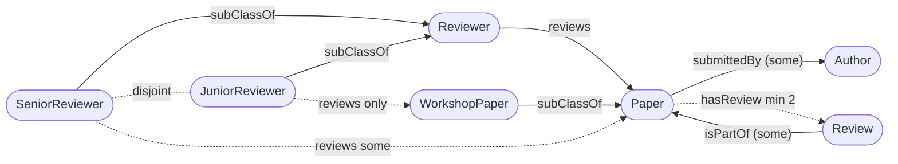
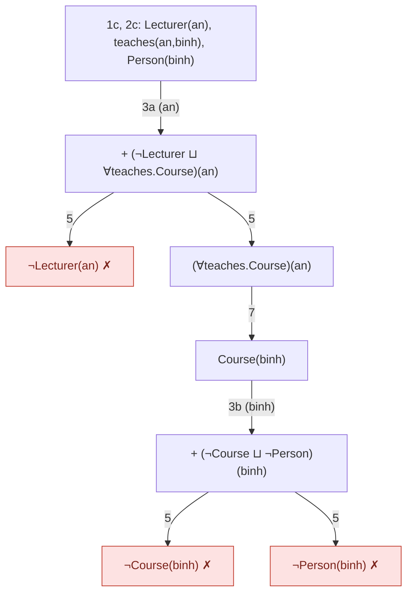
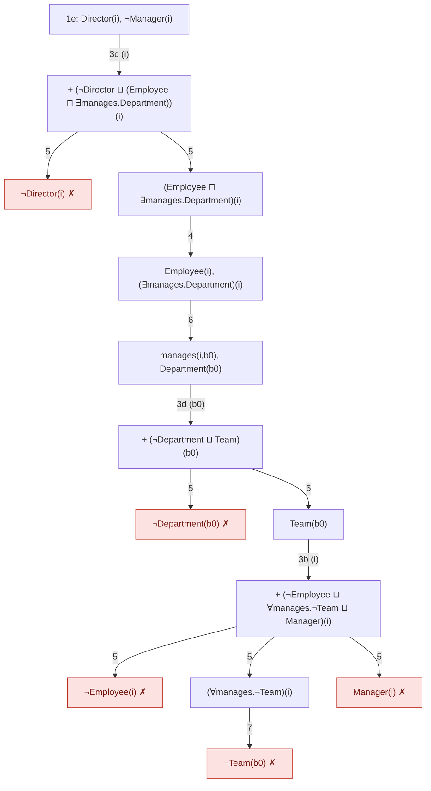
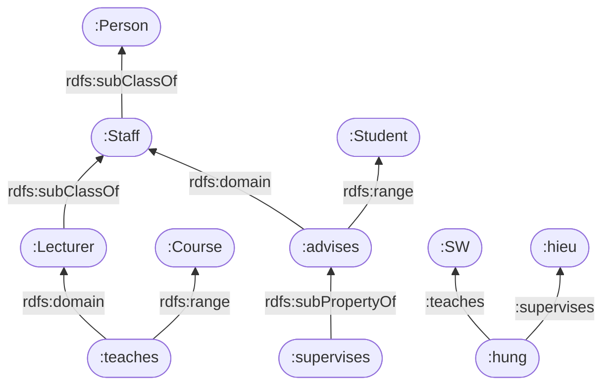
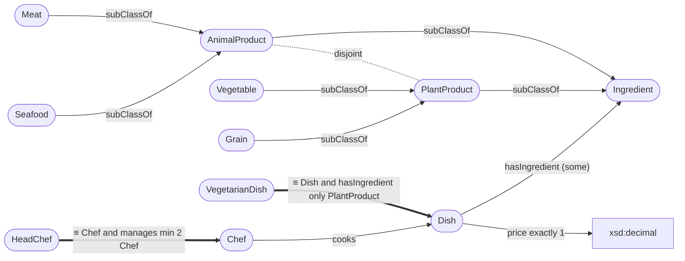
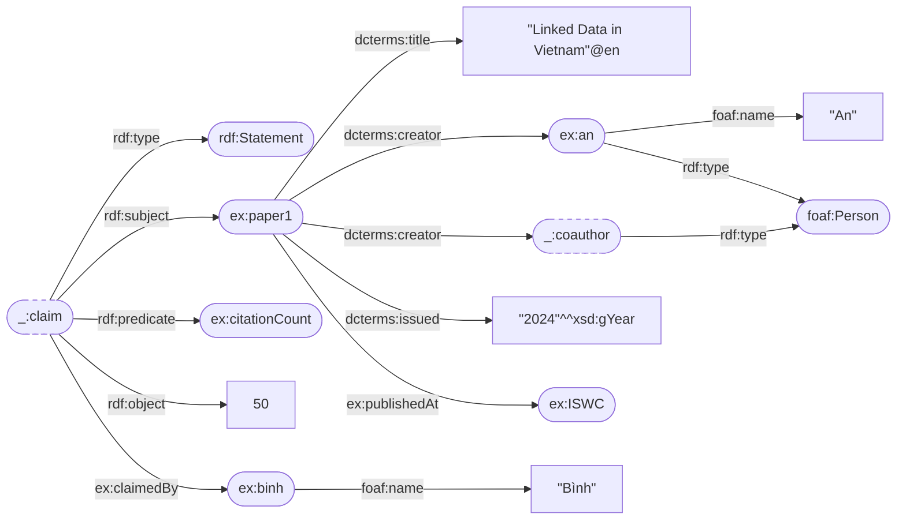

# ĐÁP ÁN & BAREM — Đề thi thử 1 và 2

> Kết quả SPARQL là kết quả chạy thật (`files/queries/t1-*.rq`, `t2-*.rq`; chạy `python run_queries.py t1 t2`). Các câu RDFS đã kiểm bằng `files/rdfs_closure.py`.
> Barem chỉ là gợi ý tự chấm: ý đúng nhưng trình bày thiếu bước thì trừ ~1/3 số điểm của ý.

---

# ĐỀ 1

## Câu 1 (30đ)

**Câu đề → tiên đề**
| Câu | Tiên đề |
|---|---|
| A workshop paper is a paper | `WorkshopPaper ⊑ Paper` |
| Papers are submitted by authors | `submittedBy`: domain Paper, range Author; `Paper ⊑ ∃submittedBy.Author`; `submits ≡ submittedBy⁻` |
| Reviewers can be senior or junior, **not both** | `Reviewer ≡ SeniorReviewer ⊔ JuniorReviewer`, `SeniorReviewer ⊓ JuniorReviewer ⊑ ⊥` (= `DisjointUnionOf`) |
| A senior reviewer reviews papers | `reviews`: domain Reviewer, range Paper; `SeniorReviewer ⊑ ∃reviews.Paper` |
| a junior reviewer **only** reviews workshop papers | `JuniorReviewer ⊑ ∀reviews.WorkshopPaper` |
| A review is part of a paper | `Review ⊑ ∃isPartOf.Paper`; `hasReview ≡ isPartOf⁻` |
| every paper has **at least two** reviews | `Paper ⊑ ≥2 hasReview.Review` |
| Nobody may review a paper they submitted | **disjoint properties** `Dis(reviews, submits)` — `owl:propertyDisjointWith` (OWL 2) |

**a) Sơ đồ (6đ)**

Barem: đủ class & subClassOf (2đ), property có hướng đúng (2đ), thể hiện some/only/min 2/disjoint (2đ).

**b) DL (10đ)**
```
WorkshopPaper ⊑ Paper
Reviewer ≡ SeniorReviewer ⊔ JuniorReviewer          SeniorReviewer ⊓ JuniorReviewer ⊑ ⊥
∃submittedBy.⊤ ⊑ Paper     ⊤ ⊑ ∀submittedBy.Author    Paper ⊑ ∃submittedBy.Author    submits ≡ submittedBy⁻
∃reviews.⊤ ⊑ Reviewer      ⊤ ⊑ ∀reviews.Paper
SeniorReviewer ⊑ ∃reviews.Paper
JuniorReviewer ⊑ ∀reviews.WorkshopPaper
∃isPartOf.⊤ ⊑ Review       ⊤ ⊑ ∀isPartOf.Paper        Review ⊑ ∃isPartOf.Paper      hasReview ≡ isPartOf⁻
Paper ⊑ ≥2 hasReview.Review
Dis(reviews, submits)                                  Paper ⊓ Review ⊑ ⊥
```
Barem: mỗi câu đề đúng 1–1,5đ; **dùng ∀ cho "only"** (2đ), **qualified ≥2** (1,5đ), **disjoint properties** (1,5đ — chấp nhận giải thích "cần SWRL" nếu lập luận đúng).
*Lưu ý:* **không** khai báo Author ⊓ Reviewer ⊑ ⊥ (một người có thể vừa là tác giả vừa là phản biện viên — chính vì vậy mới cần ràng buộc cuối).

**c) Turtle (8đ)**
```turtle
@prefix :     <http://example.org/review#> .
@prefix owl:  <http://www.w3.org/2002/07/owl#> .
@prefix rdfs: <http://www.w3.org/2000/01/rdf-schema#> .
@prefix xsd:  <http://www.w3.org/2001/XMLSchema#> .

:Paper a owl:Class ;
    rdfs:subClassOf
        [ a owl:Restriction ; owl:onProperty :submittedBy ; owl:someValuesFrom :Author ] ,
        [ a owl:Restriction ; owl:onProperty :hasReview ;
          owl:minQualifiedCardinality "2"^^xsd:nonNegativeInteger ; owl:onClass :Review ] ;
    owl:disjointWith :Review .
:WorkshopPaper a owl:Class ; rdfs:subClassOf :Paper .
:Author a owl:Class .
:Review a owl:Class ;
    rdfs:subClassOf [ a owl:Restriction ; owl:onProperty :isPartOf ; owl:someValuesFrom :Paper ] .
:Reviewer a owl:Class ;
    owl:disjointUnionOf ( :SeniorReviewer :JuniorReviewer ) .
:SeniorReviewer a owl:Class ;
    rdfs:subClassOf [ a owl:Restriction ; owl:onProperty :reviews ; owl:someValuesFrom :Paper ] .
:JuniorReviewer a owl:Class ;
    rdfs:subClassOf [ a owl:Restriction ; owl:onProperty :reviews ; owl:allValuesFrom :WorkshopPaper ] .

:submittedBy a owl:ObjectProperty ; rdfs:domain :Paper ; rdfs:range :Author .
:submits     a owl:ObjectProperty ; owl:inverseOf :submittedBy .
:reviews     a owl:ObjectProperty ; rdfs:domain :Reviewer ; rdfs:range :Paper ;
             owl:propertyDisjointWith :submits .
:isPartOf    a owl:ObjectProperty ; rdfs:domain :Review ; rdfs:range :Paper .
:hasReview   a owl:ObjectProperty ; owl:inverseOf :isPartOf .
```

**d) Manchester (3đ)**
```
Class: JuniorReviewer
    SubClassOf: Reviewer, reviews only WorkshopPaper
    DisjointWith: SeniorReviewer
Class: Paper
    SubClassOf: submittedBy some Author, hasReview min 2 Review
    DisjointWith: Review
```

**e) (3đ)** `JuniorReviewer(erin)`, `reviews(erin, p1)` + `JuniorReviewer ⊑ ∀reviews.WorkshopPaper` ⇒ reasoner **suy ra `WorkshopPaper(p1)`**; còn suy ra `Reviewer(erin)`. **Không inconsistent:** không có tiên đề nào nói p1 *không phải* WorkshopPaper (OWA). `only` là tiên đề suy diễn, không phải ràng buộc kiểm tra. p1 hiện chưa có review nào nhưng reasoner cũng **không** báo lỗi "thiếu 2 review" — theo OWA, các review có thể tồn tại mà chưa biết. Chỉ inconsistent nếu, ví dụ, thêm `p1 submittedBy erin` (vi phạm `Dis(reviews, submits)`) hoặc khai báo p1 thuộc một lớp disjoint với WorkshopPaper.

## Câu 2 (20đ) — chung prefix `PREFIX : <http://example.org/review#>` `PREFIX rdfs: <http://www.w3.org/2000/01/rdf-schema#>`

**a) (4đ)**
```sparql
SELECT ?title (COUNT(?r) AS ?reviews)
WHERE { ?p :title ?title . OPTIONAL { ?r :isPartOf ?p } }
GROUP BY ?title
ORDER BY DESC(?reviews) ?title
```
| ?title | ?reviews |
|---|---|
| "Graph Embeddings" | 2 |
| "SPARQL Tricks" | 2 |
| "OWL Reasoning at Scale" | 1 |
| "Linked Data in Vietnam" | 0 |

Barem: OPTIONAL + COUNT(?r) để có số 0 (2đ); GROUP BY đúng (1đ); kết quả (1đ).

**b) (4đ)** cùng truy vấn a, thêm `HAVING (COUNT(?r) < 2)` ⇒ "Linked Data in Vietnam" (0), "OWL Reasoning at Scale" (1).
Ý thêm (ăn điểm): reasoner OWL **không** phát hiện được vi phạm này (OWA). Kiểm tra kiểu "đóng" phải dùng SPARQL/SHACL.

**c) (3đ)**
```sparql
SELECT ?title (AVG(?s) AS ?avg)
WHERE { ?r :isPartOf ?p ; :score ?s . ?p :title ?title . }
GROUP BY ?title ORDER BY DESC(?avg)
```
Kết quả: SPARQL Tricks 4 · Graph Embeddings 3 · OWL Reasoning at Scale 1.

**d) (3đ)**
```sparql
SELECT ?name (COUNT(?p) AS ?papers)
WHERE { ?p :submittedBy ?a . ?a :name ?name . }
GROUP BY ?name HAVING (COUNT(?p) >= 2)
```
Kết quả: Alice 2 · Bob 2.

**e) (3đ)**
```sparql
SELECT DISTINCT ?name
WHERE { ?x :reviews ?p ; :name ?name . ?p a :WorkshopPaper .
        FILTER NOT EXISTS { ?x a :JuniorReviewer } }
```
Kết quả: Frank.

**f) (3đ)** **Rỗng.** Dữ liệu chỉ ghi `a :SeniorReviewer`/`a :JuniorReviewer`; SPARQL không suy diễn rdfs9. Sửa: `?x a/rdfs:subClassOf* :Reviewer` ⇒ Dave, Erin, Frank.

## Câu 3 (20đ)

**a) (8đ)** NNF:
- a) `¬Lecturer ⊔ ∀teaches.Course`
- b) `¬Course ⊔ ¬Person`
- c) `Lecturer(an)`, `teaches(an,binh)`, `Person(binh)`


Mọi nhánh đóng ⇒ **inconsistent**: Bình là người, nhưng vì giảng viên chỉ "dạy" Course nên Bình bị suy ra là Course, mà Course disjoint Person.
Barem: NNF (2đ), cây đúng luật (4đ), kết luận + giải thích (2đ).

**b) (12đ)** NNF:
- a) `¬Manager ⊔ (Employee ⊓ ∃manages.Team)`
- b) `¬Employee ⊔ ∀manages.¬Team ⊔ Manager` (chiều ⊒ của ≡, sau De Morgan và ¬∃ = ∀¬)
- c) `¬Director ⊔ (Employee ⊓ ∃manages.Department)`
- d) `¬Department ⊔ Team`
- Phản chứng: e) `Director(i)`, `¬Manager(i)`


Mọi nhánh đóng ⇒ **Director ⊑ Manager** được chứng minh.
Barem:
- Tách ≡ thành 2 chiều và lấy NNF đúng, nhất là `¬(Employee ⊓ ∃manages.Team) = ¬Employee ⊔ ∀manages.¬Team`: 4đ.
- Thêm phản chứng đúng: 2đ.
- Cây đúng: 4đ.
- Kết luận: 2đ.

## Câu 4 (15đ)

**a) (4đ)**


**b) (11đ)**
| # | Mệnh đề | Kết quả | Giải thích |
|---|---|---|---|
| 1 | `:hung a :Person` | **TRUE** | rdfs2 (domain teaches) ⇒ Lecturer; rdfs9 ×2 ⇒ Staff ⇒ Person. (Cách khác: rdfs7 ⇒ hung advises hieu; rdfs2 ⇒ Staff; rdfs9 ⇒ Person) |
| 2 | `:hieu a :Student` | **TRUE** | rdfs7: `hung advises hieu`; rdfs3 (range advises) |
| 3 | `:supervises rdfs:range :Student` | UNKNOWN | range **không kế thừa** từ superproperty xuống subproperty |
| 4 | `:hung :advises [ a :Student ]` | **TRUE** | `_:b ↦ :hieu`: (2) + rdfs7 |
| 5 | `:SW a :Person` | UNKNOWN | chỉ suy ra `SW a Course` (rdfs3); không có gì nối Course với Person |
| 6 | `:Lecturer rdfs:subClassOf [ rdfs:subClassOf :Person ]` | **TRUE** | `_:b ↦ :Staff` (cả hai triple có sẵn) |
| 7 | `:hieu :advisedBy :hung` | UNKNOWN | `advisedBy` không có trong G; RDFS không có inverse |

Barem: mỗi câu 1,5đ (kết quả 0,5đ + tên luật 1đ). Viết "false" thay cho "unknown" thì mất 0,5đ.

## Câu 5 (15đ)
**a) (5đ)**
- **OWA:** điều không được nói ra là **chưa biết**. **CWA:** điều không có trong dữ liệu là **sai** (CSDL, Prolog).
- Hệ quả trong OWL: cần closure axiom thì Margherita mới thành VegetarianPizza; `only` thỏa tầm thường; reasoner không báo thiếu dữ liệu (Câu 1e).
- Hệ quả trong SPARQL:
  - `ASK` false chỉ có nghĩa "không tìm thấy";
  - `FILTER NOT EXISTS` / `COUNT` là suy luận đóng trên dữ liệu hiện có;
  - `FILTER(?a != ?b)` không chứng minh được "hai thực thể khác nhau".

**b) (5đ)**
- Lạm dụng `owl:sameAs`: **thành phố** Hamburg và **bang** Hamburg là hai thực thể khác nhau (ví dụ trên slide LOD). sameAs làm mọi thuộc tính được chia sẻ, ví dụ thành phố "có quốc hội bang", bang "có thị trưởng" ⇒ suy diễn sai.
- Cách sửa:
  - `rdfs:seeAlso`;
  - quan hệ riêng, ví dụ `:Hamburg_City :isCapitalOf :Hamburg_State`;
  - hoặc `skos:closeMatch`.

**c) (5đ)**

| Mức | Yêu cầu | Ví dụ định dạng |
|---|---|---|
| ★ | có trên Web + giấy phép mở | PDF |
| ★★ | có cấu trúc, máy đọc được | XLS |
| ★★★ | định dạng không độc quyền | CSV |
| ★★★★ | dùng chuẩn W3C (RDF/SPARQL), URI cho sự vật | RDF |
| ★★★★★ | liên kết tới dữ liệu khác | RDF + `owl:sameAs` tới DBpedia |

---

# ĐỀ 2

## Câu 1 (30đ)

**a) Sơ đồ (5đ)**


**b) DL + Manchester (10đ)**

| Câu | DL | Manchester |
|---|---|---|
| dish made of ingredients | `Dish ⊑ ∃hasIngredient.Ingredient`; domain Dish, range Ingredient | `Class: Dish SubClassOf: hasIngredient some Ingredient` |
| meat & seafood are animal products | `Meat ⊑ AnimalProduct`, `Seafood ⊑ AnimalProduct` | `SubClassOf: AnimalProduct` |
| vegetables & grains are plant products | `Vegetable ⊑ PlantProduct`, `Grain ⊑ PlantProduct` | |
| either animal or plant, never both | `Ingredient ≡ AnimalProduct ⊔ PlantProduct`, `AnimalProduct ⊓ PlantProduct ⊑ ⊥` | `Class: Ingredient DisjointUnionOf: AnimalProduct, PlantProduct` |
| vegetarian dish **is a** dish that contains **only** plant products | `VegetarianDish ≡ Dish ⊓ ∀hasIngredient.PlantProduct` | `Class: VegetarianDish EquivalentTo: Dish and hasIngredient only PlantProduct` |
| chef cooks dishes | `cooks`: domain Chef, range Dish | `ObjectProperty: cooks Domain: Chef Range: Dish` |
| head chef **is a** chef who manages ≥ 2 chefs | `HeadChef ≡ Chef ⊓ ≥2 manages.Chef` | `Class: HeadChef EquivalentTo: Chef and manages min 2 Chef` |
| exactly one price | `Dish ⊑ =1 price`; `price` Functional, range xsd:decimal | `DataProperty: price Domain: Dish Range: xsd:decimal Characteristics: Functional` + `Dish SubClassOf: price exactly 1` |

Barem:
- `EquivalentTo` cho VegetarianDish và HeadChef (câu "is a … that/who"): 3đ.
- `only` cho "only": 2đ.
- `disjointUnion` (hoặc union + disjoint): 2đ.
- Qualified `min 2 Chef`: 1,5đ.
- `price` là DatatypeProperty, exactly 1: 1,5đ.

**c) Turtle (7đ)**
```turtle
@prefix :     <http://example.org/food#> .
@prefix owl:  <http://www.w3.org/2002/07/owl#> .
@prefix rdfs: <http://www.w3.org/2000/01/rdf-schema#> .
@prefix xsd:  <http://www.w3.org/2001/XMLSchema#> .

:Ingredient a owl:Class ; owl:disjointUnionOf ( :AnimalProduct :PlantProduct ) .
:VegetarianDish a owl:Class ;
    owl:equivalentClass [ a owl:Class ; owl:intersectionOf ( :Dish
        [ a owl:Restriction ; owl:onProperty :hasIngredient ; owl:allValuesFrom :PlantProduct ] ) ] .
:HeadChef a owl:Class ;
    owl:equivalentClass [ a owl:Class ; owl:intersectionOf ( :Chef
        [ a owl:Restriction ; owl:onProperty :manages ;
          owl:minQualifiedCardinality "2"^^xsd:nonNegativeInteger ; owl:onClass :Chef ] ) ] .
:price a owl:DatatypeProperty , owl:FunctionalProperty ; rdfs:domain :Dish ; rdfs:range xsd:decimal .
:Dish rdfs:subClassOf [ a owl:Restriction ; owl:onProperty :price ;
                        owl:cardinality "1"^^xsd:nonNegativeInteger ] .
```

**d) (8đ)**
1. **Không** xếp được cả RauCuXao lẫn Pho vào VegetarianDish.
   - Muốn xếp vào thì phải chứng minh *mọi* nguyên liệu đều là PlantProduct.
   - Theo **OWA**, món có thể còn nguyên liệu khác chưa ghi (có khi là thịt).
   - Giống Margherita không có closure axiom.
2. Cần **closure** ở mức cá thể, ví dụ `RauCuXao Types: hasIngredient only {Carrot, Onion}`. Khi đó mọi nguyên liệu là Carrot hoặc Onion, đều thuộc Vegetable ⊑ PlantProduct ⇒ reasoner **xếp RauCuXao vào VegetarianDish**. Pho tương tự với `only {Noodle, Onion}`.
3. Nếu Pho có thêm `hasIngredient Beef` (Meat ⊑ AnimalProduct, disjoint PlantProduct):
   - Pho ∈ `∃hasIngredient.¬PlantProduct` = `¬∀hasIngredient.PlantProduct` ⇒ reasoner **suy ra chắc chắn Pho ∉ VegetarianDish**. Lần này kết luận "không" là chắc chắn, vì có bằng chứng dương.
   - Nếu trước đó đã đóng `only {Noodle, Onion}` thì Beef phải sameAs Noodle hoặc Onion ⇒ mâu thuẫn disjoint ⇒ **inconsistent**.

Barem: OWA (3đ), cách đóng (3đ), trường hợp Beef (2đ).

## Câu 2 (20đ)

```turtle
@prefix ex:      <http://example.org/> .
@prefix dcterms: <http://purl.org/dc/terms/> .
@prefix foaf:    <http://xmlns.com/foaf/0.1/> .
@prefix rdf:     <http://www.w3.org/1999/02/22-rdf-syntax-ns#> .
@prefix xsd:     <http://www.w3.org/2001/XMLSchema#> .

ex:paper1 dcterms:title "Linked Data in Vietnam"@en ;
    dcterms:creator ex:an , _:coauthor ;
    dcterms:issued "2024"^^xsd:gYear ;
    ex:publishedAt ex:ISWC .
ex:an a foaf:Person ; foaf:name "An" .
_:coauthor a foaf:Person .
ex:binh foaf:name "Bình" .
_:claim a rdf:Statement ;
    rdf:subject ex:paper1 ;
    rdf:predicate ex:citationCount ;
    rdf:object 50 ;
    ex:claimedBy ex:binh .
```
```xml
<?xml version="1.0" encoding="UTF-8"?>
<rdf:RDF xmlns:rdf="http://www.w3.org/1999/02/22-rdf-syntax-ns#"
         xmlns:dcterms="http://purl.org/dc/terms/"
         xmlns:foaf="http://xmlns.com/foaf/0.1/"
         xmlns:ex="http://example.org/">
  <rdf:Description rdf:about="http://example.org/paper1">
    <dcterms:title xml:lang="en">Linked Data in Vietnam</dcterms:title>
    <dcterms:creator rdf:resource="http://example.org/an"/>
    <dcterms:creator rdf:nodeID="coauthor"/>
    <dcterms:issued rdf:datatype="http://www.w3.org/2001/XMLSchema#gYear">2024</dcterms:issued>
    <ex:publishedAt rdf:resource="http://example.org/ISWC"/>
  </rdf:Description>
  <foaf:Person rdf:about="http://example.org/an">
    <foaf:name>An</foaf:name>
  </foaf:Person>
  <foaf:Person rdf:nodeID="coauthor"/>
  <rdf:Description rdf:about="http://example.org/binh">
    <foaf:name>Bình</foaf:name>
  </rdf:Description>
  <rdf:Statement rdf:nodeID="claim">
    <rdf:subject rdf:resource="http://example.org/paper1"/>
    <rdf:predicate rdf:resource="http://example.org/citationCount"/>
    <rdf:object rdf:datatype="http://www.w3.org/2001/XMLSchema#integer">50</rdf:object>
    <ex:claimedBy rdf:resource="http://example.org/binh"/>
  </rdf:Statement>
</rdf:RDF>
```
Giải thích:
1. Đồng tác giả **không rõ tên** ⇒ **blank node**, có kiểu `foaf:Person`.
2. "**Bình cho rằng**…" ⇒ đây là phát biểu *về một phát biểu*, chưa chắc đúng ⇒ dùng **reification** (`rdf:Statement`), **không** khẳng định trực tiếp `ex:paper1 ex:citationCount 50`. Cách khác (★): RDF-star `<< ex:paper1 ex:citationCount 50 >> ex:claimedBy ex:binh`.
3. Năm và số lượng ghi kèm datatype; tiêu đề ghi kèm language tag.

Barem:
- Đồ thị: 6đ.
- Turtle: 7đ, trong đó blank node dùng chung 2đ, reification 3đ.
- RDF/XML: 7đ, trong đó `rdf:nodeID`, `rdf:datatype`, `xml:lang` 3đ.

## Câu 3 (20đ) — `PREFIX : <http://example.org/food#>` `PREFIX rdfs: <http://www.w3.org/2000/01/rdf-schema#>`
**a)** `SELECT ?name ?price WHERE { ?d a :Dish ; :name ?name ; :price ?price . FILTER (?price < 40000) } ORDER BY ?price`
⇒ Gỏi cuốn 30000 · Rau củ xào 35000.

**b)**
```sparql
SELECT ?name WHERE {
  ?d a :Dish ; :name ?name .
  FILTER NOT EXISTS { ?d :hasIngredient ?i . ?i a/rdfs:subClassOf* :AnimalProduct . }
}
```
⇒ **Rau củ xào**. Bẫy: viết `?i a :AnimalProduct` sẽ không loại được món nào, vì SPARQL không suy diễn ⇒ kết quả sai thành cả 4 món.

**c)** `SELECT ?ingredient (COUNT(?d) AS ?dishes) WHERE { ?d :hasIngredient ?ingredient } GROUP BY ?ingredient HAVING (COUNT(?d) >= 2) ORDER BY DESC(?dishes)`
⇒ :noodle 3 · :onion 2.

**d)** `SELECT ?dish ?chef WHERE { ?d a :Dish ; :name ?dish . OPTIONAL { ?c :cooks ?d ; :name ?chef } } ORDER BY ?dish`

| ?dish | ?chef |
|---|---|
| "Bún chả"@vi | "Lan" |
| "Gỏi cuốn"@vi | "Minh" |
| "Phở bò"@vi | "Lan" |
| "Rau củ xào"@vi | *(unbound)* |

**e)**
```sparql
CONSTRUCT { ?d a :VegetarianDish }
WHERE { ?d a :Dish . FILTER NOT EXISTS { ?d :hasIngredient ?i . ?i a/rdfs:subClassOf* :AnimalProduct . } }
```
⇒ `:raucu a :VegetarianDish .`
Ý ăn điểm: đây là phân loại kiểu **CWA**, khác với reasoner OWL ở Câu 1d.

**f)** avg = **40000** (= (50000 + 45000 + 30000 + 35000) / 4); n = **4**.

## Câu 4 (15đ)
**a) (9đ)** NNF:
- a) `¬Expert ⊔ (Person ⊓ ∃writes.Book)`
- b) `¬Person ⊔ ∀writes.¬Book ⊔ Expert`
- c) `Person(an)`, `writes(an,kg)`, `Book(kg)`
- d) phản chứng `¬Expert(an)`

Áp luật:
1. **1c, 2c, 1d.**
2. **3b(an) → 5** tách 3 nhánh:
   - `¬Person(an)` ✗
   - `∀writes.¬Book(an)` → **7**: `¬Book(kg)` ✗
   - `Expert(an)` ✗

Mọi nhánh đóng ⇒ **Expert(an) đúng**. Khác Ex2 trên lớp: ở đây `Book(kg)` đã được khẳng định.

**b) (6đ)** **Consistent.**
- NNF: `¬Person ⊔ ∃knows.Person`.
- **3a(an) → 5:** nhánh `¬Person(an)` ✗; nhánh `∃knows.Person(an)` → **6:** `knows(an,b0)`, `Person(b0)`.
- **3a(b0)** lại sinh `∃knows.Person(b0)`: luật 6 sẽ tạo b1, b2… **vô hạn**.
- Theo slide: đã dùng luật 6 thì **block** nó ⇒ thuật toán dừng với nhánh mở ⇒ consistent. Mô hình hữu hạn: b0 knows an, hoặc an knows chính an.

Không có blocking thì tableau **không dừng**.

## Câu 5 (15đ)
**a) (5đ)** Lỗi **rigidity**:
- Person và Company là lớp **rigid**; Customer là **vai trò** (anti-rigid — một người có thể thôi làm khách hàng).
- Lớp rigid không được là lớp con của lớp anti-rigid. Hậu quả: mọi Person/Company đều bị suy ra là Customer.
- Thêm về identity: Person và Company có tiêu chí đồng nhất khác nhau.
- Sửa:
  - `Customer ≡ ∃buys.Product` (vai trò định nghĩa bằng quan hệ), hoặc
  - `Person/Company —hasRole→ CustomerRole`;
  - hoặc `Customer ⊑ Person ⊔ Company` (ngược chiều).

**b) (5đ)**
- Reasoner suy ra `SrirachaBottle a SpicyDish` — một chai tương ớt thành "món ăn cay".
- Đây là anti-pattern **Exclusivity**: định nghĩa chỉ nghĩ cho miền món ăn (tương tự CoastalCity/Germany), vi phạm tinh thần AAA.
- Sửa: `SpicyDish ≡ Dish ⊓ ∃hasIngredient.Chili`.

**c) (5đ)**
1. Hồ Gươm: Physical · Continuant · Independent ⇒ **Object**.
2. Buổi thi ngày 17/10: Physical · Occurrent · Independent ⇒ **Process** (như "buổi giảng" trên slide).
3. Quy chế thi: Abstract · Continuant ⇒ **Schema** (Independent — một hình thức trừu tượng) hoặc **Reason** (Mediating — ràng buộc giữa sinh viên và kỳ thi). Chấm theo lập luận.
4. Mục tiêu đạt điểm A: Abstract · Occurrent · Mediating ⇒ **Purpose** (như "motivation" trên slide).
